# System I/O & Exceptions

**Arquitectura de Computadoras 2026**

Universidad Nacional de Córdoba — Facultad de Matemática, Astronomía, Física y Computación (FAMAF)

> Transcripción fiel en Markdown del PDF `Presentacion FAMAF_AdC_IOExceptions.pptx.pdf` (27 diapositivas). Cada sección corresponde a una diapositiva del original. Los diagramas se recrean con `mermaid` y/o ASCII, acompañados siempre de una descripción textual completa de cada elemento para no perder información.

---

## Diapositiva 1: Portada — System I/O & Exceptions

- Título: **System I/O**
- Subtítulo: **& Exceptions**
- Línea inferior: **Arquitectura de Computadoras 2026**
- Logos: Universidad Nacional de Córdoba (UNC) y FAMAF (Facultad de Matemática, Astronomía, Física y Computación)
- Imagen decorativa: collage de dispositivos electrónicos (teléfonos celulares, GPS, antena satelital, placa de desarrollo tipo FPGA/microcontrolador con múltiples conectores, robot con ruedas, cámara/reproductor portátil) representando el mundo de la E/S (I/O) y sistemas embebidos.

---

## Diapositiva 2: Microprocessor interfacing: I/O addressing

A microprocessor communicates with other devices through different interfaces…

- **Port-based I/O** (*Old Architectures!*)
  - Processor has one or more N-bit ports
  - Processor's software reads and writes a port just like a register
- **Bus-based I/O** (*Nowadays!*)
  - Processor has address, data and control ports that form a system bus
  - Communication protocol is built into the processor
  - A single instruction carries out the read or write protocol on the bus

**Diagrama 1 — Port-based I/O:**

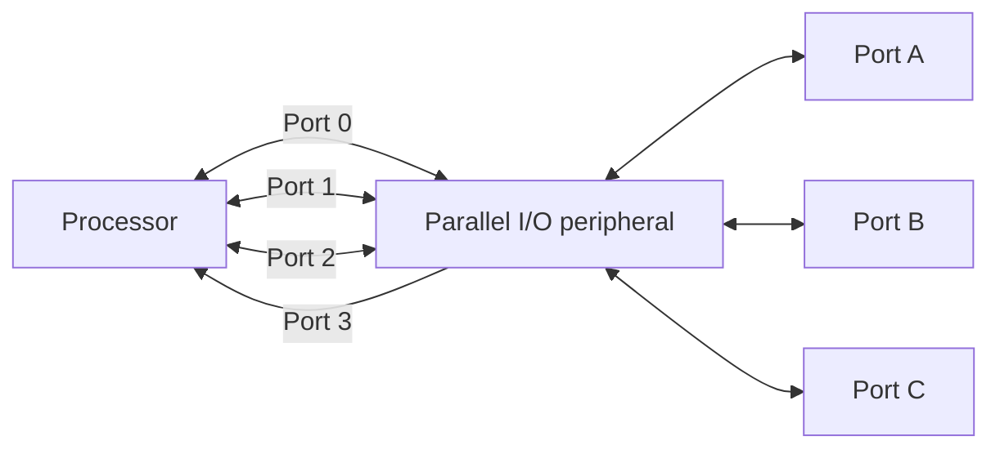

Descripción: el `Processor` tiene 4 puertos rotulados Port 0, Port 1, Port 2 y Port 3 que lo conectan con un `Parallel I/O peripheral`. Port 0, Port 1 y Port 2 son bidireccionales (flechas en ambos sentidos entre Processor y el periférico). Port 3 es unidireccional: la flecha va del periférico hacia el Processor únicamente. El periférico, a su vez, expone hacia el exterior tres puertos bidireccionales: Port A, Port B y Port C.

**Diagrama 2 — Bus-based I/O:**

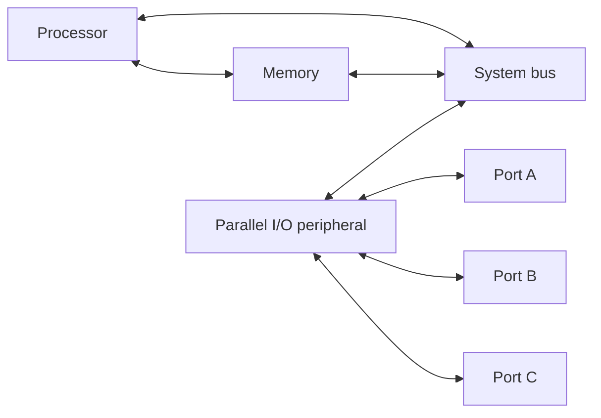

Descripción: `Processor` y `Memory` están conectados directamente entre sí y ambos a un `System bus` horizontal que se extiende hacia la derecha (bus de direcciones/datos/control). El `Parallel I/O peripheral` cuelga del System bus (conexión bidireccional). El periférico expone hacia afuera Port A, Port B y Port C (bidireccionales), igual que en el diagrama anterior.

Fuente (pie de página): *Embedded Systems Design: A Unified Hardware/Software Introduction*, © 2000 Vahid/Givargis

---

## Diapositiva 3: Types of bus-based I/O: memory-mapped I/O vs. standard I/O

Processor talks to both memory and peripherals using same bus – two ways to talk to peripherals

- **Memory-mapped I/O:** Peripheral registers occupy addresses in same address space as memory
- **Standard I/O (I/O-mapped I/O):** Additional pin (*M/IO*) on bus indicates whether a memory or peripheral access.

**Diagrama 1 — Memory-mapped I/O (un único espacio de direcciones):**

| Dirección | Contenido |
|---|---|
| 0xFFFF | I/O Reg. |
| (rango intermedio) | *(sin usar / blanco)* |
| — | RAM |
| 0x0000 | Flash |

Descripción: un solo mapa de direcciones que va de 0x0000 (abajo) a 0xFFFF (arriba). De abajo hacia arriba: primero **Flash**, luego **RAM**, luego una zona en blanco (sin asignar), y en la parte superior, terminando en 0xFFFF, los **I/O Reg.** (registros de periféricos). Es decir, los periféricos comparten el mismo espacio de direcciones que la memoria.

**Diagrama 2 — Standard I/O (dos espacios de direcciones separados, seleccionados por la señal M/IO):**

| Dirección | Espacio M/IO=0 (Memoria) | Espacio M/IO=1 (I/O) |
|---|---|---|
| 0xFFFF | RAM | I/O Reg. |
| … | (RAM continúa) | (I/O Reg. continúa) |
| 0x0000 | Flash | I/O Reg. |

Descripción: hay dos columnas/espacios de direcciones independientes, cada uno de 0x0000 a 0xFFFF. El espacio izquierdo (seleccionado cuando la señal `M/IO = 0`) contiene RAM (parte superior) y Flash (parte inferior). El espacio derecho (seleccionado cuando `M/IO = 1`) está completo ocupado por registros de I/O. Una señal adicional en el bus, `M/IO`, indica a cuál de los dos espacios corresponde el acceso.

Fuente (pie de página): *Embedded Systems Design: A Unified Hardware/Software Introduction*, © 2000 Vahid/Givargis

---

## Diapositiva 4: Memory-mapped I/O vs. Standard I/O

**Memory-mapped I/O**

- Requires no special instructions
  - Assembly instructions involving memory like MOV and ADD work with peripherals as well
  - Standard I/O requires special instructions (e.g., IN, OUT) to move data between peripheral registers and memory

**Standard I/O**

- No loss of memory addresses to peripherals
- Simpler address decoding logic in peripherals
  - When number of peripherals much smaller than address space then high-order address bits can be ignored.

Fuente (pie de página): *Embedded Systems Design: A Unified Hardware/Software Introduction*, © 2000 Vahid/Givargis

---

## Diapositiva 5: Example: ARM Cortex A9 Memory map

Diapositiva compuesta enteramente por un diagrama de mapa de memoria (sin texto de viñetas adicional). Se transcribe como tablas de rangos de direcciones, de mayor a menor, con la descripción de cómo se relacionan los bloques de la izquierda con los de la derecha.

**Mapa completo de direcciones (columna derecha, 4 GB):**

| Rango de direcciones | Región | Tamaño |
|---|---|---|
| 0xFFFFFFFF – 0xE0100000 | Vendor-specific | — |
| 0xE00FFFFF – 0xE0040000 | Private peripheral bus – external | — |
| 0xE003FFFF – 0xE0000000 | Private peripheral bus – internal | — |
| 0xDFFFFFFF – 0xA0000000 | External device | 1.0 GB |
| 0x9FFFFFFF – 0x60000000 | External RAM | 1.0 GB |
| 0x5FFFFFFF – 0x40000000 | Peripheral | 0.5 GB |
| 0x3FFFFFFF – 0x20000000 | SRAM | 0.5 GB |
| 0x1FFFFFFF – 0x00000000 | Code | 0.5 GB |

**Detalle del Private Peripheral Bus (bloque izquierdo superior, corresponde a las regiones "Private peripheral bus – external / internal" de la tabla anterior):**

| Dirección | Contenido |
|---|---|
| 0xE00FFFFF – 0xE00FF000 | ROM table |
| 0xE0042000 | External PPB |
| 0xE0041000 | ETM |
| 0xE0040000 | TPIU |
| 0xE003FFFF | — |
| 0xE000F000 | Reserved |
| 0xE000E000 | System control space |
| 0xE0003000 | Reserved |
| 0xE0002000 | FPB |
| 0xE0001000 | DWT |
| 0xE0000000 | ITM |

**Detalle de Bit-banding (dos bloques, cada uno se relaciona por una línea con las regiones SRAM y Peripheral de la tabla de 4 GB):**

Bloque superior (relacionado con la región de 0x40000000, *Peripheral*):

| Dirección | Contenido | Tamaño |
|---|---|---|
| 0x43FFFFFF – 0x42000000 | Bit band alias | 32 MB |
| 0x41FFFFFF – 0x40100000 | *(reservado)* | 31 MB |
| 0x40100000 – 0x40000000 | Bit banding | 1 MB |

Bloque inferior (relacionado con la región de 0x20000000, *SRAM*):

| Dirección | Contenido | Tamaño |
|---|---|---|
| 0x23FFFFFF – 0x22000000 | Bit band alias | 32 MB |
| 0x21FFFFFF – 0x20100000 | *(reservado)* | 31 MB |
| 0x20100000 – 0x20000000 | Bit banding | 1 MB |

Descripción de las conexiones: en el diagrama original, líneas oblicuas unen el bloque "Private peripheral bus" (izquierda arriba) con las dos franjas "Private peripheral bus – external" y "Private peripheral bus – internal" del mapa de 4 GB (derecha). Del mismo modo, líneas oblicuas unen los dos bloques de "Bit banding / Bit band alias" (izquierda abajo) con las regiones "SRAM" y "Peripheral" del mapa de 4 GB, indicando que esas 32 MB de "alias de bit-banding" son una vista alternativa (acceso a nivel de bit) de 1 MB de memoria SRAM o de registros de periféricos.

---

## Diapositiva 6: I/O Operation Methods

- ❑ ***Polling-driven*** (E/S Programada)
- ❑ ***Interrupt-driven*** (Interrupción)
- ❑ ***Direct Memory Access*** (DMA)

**Diagrama:**

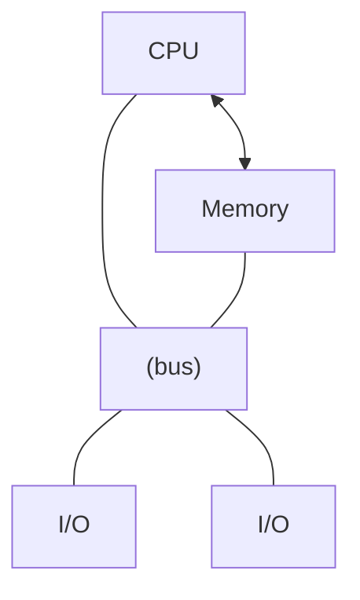

Descripción del bloque general: `Memory` arriba, conectada a `CPU` (izquierda) y a un bus horizontal que recorre hacia la derecha; dos módulos `I/O` cuelgan de ese bus.

**Zoom interno de un módulo de E/S** (recuadro ampliado desde el bloque "I/O" izquierdo, unido por líneas punteadas):

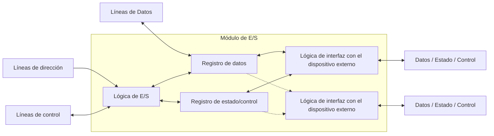

Descripción textual del módulo de E/S interno:

- **Líneas de Datos** (izquierda): conectadas bidireccionalmente al **Registro de datos**.
- **Líneas de dirección** (izquierda, abajo): entran (flecha hacia adentro) a la **Lógica de E/S**.
- **Líneas de control** (izquierda, abajo): bidireccionales con la **Lógica de E/S**.
- **Lógica de E/S**: bloque central que se comunica bidireccionalmente con el **Registro de datos** y el **Registro de estado/control**.
- **Registro de datos** y **Registro de estado/control**: a su derecha se conectan (flechas bidireccionales) a uno o más bloques de **Lógica de interfaz con el dispositivo externo** (el diagrama muestra dos instancias, unidas por una línea punteada vertical que indica "…" — es decir, puede haber más de una interfaz de dispositivo por módulo).
- Cada **Lógica de interfaz con el dispositivo externo** expone hacia el exterior tres señales: **Datos**, **Estado** y **Control**, hacia/desde el dispositivo físico externo.

Fuente (pie de página): W. Stallings, *Organización y Arquitectura de Computadores*, 5° Ed., Prentice Hall, Madrid, 2000

---

## Diapositiva 7: E/S Programada

- ❑ El manejo se realiza mediante el uso de instrucciones de E/S por código de programa
- ❑ **Principal desventaja**: se desperdician muchos ciclos de instrucción en revisar el estado del módulo E/S (*polling*)

**Diagrama izquierdo** (bus simple):


Descripción: mismo esquema simple CPU–Memory–bus–I/O de la diapositiva anterior, sin señal de interrupción.

**Diagrama derecho — Diagrama de flujo de E/S programada:**

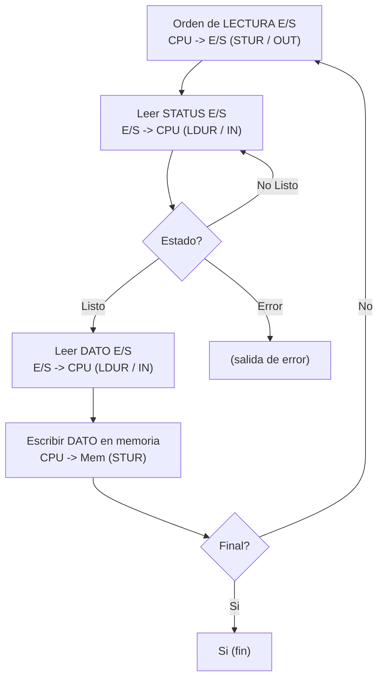

Descripción paso a paso del flujo:

1. **Orden de LECTURA E/S**: la CPU envía la orden al módulo de E/S (`CPU -> E/S`, instrucciones `STUR` / `OUT`).
2. **Leer STATUS E/S**: la CPU lee el registro de estado del módulo (`E/S -> CPU`, instrucciones `LDUR` / `IN`).
3. **Estado?** (decisión): si el estado indica **"No Listo"**, se vuelve a "Leer STATUS E/S" (bucle de espera activa / *polling*). Si indica **"Error"**, el flujo sale por la rama de error. Si indica **"Listo"**, continúa.
4. **Leer DATO E/S**: la CPU lee el dato del módulo (`E/S -> CPU`, `LDUR` / `IN`).
5. **Escribir DATO en memoria**: la CPU escribe el dato leído en memoria (`CPU -> Mem`, `STUR`).
6. **Final?** (decisión): si es **"No"**, se vuelve al paso 1 (nueva orden de lectura). Si es **"Si"**, el proceso termina.

Fuente (pie de página): W. Stallings, *Organización y Arquitectura de Computadores*, 5° Ed., Prentice Hall, Madrid, 2000

---

## Diapositiva 8: Interrupción

- ❑ Es un recurso de HW propio de la CPU: señal de ***Int*** externa para periféricos
- ❑ Es literalmente una "interrupción" o quiebre de la ejecución normal del código de programa

**Diagrama izquierdo** (bus con línea de interrupción):

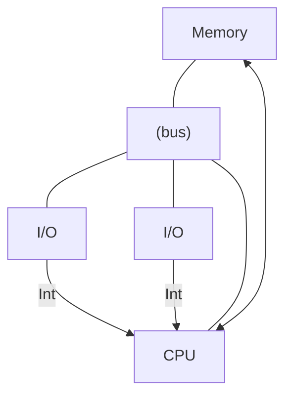

Descripción: igual al esquema CPU–Memory–bus–I/O anterior, pero ahora se agrega una línea **Int** que sale de los módulos de E/S y entra a la CPU (flecha hacia la CPU), representando la señal física de solicitud de interrupción.

**Diagrama derecho — mismo diagrama de flujo de la diapositiva 7, con dos agregados en rojo/punteado:**

- Desde el bloque **"Orden de LECTURA E/S"** sale una flecha punteada roja hacia la derecha rotulada **"Continúa programa"**: indica que, a diferencia de la E/S programada, tras emitir la orden de lectura la CPU **no espera/consulta** — continúa ejecutando su programa principal normalmente.
- Hacia el bloque **"Leer STATUS E/S"** entra, desde la derecha, una flecha punteada roja rotulada **"Interrupción"**: representa que es el propio periférico el que, de forma asíncrona, provoca que la CPU pase a leer el estado de E/S (en lugar de que la CPU lo consulte por *polling*).
- El resto del diagrama de flujo (Estado?, Leer DATO E/S, Escribir DATO en memoria, Final?) es idéntico al de la diapositiva 7.

Fuente (pie de página): W. Stallings, *Organización y Arquitectura de Computadores*, 5° Ed., Prentice Hall, Madrid, 2000

---

## Diapositiva 9: Interrupción (cont.)

- ❑ Al finalizar cada ciclo de instrucción el CPU verifica automáticamente si hay ***Int*** pendientes.
- ❑ De esta forma el "polling" lo realiza la CPU por HW: **no consume ciclos de instrucción!!**
- ❑ Si hay ***Int***, el CPU salta automáticamente a una posición de memoria especifica llamada **vector de interrupciones**.
- ❑ El vector de interrupciones contiene el código (o su referencia) con los procedimientos necesarios para dar servicio a dicha interrupción. Este código se denomina **ISR** (*Interrupt Service Routine*)

---

## Diapositiva 10: Donde se aloja la ISR? (interrupt address vector)

- Dirección fija (*Fixed interrupt*)
  - La dirección esta establecida en la lógica de la CPU, no puede ser modificada
  - La CPU puede contener la dirección real, o contener una instrucción de salto a la dirección real de la ISR si no hay suficiente espacio reservado.
- Dirección vectorizada (*Vectored interrupt*)
  - El periférico provee la dirección al CPU por medio del bus de datos
  - Para esto, se agrega una señal mas: INT ACK
  - Muy utilizado en sistemas con múltiples periféricos conectados por un bus
- Solución de compromiso:
  - Tabla de direcciones (*interrupt address table*) — **Old fashion!** *(texto en rojo)*

---

## Diapositiva 11: Cómo se procesa una Interrupción?

**Diagrama de dos columnas (Hardware → Software/ISR), conectadas en secuencia:**

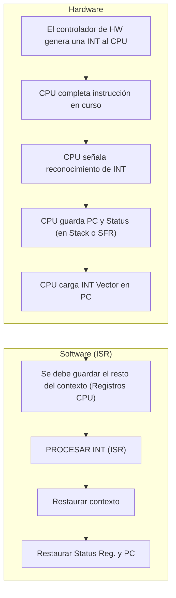

Descripción: la columna izquierda, agrupada con una llave y rotulada **"Hardware"**, contiene cinco pasos secuenciales realizados automáticamente por el hardware de la CPU:

1. El controlador de HW genera una INT al CPU
2. CPU completa instrucción en curso
3. CPU señala reconocimiento de INT
4. CPU guarda PC y Status (en Stack o SFR)
5. CPU carga INT Vector en PC

La columna derecha, agrupada con una llave y rotulada **"Software (ISR)"**, contiene cuatro pasos que ejecuta el código de la ISR, encadenados después del último paso de hardware (una línea naranja conecta el final de la columna de Hardware con el comienzo de la columna de Software):

6. Se debe guardar el resto del contexto (Registros CPU)
7. PROCESAR INT (ISR)
8. Restaurar contexto
9. Restaurar Status Reg. y PC

Fuente (pie de página): W. Stallings, *Organización y Arquitectura de Computadores*, 5° Ed., Prentice Hall, Madrid, 2000

---

## Diapositiva 12: Consideraciones adicionales

**Interrupciones Enmascarables vs. no-enmascarables**

- Enmascarables: El programador puede modificar un bit que causa que el procesador ignore una solicitud de interrupción (GEI)
  - Muy importante para usar cuando se tienen porciones de códigos temporalmente criticas.
- No-enmascarable: una señal separada que no puede ser ignorada (internas a la CPU)
  - Típicamente reservada para situaciones drásticas, como la ocurrencia de un fallo de alimentación, un acceso indebido a memoria flash o la detección de un código de operación invalido.
  - Estas ISR se las suele conocer con el nombre de **"Traps"**

**Salto a una ISR**

- Algunos procesadores tratan el salto de una INT como una llamada a cualquier otra rutina
  - Salvan el entorno completo (PC, status, registers) – toma muchos ciclos
- Otros salvan parcialmente su entorno (solo PC y status)
  - El programador debe asegurarse que el ISR no altere los registros o debe salvarlos previamente
  - Es necesario instrucciones de retornos diferentes en su set de instrucciones (RET – RETI)

---

## Diapositiva 13: Múltiples periféricos: Arbitraje

Considere la situación donde muchos periféricos solicitan el servicio de una CPU simultáneamente (microcontrolador) – **Cual será atendida primero y en que orden?**

- o **Software polling**
  - o Muy simple implementación por HW (una sola línea de INT)
  - o El programador debe determinar en la ISR el origen de la INT buscando banderas INT FLG
  - o La prioridad es establecida en la ISR según el orden de la búsqueda
- o **Árbitro de prioridades** (*Priority arbiter*)
- o **Conexión en cadena** (*Daisy chain*)
- o **Arbitraje de bus** (*Network-oriented*)
  - o Utilizado en arquitecturas de múltiples procesadores
  - o El periférico debe primero obtener la sesión del bus para luego requerir una interrupción

---

## Diapositiva 14: Arbitraje: Arbitro de prioridades

- o También conocido como **controlador de interrupciones**
- o Muy usado en arquitecturas de una CPU de propósito general
- o El periféricos hace la petición INT REQ al controlador, y este a la CPU. En orden inverso para los INT ACK
- o Esquema de direccionamiento vectorizado
- o Múltiples esquemas de prioridad:
  - o Fija
  - o Round-robin
  - o FIFO
- o Conexión al bus del sistema solo con fines de configuración

**Diagrama:**

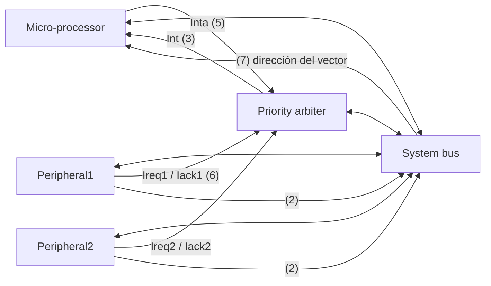

Descripción de las conexiones: el `Micro-processor` tiene una salida **Inta** (paso 5) hacia el `Priority arbiter` y una entrada **Int** (paso 3) desde este. El `Priority arbiter` posee las líneas **Ireq1/Iack1** (paso 6) hacia `Peripheral1` y **Ireq2/Iack2** hacia `Peripheral2` (pasos marcados con 2). Micro-processor, Priority arbiter, Peripheral1 y Peripheral2 están además conectados al **System bus** (flechas bidireccionales); por el bus viaja la dirección del vector de interrupción (paso 7) desde el periférico solicitante hacia el microprocesador.

Secuencia numerada de eventos (tal como aparece en la diapositiva):

1. CPU ejecuta su programa principal
2. P1 solicita servicio seteando *Ireq1*. P2 también solicita servicio mediante *Ireq2*.
3. Como el controlador detecta al menos una *Ireq*, entonces setea *Int*.
4. La CPU para la ejecución del programa y guarda el contexto.
5. La CPU setea *Inta*.
6. El controlador setea *Iack1* para responder a P1.
7. P1 pone la dirección del vector en el bus de datos
8. La CPU salta a la dirección del ISR leída del bus, la ISR se ejecuta y retorna.
9. La CPU resume la ejecución del programa principal

Fuente (pie de página): F. Vahid, T. Givargis, *Embedded System Desig[n]: A Unified Hardware/Software Introduction*, John Wiley & Son., New York, 2002

---

## Diapositiva 15: Arbitraje: Conexión en cadena

La lógica de control de arbitraje esta embebida en cada periférico

- Se agrega una señal de entrada *IntReq* y de salida *IntAck*

Los periféricos están dispuestos en el sistema en forma de cadena

- Un solo periférico se conecta al CPU (el de mayor prioridad), los otros "aguas arriba"
- Los periféricos difunden la señal **IntReq** hacia el CPU y la señal **IntAck** hacia el origen de la interrupción

Pros vs. contras:

- Ideal si es necesario agregar o sacar periféricos
- Bajo rendimiento con muchos periféricos
- Es necesario agregar lógica por seguridad (periférico fuera de servicio)
- Esquema de prioridad único

**Diagrama:**

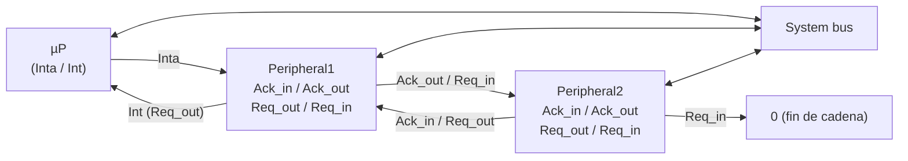

Descripción: `µP` tiene pines **Inta** e **Int** conectados en cadena: primero a `Peripheral1` (que tiene pines `Ack_in`, `Ack_out`, `Req_out`, `Req_in`), y la cadena continúa hacia `Peripheral2` (mismos pines). El extremo final de la cadena (`Req_in` de Peripheral2, el de menor prioridad) está atado a **0** (no hay más periféricos aguas arriba). Todos los periféricos y el µP están además conectados al **System bus** (flechas bidireccionales), usado solo para configuración.

Fuente (pie de página): F. Vahid, T. Givargis, *Embedded System Desig[n]: A Unified Hardware/Software Introduction*, John Wiley & Son., New York, 2002

---

## Diapositiva 16: Caso de estudio #1: Familia Microchip PIC16x

**Esquema de vector único**

- Cada periférico posee un habilitador (IE) y una flag (IF)
- Esquema software polling
- La prioridad la define el programador en la ISR
- Habilitador general de int (GIE)
- Esquema simple de rendimiento moderado

**Diagrama — red de compuertas lógicas de interrupción:**

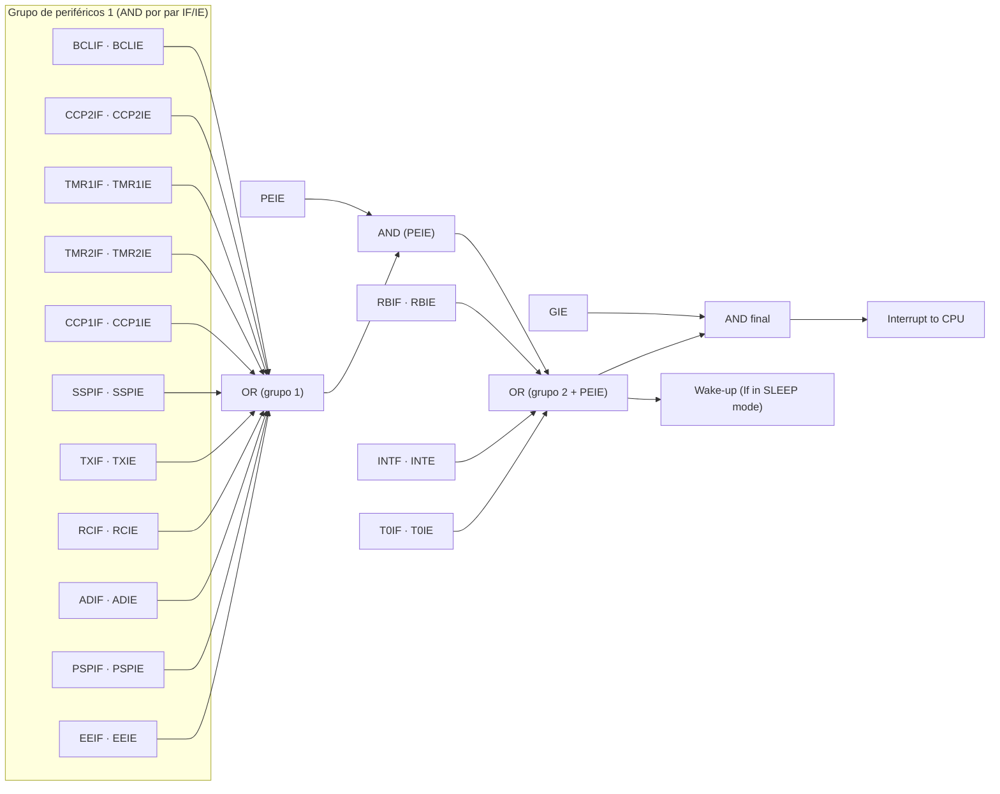

Descripción: cada periférico aporta un par de señales **IF** (flag de interrupción) e **IE** (habilitador de esa interrupción) que entran a una compuerta **AND** individual (una por periférico). Periféricos del "grupo 1": `EEIF/EEIE` (EEPROM), `PSPIF/PSPIE` (puerto esclavo paralelo), `ADIF/ADIE` (conversor A/D), `RCIF/RCIE` (recepción serie), `TXIF/TXIE` (transmisión serie), `SSPIF/SSPIE` (puerto serie síncrono), `CCP1IF/CCP1IE` (captura/comparación/PWM 1), `TMR2IF/TMR2IE` (timer 2), `TMR1IF/TMR1IE` (timer 1), `CCP2IF/CCP2IE` (captura/comparación/PWM 2) y `BCLIF/BCLIE` (colisión de bus). Todas las salidas de estas AND se combinan en una compuerta **OR** grande, cuya salida se combina (AND) con **PEIE** (habilitador de interrupciones de periféricos). Ese resultado se combina en otra **OR** junto con las salidas AND de `T0IF/T0IE` (timer 0), `INTF/INTE` (interrupción externa INT) y `RBIF/RBIE` (cambio en puerto B). La salida de esta última OR se usa directamente como señal de **Wake-up** (si el dispositivo está en modo SLEEP) y, combinada (AND) con **GIE** (Global Interrupt Enable), produce la señal final **Interrupt to CPU**.

---

## Diapositiva 17: Caso de estudio #2: Familia MSP430x2xx

**Esquema en cadena vectorizado**

- Cada periférico posee un habilitador (IE) y una flag (IF)
- Vectores con servicios compartidos
- Esquema de prioridad fija
- Interrupciones enmascarables (periféricos) y no-enmascarables (sistema)
- Habilitador general de int (GIE)
- El guardado del entorno y el retorno de una interrupción (RETI) toman 5 ciclos de reloj cada uno.

**Diagrama:**

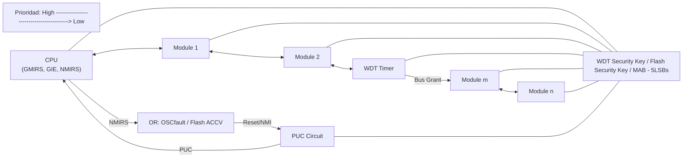

Descripción: en la parte superior una barra indica que la **prioridad** decrece de izquierda (**High**) a derecha (**Low**). El bloque `CPU` tiene una compuerta **AND** (rotulada **GMIRS**) que combina señales de módulos, una línea **GIE** (Global Interrupt Enable) y una línea **NMIRS**. La CPU se conecta en cadena (similar a *daisy chain*, con pines "1" y "2" en cada módulo) a `Module 1`, `Module 2`, `WDT Timer` (con señal **Bus Grant** hacia el siguiente), `Module m` y `Module n`, en orden decreciente de prioridad de izquierda a derecha. Por separado, el bloque `PUC Circuit` recibe la señal **Reset/NMI**, generada por una compuerta **OR** que combina **OSCfault** y **Flash ACCV** (fallo de oscilador o acceso indebido a Flash); `PUC Circuit` entrega la señal **PUC** (Power-Up Clear) a la CPU. En la parte inferior corren tres buses horizontales comunes a todos los bloques: **WDT Security Key**, **Flash Security Key** y **MAB – 5LSBs** (bits menos significativos del bus de direcciones de memoria).

---

## Diapositiva 18: Caso #3: Familia ARM Cortex M

**Controlador vectorizado de interrupciones anidadas** (NVIC, *Nested vectored interrupt controller*)

- Hasta 81 entradas de INT de periféricos (IRQs)
- **ANIDADAS!!! Una IRQ puede interrumpir a otra de menor prioridad.**
- Nivel de prioridad programable 0-15 para cada IRQ. Los niveles altos corresponden a prioridades bajas.
- Detección por nivel o flanco de las señales de INT
- Reprogramación de las prioridades en forma dinámica
- A cada periférico se le asigna un nivel de prioridad y sub-prioridad
- Interrupción externa No-enmascarable (NMI)

**Diagrama:**

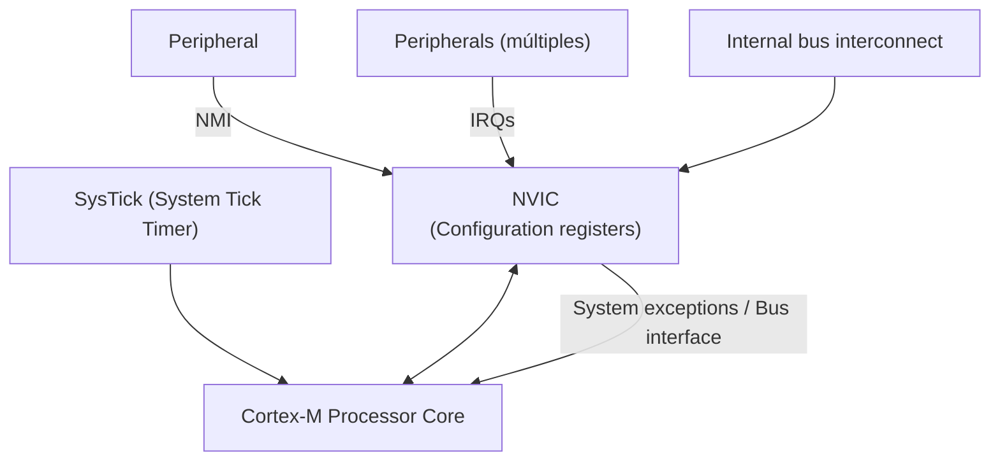

Descripción: `SysTick (System Tick Timer)` y `Cortex-M Processor Core` están conectados bidireccionalmente en la parte superior derecha. El `NVIC`, con su sub-bloque de **Configuration registers**, recibe la señal **NMI** desde un `Peripheral` y múltiples líneas **IRQs** desde el conjunto de `Peripherals` (dibujados como una pila de bloques apilados, indicando varias instancias). El NVIC se comunica con el `Cortex-M Processor Core` mediante **System exceptions** y **Bus interface**. En la parte inferior, el `Internal bus interconnect` se conecta hacia el NVIC (y continúa hacia abajo, fuera de la diapositiva).

---

## Diapositiva 19: Exceptions and Interrupts

"Unexpected" events requiring change in flow of control

- Different ISAs use the terms differently

**Exception**

- Arises within the CPU
  - e.g., undefined opcode, FPU overflow, syscall, …

**Interrupt**

- From an external I/O controller

*Dealing with them without sacrificing performance is hard!* *(texto en rojo, cursiva y negrita)*

---

## Diapositiva 20: Handling Exceptions

- Save PC of offending (or interrupted) instruction
  - In LEGv8: **Exception Link Register (ELR)**
- Save indication of the problem
  - In LEGv8: **Exception Syndrome Rregister (ESR)** *(sic, así aparece escrito en el original: "Rregister")*
  - We'll assume 1-bit
    - 0 for undefined opcode, 1 for overflow

---

## Diapositiva 21: An Alternate Mechanism

- **Vectored Interrupts**
  - Handler address determined by the cause
- Exception vector address to be added to a vector table base register:
  - Unknown Reason: `00 0000` (subíndice *two*, es decir, en binario)
  - Overflow: `10 1100` (subíndice *two*)
  - …: `11 1111` (subíndice *two*)
- Instructions either
  - Deal with the interrupt, or
  - Jump to real handler

---

## Diapositiva 22: Handler Actions

- Read cause, and transfer to relevant handler
- Determine action required
- If restartable
  - Take corrective action
  - use EPC to return to program
- Otherwise
  - Terminate program
  - Report error using EPC, cause, …

---

## Diapositiva 23: Processor with Exceptions (a LEGv8 approach)

Diagrama de bloques del procesador completo con soporte de excepciones. Bloque contenedor externo (línea punteada) rotulado `(#processor_arm)`, que agrupa tres sub-bloques: `Controller`, `Datapath` e `Instruction Memory`, más un bloque `Data Memory` a la derecha.

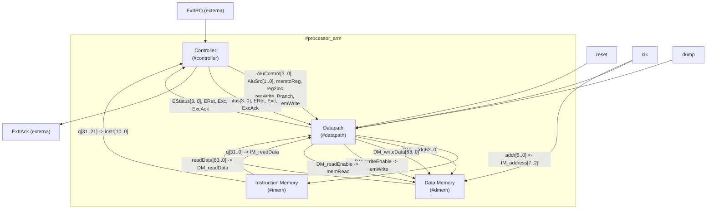

Descripción exhaustiva de cada elemento del diagrama original:

- **Bloque `Controller`** (`#controller`, recuadro celeste redondeado, arriba a la izquierda dentro del procesador):
  - Entradas/salidas externas al procesador: **ExtIRQ** (flecha roja entrante, solicitud de interrupción externa) y **ExtIAck** (flecha roja saliente, acuse de recibo de la interrupción externa).
  - Entrada desde Instruction Memory: **instr[10..0]** (los bits de opcode de la instrucción, provenientes de `q[31..21]`).
  - Salidas de control "clásicas" hacia el Datapath (líneas celestes): **AluControl[3..0]**, **AluSrc[1..0]**, **memtoReg**, **reg2loc**, **regWrite**, **Branch**, **memRead**, **memWrite**.
  - Señales relacionadas con excepciones (líneas rojas, van y vuelven entre Controller y Datapath): **EStatus[3..0]** (código/causa de la excepción), **ERet** (señal de retorno de excepción), **Exc** (señal de "ocurrió una excepción"), **ExcAck** (acuse de recibo de la excepción).
- **Bloque `Instruction Memory`** (`#imem`, arriba a la derecha): entrada **addr[5..0]**, salida **q[31..0]**. La parte alta de la palabra (**q[31..21]**) alimenta al Controller como `instr[10..0]`; toda la palabra **q[31..0]** baja también hacia el Datapath como dato de instrucción leída. La dirección de acceso a esta memoria viene del Datapath a través de la línea **IM_address[7..2]**.
- **Bloque `Datapath`** (`#datapath`, recuadro gris grande, centro): recibe todas las señales de control del Controller (mismos nombres que arriba, en el lado receptor) y produce/consume:
  - **IM_addr[63..0]** (dirección hacia Instruction Memory) y **IM_readData[31..0]** (instrucción leída, entrada).
  - **DM_addr[63..0]** (dirección hacia Data Memory), **DM_writeData[63..0]** (dato a escribir), **DM_readData[63..0]** (dato leído, entrada).
  - **DM_writeEnable** y **DM_readEnable** (líneas celestes de habilitación) hacia Data Memory.
  - Entradas globales: **reset**, **clk**, **dump** (esta última relacionada con volcado/depuración de estado).
- **Bloque `Data Memory`** (`#dmem`, derecha, debajo de Instruction Memory): entradas **memWrite**, **memRead** (provenientes de DM_writeEnable/DM_readEnable del Datapath), **address[5..0]** (proveniente de DM_addr[8..3]), **writeData[63..0]**; salida **readData[63..0]** hacia el Datapath. También recibe **clk** y una señal **dump** (relacionada con la del Datapath, para volcar el contenido de memoria).

En resumen: el Controller genera tanto las señales de control tradicionales del datapath como un conjunto adicional de señales específicas para el manejo de excepciones (EStatus, ERet, Exc, ExcAck), que viajan en ambos sentidos entre Controller y Datapath. El Datapath es quien efectivamente accede a Instruction Memory y Data Memory.

---

## Diapositiva 24: Datapath with Exceptions (just an approach!)

Diagrama de muy alta densidad (nivel de compuertas/registros) que muestra el datapath segmentado (fetch, decode, execute, memory, writeback) de un procesador LEGv8, con los agregados de hardware necesarios para soportar excepciones. Dado el nivel de detalle del esquemático original, se transcribe primero un diagrama simplificado del flujo entre etapas y luego un listado exhaustivo de **todas** las etiquetas/señales legibles agrupadas por sub-bloque, para no perder información.

**Diagrama simplificado de flujo entre etapas, con los agregados de excepciones:**

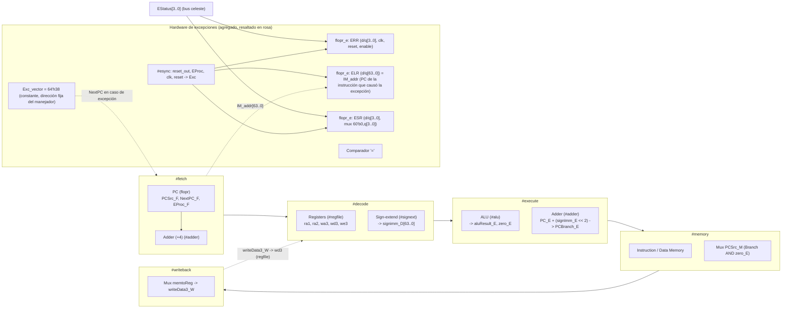

**Listado exhaustivo de etiquetas visibles en el esquemático original, agrupadas por sub-bloque:**

- **`(#fetch)`**: `PCSrc_F`, `NextPC_F`, `EProc_F`, `PCBranch_F[63..0]`, `EVAddr_F[63..0]`, un multiplexor (para elegir próximo PC entre PC+4, PCBranch y EVAddr/Exc_vector en caso de excepción), un registro `(#flopr)` con entradas `PC`, `clk`, `reset` y salida `imem_addr_F[63..0]`, una constante `64'h4` y un sumador `(#adder)` que calcula PC+4.
- **`(#decode)`**: `reg2loc_D`, `instr_D[31..0]` (con sub-campos usados como índices: `instr_D[20..16]`, `instr_D[9..5]`, `instr_D[4..0]`), bloque `(#signext)` que produce `signimm_D[63..0]` a partir de la instrucción, bloque `(#regfile)` "Registers" con puertos `ra1[4..0]`, `ra2[4..0]` (seleccionado por `reg2loc_D` vía mux), `wa3[4..0]`, `wd3[63..0]`, `we3`, `clk`, y salidas `rd1[63..0]` → `readData1_D[63..0]` y `rd2[63..0]` → `readData2_D[63..0]`.
- **`(#execute)`**: `PC_E[63..0]`, sumador `(#adder)` que calcula `PCBranch_E[63..0]` = `PC_E` + (`signImm_E[63..0]` desplazado 2 bits a la izquierda, bloque "Shift left 2"), bloque `(#alu)` "ALU" con entradas `readData1_E[63..0]`, `readData2_E[63..0]` (o `signImm_E` vía multiplexores selectores "0x"/"1x" controlados por `aluSrc_E[1..0]`) y `aluControl[3..0]`, produciendo `aluResult_E[63..0]` y la bandera `zero_E`; además se propagan `writeData3_E[63..0]` y `readData3_E[63..0]`.
- **`(#memory)`**: compuerta AND que combina `Branch` y `zero_E` para decidir el multiplexor `PCSrc_M` (selección de salto); líneas `DM_addr[63..0]`, `DM_writeData[63..0]`, `DM_readData[63..0]` hacia/desde la Instruction Memory y Data Memory externas (indicadas con llaves en la parte inferior del diagrama, rotuladas **"Instruction Memory"** y **"Data Memory"**).
- **`(#writeback)`**: multiplexor controlado por `memtoReg` que selecciona entre `aluResult_W[63..0]` y `DM_readData_W[63..0]` para producir `writeData3_W[63..0]`, que vuelve al banco de registros.
- **Agregados de hardware para excepciones (resaltados en color rosa en el original)**:
  - Registro `(#flopr_e)` rotulado **ERR** (d[3..0]/q[3..0], con entradas `clk`, `reset`, `enable`) que almacena el motivo/código de excepción, alimentado por el bus celeste `EStatus[3..0]` que recorre horizontalmente el diagrama desde decode/execute.
  - Un multiplexor (triángulo "M") que selecciona el próximo PC a cargar en el registro de fetch cuando ocurre una excepción.
  - Constante **`Exc_vector = 64'h38`** (recuadro rosa cerca del límite entre fetch y decode): dirección fija a la que se salta al atender una excepción.
  - Un comparador **"="** (círculo rosa) cerca de la parte inferior izquierda del diagrama.
  - Bloque **`(#esync)`**, con entradas `reset_out`, una señal relacionada con `EProc` y `clk`/`reset`, y salida **`Exc`** — sincroniza la señal de excepción con el pipeline.
  - Registro `(#flopr_e)` rotulado **ELR** (d[63..0]/q[63..0], `clk`, `reset`, `enable`): almacena el **Exception Link Register**, cargado con `IM_addr[63..0]` (la dirección/PC de la instrucción que causó o fue interrumpida por la excepción).
  - Registro `(#flopr_e)` rotulado **ESR** (con un multiplexor de entrada `60'b0, q[3..0]`): almacena el **Exception Syndrome Register**, cargado desde `EStatus[3..0]`.
  - Señales de control celestes que se distribuyen a lo largo de todo el datapath (desde el Controller de la diapositiva 23) y aparecen repetidas en varios puntos del esquema: `ERet`, `Exc`, `ExcAck`, `EStatus[3..0]`, `regWrite`, `aluSrc[1..0]`, `aluControl[3..0]`, `reg2loc`, `branch`, `memRead`, `memWrite`, `DM_writeEnable`, `DM_readEnable`, `memtoReg`.

*Nota de fidelidad:* este esquemático es un diagrama de muy alta densidad (texto microscópico en el PDF original). Se transcribieron todas las etiquetas legibles; el trazado exacto de cada cable individual puede no reproducirse pixel-perfect, pero la descripción anterior cubre todos los bloques, registros, multiplexores y señales presentes en la diapositiva.

---

## Diapositiva 25: Exceptions – The ISA Approach — New Instructions!

- **ERET** (Exception Return)
  - Type: R - OpCode: `1101011(0100)`
  - Syntaxis: `ERET`
- **MRS** (Move (from)SystemReg to GeneralPurposeReg)
  - Syntaxis: `MRS <Rt>, <systemReg>`
  - Type: S (*new!*) - OpCode: `1101010100(1)`
  - `<systemReg>` = `"S<2+op0>_<op1>_<CRn>_<CRm>_<op2>"`
    - `S2_0_C0_C0_0` → ERR
    - `S2_0_C1_C0_0` → ELR
    - `S2_0_C2_C0_0` → ESR
    - `S2_0_C3_C0_0` → Reserved

**Tabla de codificación — ERET (Type R):**

| Bits | 31–25 | 24–21 (opc) | 20–16 (Rm) | 15–10 (shamt) | 9–5 (Rn) | 4–0 (Rd/Rt) |
|---|---|---|---|---|---|---|
| Valor | `1101011` | `0100` | `11111` *(resaltado)* | `000000` | `11111` | `00000` |

**Tabla de codificación — MRS (Type S, nuevo):**

| Bits | 31–21 | 20–19 (op0) | 18–16 (op1) | 15–12 (CRn) | 11–8 (CRm) | 7–5 (op2) | 4–0 (Rt) |
|---|---|---|---|---|---|---|---|
| Valor | `11010101001` | `1X` | `XXX` | `XXXX` *(resaltado)* | `XXXX` | `XXX` | `XXXXX` |

(`X` indica bit "don't care" tal como aparece en el esquema de codificación original; los campos `Rm` en ERET y `CRn` en MRS aparecen remarcados con un círculo en la diapositiva original.)

---

## Diapositiva 26: Exceptions – The ISA Approach — More useful Instructions…

- **BR** (Branch with Register)

```asm
BR Xt
```

- **SVC** (Generate exception with 16-bit payload)

```asm
SVC #uimm16
```

- **MSR** (Move (from)GeneralPurposeReg to SystemReg)

```asm
MSR <system_register>, Xt
```

---

## Diapositiva 27: Preguntas? Dudas? Consultas?

- Texto: **"Preguntas? Dudas? Consultas?"**
- Imagen decorativa: Homer Simpson (personaje de Los Simpson), rascándose la cabeza con gesto de duda, con lentes, camisa blanca, corbata a rayas y una credencial/identificación colgada del cuello — diapositiva de cierre típica para abrir el espacio de preguntas.
