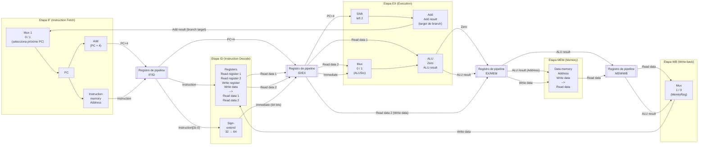
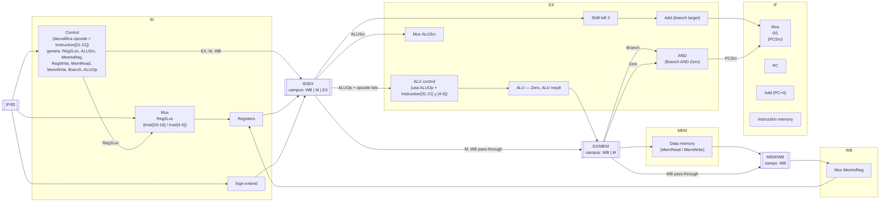

# Práctico N° 4: Procesador con pipeline

*Arquitectura de Computadoras 2026*

> Transcripción fiel en Markdown del PDF `Práctico4-clase.pdf` (50 páginas/diapositivas). Cada sección corresponde a una diapositiva del original, en el mismo orden.

---

## Página 1 — Portada

# Práctico N° 4: Procesador con pipeline

Arquitectura de Computadoras 2026

---

## Página 2 — Pipelined datapath

### Diagrama base del datapath segmentado (pipeline)

Este es el datapath de LEGv8 con pipeline de 5 etapas, dividido por 4 registros de pipeline: **IF/ID**, **ID/EX**, **EX/MEM**, **MEM/WB**. Este mismo diagrama se reutiliza en las páginas siguientes resaltando (en celeste) la parte activa en cada etapa para la instrucción `LDUR`.



### Descripción textual de todos los elementos del datapath

**Etapa IF (Instruction Fetch):**
- **Mux 1** (identificado como `0 Mux 1`): multiplexor de 2 entradas que selecciona el próximo valor del **PC**. Entrada 0 = PC+4 (secuencial); entrada 1 = dirección de salto/branch (viene del `Add` de la etapa EX, señal que recorre todo el datapath hacia atrás, por arriba del diagrama).
- **PC**: registro que contiene la dirección de la instrucción actual.
- **Instruction memory**: memoria de instrucciones, entrada `Address` = PC, salida = `Instruction`.
- **Add** (parte superior izquierda): sumador que calcula `PC + 4`, con entrada constante `4`.

**Registro de pipeline IF/ID**: almacena la `Instruction` leída y el valor `PC+4`, para que la etapa ID los use en el siguiente ciclo de clock.

**Etapa ID (Instruction Decode):**
- **Registers** (banco de registros): entradas `Read register 1`, `Read register 2`, `Write register`, `Write data`; salidas `Read data 1`, `Read data 2`.
- **Sign-extend**: toma los 32 bits bajos de la instrucción (campo inmediato) y los extiende a 64 bits.
- El valor `PC+4` pasa de largo desde IF/ID hacia ID/EX (para el cálculo de dirección de branch).

**Registro de pipeline ID/EX**: almacena `Read data 1`, `Read data 2`, el inmediato con signo extendido, `PC+4`, y los campos de la instrucción usados para identificar registros destino.

**Etapa EX (Execution):**
- **Shift left 2**: desplaza el inmediato 2 bits a la izquierda (multiplica por 4) para calcular offsets de branch.
- **Add** (sumador de branch): calcula `PC+4 + (inmediato << 2)` = dirección destino del branch. Su salida (`Add result`) vuelve hacia el **Mux 1** de la etapa IF (entrada 1), recorriendo todo el datapath por la parte superior.
- **Mux** (`0 Mux 1`, ALUSrc): selecciona la segunda entrada de la ALU entre `Read data 2` (registro) y el inmediato con signo extendido.
- **ALU**: realiza la operación aritmético-lógica. Entradas: `Read data 1` y la salida del mux ALUSrc. Salidas: `Zero` (flag) y `ALU result`.

**Registro de pipeline EX/MEM**: almacena `Zero`, `ALU result`, `Read data 2` (renombrado como dato a escribir en memoria, `Write data`), y el registro destino.

**Etapa MEM (Memory):**
- **Data memory**: entradas `Address` (= `ALU result`) y `Write data`; salida `Read data`.

**Registro de pipeline MEM/WB**: almacena `Read data` (leído de memoria) y `ALU result` (para instrucciones que no acceden a memoria), y el registro destino.

**Etapa WB (Write-back):**
- **Mux** (`1 Mux 0`, MemtoReg): selecciona el dato a escribir en el banco de registros entre `Read data` (de memoria) y `ALU result`. La salida vuelve al banco de **Registers** de la etapa ID como `Write data` (flecha larga que recorre el datapath de derecha a izquierda, por la parte inferior).

---

## Página 3 — Pipelined datapath (LDUR — Instruction fetch)

Mismo datapath de la página 2. Se resalta en celeste la parte activa durante la etapa **Instruction fetch** de la instrucción `LDUR`, indicada arriba del diagrama con el rótulo `LDUR` y una llave que enmarca el segmento `Instruction fetch` (en color celeste, a la izquierda del rango total de la instrucción).

**Elementos resaltados (celeste) en esta página:**
- El **Mux 1** de selección de PC.
- El registro **PC**.
- La mitad izquierda de la **Instruction memory** (la lectura de la instrucción).
- El registro de pipeline **IF/ID** (resaltado como una barra celeste), que es el que va a capturar el resultado de esta etapa al final del ciclo.

El resto del datapath (ID/EX, EX/MEM, MEM/WB y sus etapas) permanece sin resaltar, ya que todavía no participan del procesamiento de esta instrucción en este ciclo.

---

## Página 4 — Pipelined datapath (LDUR — Instruction decode)

Mismo datapath. Rótulo superior `LDUR` con la llave celeste ahora sobre el segmento **Instruction decode**.

**Elementos resaltados (celeste):**
- El registro de pipeline **IF/ID** (como origen de los datos).
- El registro de pipeline **ID/EX** (destino, se llena al final de esta etapa).
- Dentro de **Registers**: la mitad izquierda del bloque (entradas `Read register 1`, `Read register 2`) y la salida `Read data 1` resaltada (columna derecha superior de `Registers`, `Read data 1`).

Nota: en esta diapositiva sólo se ve resaltada la salida `Read data 1` del banco de registros (no `Read data 2`), junto con la mitad de entrada del bloque `Registers`.

---

## Página 5 — Pipelined datapath (LDUR — Execution)

Rótulo superior `LDUR` con llave celeste sobre **Execution**.

**Elementos resaltados (celeste):**
- El registro de pipeline **ID/EX** (origen de los operandos).
- El registro de pipeline **EX/MEM** (destino).
- **Shift left 2** y el sumador **Add** (cálculo de dirección de branch) resaltados.
- El **Mux** ALUSrc (`0 Mux 1`) resaltado.
- La **ALU** resaltada (en celeste, incluyendo su forma trapezoidal), con salidas `Zero` y `ALU result`.

---

## Página 6 — Pipelined datapath (LDUR — Memory)

Rótulo superior `LDUR` con llave celeste sobre **Memory**.

**Elementos resaltados (celeste):**
- El registro de pipeline **EX/MEM** (origen).
- El registro de pipeline **MEM/WB** (destino).
- Dentro de **Data memory**: la mitad derecha del bloque, correspondiente a la salida `Read data` (lectura de memoria), resaltada.

---

## Página 7 — Pipelined datapath (LDUR — Write-back)

Rótulo superior `LDUR` con llave celeste sobre **Write-back**.

**Elementos resaltados (celeste):**
- El registro de pipeline **MEM/WB** (origen).
- El bloque **Registers**, específicamente su mitad izquierda (donde entra `Write data`), resaltado.
- El **Mux** final (`1 Mux 0`, MemtoReg) resaltado, mostrando el camino del dato que vuelve a escribirse en el banco de registros.

---

## Página 8 — Pipelined datapath with the control signals connected to the control portions of the pipeline registers

### Diagrama con señales de control

Mismo datapath base, ahora con la unidad de **Control** y todas las señales de control (en celeste) agregadas y propagadas a través de los registros de pipeline.



### Descripción textual de las señales de control

- **Control**: unidad combinacional que decodifica el campo **opcode** (`Instruction[31-21]`) de la instrucción en la etapa ID y genera las señales de control. Estas señales se agrupan y se guardan en el registro **ID/EX**, dividido en tres subcampos: **WB** (Write-Back: `RegWrite`, `MemtoReg`), **M** (Memory: `Branch`, `MemRead`, `MemWrite`), y **EX** (Execution: `ALUSrc`, `ALUOp`).
- **Reg2Loc**: señal de control que maneja un multiplexor ubicado antes del banco de **Registers**, que decide si el segundo registro a leer (`Read register 2`) proviene de `Instruction[20-16]` o de `Instruction[4-0]`.
- **RegWrite**: habilita la escritura en el banco de registros (viaja WB a través de ID/EX → EX/MEM → MEM/WB).
- **ALUSrc**: selecciona la segunda entrada de la ALU (registro vs. inmediato).
- **ALUOp**: junto con `Instruction[31-21]` (opcode) e `Instruction[4-0]`, alimenta al bloque **ALU control**, que genera la operación específica que realiza la ALU.
- **Branch**: indica que la instrucción es un salto condicional; viaja en el campo M hasta EX/MEM.
- **Zero**: flag de salida de la ALU que indica si el resultado fue cero (usado para evaluar condición de branch, p. ej. `CBZ`).
- **AND (Branch AND Zero)**: puerta lógica ubicada después de EX/MEM que combina `Branch` y `Zero` para producir la señal **PCSrc**, que controla el **Mux 1** de selección de PC en la etapa IF (vuelve por la parte superior del diagrama hasta el mux inicial).
- **MemRead / MemWrite**: controlan la lectura/escritura de la memoria de datos en la etapa MEM.
- **MemtoReg**: selecciona, en el mux final de WB, si el dato a escribir en el banco de registros viene de memoria (`Read data`) o de la ALU (`ALU result`).
- Los campos de control se van "arrastrando" de registro en registro (ID/EX → EX/MEM → MEM/WB), perdiendo los subcampos que ya no son necesarios en etapas posteriores (por eso ID/EX tiene WB+M+EX, EX/MEM tiene WB+M, y MEM/WB sólo tiene WB).

---

## Página 9 — Single-cycle, nonpipelined execution (top) versus pipelined execution (bottom)

### Diagrama superior: ejecución sin pipeline (single-cycle, no segmentada)

Eje de tiempo en **picosegundos (ps)**, marcas cada 200 ps: 200, 400, 600, 800, 1000, 1200, 1400, 1600, 1800.

Tres instrucciones ejecutadas **secuencialmente**, cada una tarda **800 ps** en total, compuesta de 5 sub-etapas (de duración desigual): `Instruction fetch`, `Reg`, `ALU`, `Data access`, `Reg`.

| Instrucción | Secuencia de etapas | Duración total | Rango aproximado |
|---|---|---|---|
| `LDUR X1, [X4,#100]` | Instruction fetch → Reg → ALU → Data access → Reg | 800 ps | ~200 a ~1000 |
| `LDUR X2, [X4,#200]` | Instruction fetch → Reg → ALU → Data access → Reg | 800 ps | ~1000 a ~1800 |
| `LDUR X3, [X4,#400]` | Instruction fetch → … | 800 ps | comienza en ~1800 (continúa fuera del gráfico, indicado con "…") |

Cada instrucción comienza recién cuando termina la anterior (no hay solapamiento). El bracket "800 ps" se dibuja debajo de cada instrucción marcando su duración total.

### Diagrama inferior: ejecución con pipeline (segmentada)

Eje de tiempo en ps: 200, 400, 600, 800, 1000, 1200, 1400.

Las mismas 5 sub-etapas (`Instruction fetch`, `Reg`, `ALU`, `Data access`, `Reg`) ahora tienen **igual duración: 200 ps cada una** (el período de clock queda fijado por la etapa más lenta). Las instrucciones se solapan, cada una empieza **200 ps** después de la anterior:

| Instrucción | 0-200 | 200-400 | 400-600 | 600-800 | 800-1000 | 1000-1200 | 1200-1400 |
|---|---|---|---|---|---|---|---|
| `LDUR X1, [X4,#100]` | Instruction fetch | Reg | ALU | Data access | Reg | | |
| `LDUR X2, [X4,#200]` | | Instruction fetch | Reg | ALU | Data access | Reg | |
| `LDUR X3, [X4,#400]` | | | Instruction fetch | Reg | ALU | Data access | Reg |

El bracket "200 ps" se marca entre el inicio de cada instrucción y la siguiente (offset de 200 ps), y también se marca una serie de cinco brackets de "200 ps" debajo de la última fila, indicando la duración de cada una de las 5 etapas.

**Conclusión implícita de la figura**: con pipeline, el tiempo total para las 3 instrucciones baja de 2400 ps (3×800, no pipelined) a 1400 ps (pipelined), aunque la latencia de una instrucción individual no mejora (sigue siendo la suma de las etapas).

---

## Página 10 — Multiple-clock-cycle diagram and single-clock-cycle figure

Esta diapositiva muestra dos figuras lado a lado.

### Izquierda: FIGURE 4.43 — Traditional multiple-clock-cycle pipeline diagram of five instructions in Figure 4.42

Tabla de instrucción × ciclo de clock (CC1 a CC9). Cada celda indica la etapa que ejecuta esa instrucción en ese ciclo.

| Instrucción | CC1 | CC2 | CC3 | CC4 | CC5 | CC6 | CC7 | CC8 | CC9 |
|---|---|---|---|---|---|---|---|---|---|
| `LDUR X10, [X1,#40]` | Instruction fetch | Instruction decode | Execution | Data access | Write-back | | | | |
| `SUB X11, X2, X3` | | Instruction fetch | Instruction decode | Execution | Data access | Write-back | | | |
| `ADD X12, X3, X4` | | | Instruction fetch | Instruction decode | Execution | Data access | Write-back | | |
| `LDUR X13, [X1,#48]` | | | | Instruction fetch | Instruction decode | Execution | Data access | Write-back | |
| `ADD X14, X5, X6` | | | | | Instruction fetch | Instruction decode | Execution | Data access | Write-back |

*(Nota: en la figura original, "Data access" también aparece como "Data access" en la columna correspondiente a Memoria, y "Write-back" es la última etapa.)*

### Derecha, arriba: tabla resumen de la etapa "Execution"

Fila con las 5 instrucciones y su etapa activa en el instante graficado (CC5), de izquierda a derecha en orden de más antigua a más nueva:

| `ADD X14, X5, X6` | `LDUR X13, [X1,#48]` | `ADD X12, X3, X4` | `SUB X11, X2, X3` | `LDUR X10, [X1,#40]` |
|---|---|---|---|---|
| Instruction fetch | Instruction decode | Execution | Memory | Write-back |

### Derecha, abajo: FIGURE 4.44 — The single-clock-cycle diagram corresponding to clock cycle 5 of the pipeline in Figures 4.42 and 4.43

Es el mismo diagrama de datapath segmentado (idéntico al de la página 2), mostrado sin resaltados particulares, representando una "foto" (corte vertical) del pipeline en el ciclo de clock 5, donde conviven 5 instrucciones distintas, cada una en una etapa diferente (IF, ID, EX, MEM, WB respectivamente para `ADD X14`, `LDUR X13`, `ADD X12`, `SUB X11`, `LDUR X10`).

**Pie de figura (texto completo visible en la diapositiva):**
> "FIGURE 4.44 The single-clock-cycle diagram corresponding to clock cycle 5 of the pipeline in Figures 4.42 and 4.43. As you can see, a single-clock-cycle figure is a vertical slice through a multiple-clock-cycle diagram."

---

## Página 11 — Multiple-clock-cycle diagram and single-clock-cycle figure

### FIGURE 4.42 — Multiple-clock-cycle pipeline diagram of five instructions

Diagrama gráfico (no tabular) que representa lo mismo que la tabla de la página anterior, pero dibujando cada etapa como un bloque con forma distinta según su función:

- `IM` (Instruction Memory) → etapa Instruction fetch: rectángulo celeste.
- `Reg` → etapa Instruction decode / Write-back: rectángulo delgado con líneas punteadas (representa acceso al banco de registros).
- `ALU` → etapa Execution: forma trapezoidal (símbolo de ALU).
- `DM` (Data Memory) → etapa Data access: rectángulo celeste.
- `Reg` (segunda aparición, al final) → etapa Write-back.

Eje de tiempo horizontal: `Time (in clock cycles)`, con marcas **CC 1** a **CC 9**.

Instrucciones (eje vertical, orden de programa):
1. `LDUR X10, [X1,#40]` — ocupa CC1 (IM) - CC2 (Reg) - CC3 (ALU) - CC4 (DM) - CC5 (Reg)
2. `SUB X11, X2, X3` — ocupa CC2 (IM) - CC3 (Reg) - CC4 (ALU) - CC5 (DM) - CC6 (Reg)
3. `ADD X12, X3, X4` — ocupa CC3 (IM) - CC4 (Reg) - CC5 (ALU) - CC6 (DM) - CC7 (Reg)
4. `LDUR X13, [X1,#48]` — ocupa CC4 (IM) - CC5 (Reg) - CC6 (ALU) - CC7 (DM) - CC8 (Reg)
5. `ADD X14, X5, X6` — ocupa CC5 (IM) - CC6 (Reg) - CC7 (ALU) - CC8 (DM) - CC9 (Reg)

Cada fila está desplazada un ciclo de clock hacia la derecha respecto de la anterior, formando el clásico patrón "en escalera" de un diagrama de pipeline sin stalls ni hazards.

**Pie de figura (texto visible, parcialmente cortado en la diapositiva):**
> "FIGURE 4.42 Multiple-clock-cycle pipeline diagram of five instructions. This style of pipeline representation shows the complete [texto continúa fuera del área visible de la diapositiva, referido a la ejecución de las instrucciones a través de las etapas del pipeline en cada ciclo de clock]."

---

## Página 12 — Ejercicio 1-a (enunciado)

**Ejercicio 1-a**

En un microprocesador con tres etapas de pipeline: S1 -> S2 -> S3, con tiempos de ejecución

T1 = T3 = T

T2 = 3T.

```
 ──▶ [ S1 ] ──▶ [ S2 ] ──▶ [ S3 ] ──▶
       T1         T2         T3
      T1 = T3 = T ; T2 = 3T
```

a) ¿Cuál de los tres segmentos o etapas causa la congestión? (el cuello de botella).

---

## Página 13 — Ejercicio 1-a (respuesta)

**Ejercicio 1-a**

En un microprocesador con tres etapas de pipeline: S1 -> S2 -> S3, con tiempos de ejecución T1 = T3 = T y T2 = 3T.

```
 ──▶ [ S1 ] ──▶ [ S2 ] ──▶ [ S3 ] ──▶
       T1         T2         T3
      T1 = T3 = T ; T2 = 3T
```

a) ¿Cuál de los tres segmentos o etapas causa la congestión? (el cuello de botella).

-> El segmento **S2**, que tiene mayor tiempo de ejecución.

---

## Página 14 — Ejercicio 1-b (enunciado)

**Ejercicio 1-b**

En un microprocesador con tres etapas de pipeline: S1 -> S2 -> S3, con tiempos de ejecución T1 = T3 = T y T2 = 3T.

```
 ──▶ [ S1 ] ──▶ [ S2 ] ──▶ [ S3 ] ──▶
       T1         T2         T3
      T1 = T3 = T ; T2 = 3T
```

b) Asumiendo que el segmento problemático se puede dividir en dos etapas consecutivas, ninguna de ellas con duración menor que T, ¿cuál sería la mejor partición posible? ¿Cuál sería el período de clock resultante para este nuevo pipeline de 4 etapas?

---

## Página 15 — Ejercicio 1-b (respuesta)

**Ejercicio 1-b**

En un microprocesador con tres etapas de pipeline: S1 -> S2 -> S3, con tiempos de ejecución T1 = T3 = T y T2 = 3T.

```
 ──▶ [ S1 ] ──▶ [ S2 ] ──▶ [ S3 ] ──▶
       T1         T2         T3
      T1 = T3 = T ; T2 = 3T
```

b) Asumiendo que el segmento problemático se puede dividir en dos etapas consecutivas, ninguna de ellas con duración menor que T, ¿cuál sería la mejor partición posible? ¿Cuál sería el período de clock resultante para este nuevo pipeline de 4 etapas?

-> T_nuevo = **3T/2**

-> Nuevo período de clock = **1.5T**

---

## Página 16 — Ejercicio 1-c (enunciado)

**Ejercicio 1-c**

En un microprocesador con tres etapas de pipeline: S1 -> S2 -> S3, con tiempos de ejecución T1 = T3 = T y T2 = 3T.

```
 ──▶ [ S1 ] ──▶ [ S2 ] ──▶ [ S3 ] ──▶
       T1         T2         T3
      T1 = T3 = T ; T2 = 3T
```

c) Asumiendo que el segmento problemático se puede dividir en varias etapas consecutivas de duración T, ¿cuál es el período de clock del microprocesador? ¿Cuál es el tiempo de ejecución entre instrucciones?

---

## Página 17 — Ejercicio 1-c (respuesta)

**Ejercicio 1-c**

En un microprocesador con tres etapas de pipeline: S1 -> S2 -> S3, con tiempos de ejecución T1 = T3 = T y T2 = 3T.

```
 ──▶ [ S1 ] ──▶ [ S2 ] ──▶ [ S3 ] ──▶
       T1         T2         T3
      T1 = T3 = T ; T2 = 3T
```

c) Asumiendo que el segmento problemático se puede dividir en varias etapas consecutivas de duración T, ¿cuál es el período de clock del microprocesador? ¿Cuál es el tiempo de ejecución entre instrucciones?

-> Período de clock del microprocesador = **T**

-> Tiempo de ejecución entre instrucciones = **T**

---

## Página 18 — Ejercicio 2-a (enunciado)

**Ejercicio 2-a**

Asumiendo que las etapas de un procesador ARM tienen las siguientes latencias:

| IF | ID | EX | MEM | WB |
|---|---|---|---|---|
| 30ns | 10ns | 9ns | 40ns | 20ns |

a) ¿Cuánto tiempo se requiere en un microprocesador sin pipeline para completar la ejecución de la instrucción de mayor latencia, es decir, la latencia del procesador completo?

---

## Página 19 — Ejercicio 2-a (respuesta)

**Ejercicio 2-a**

Asumiendo que las etapas de un procesador ARM tienen las siguientes latencias:

| IF | ID | EX | MEM | WB |
|---|---|---|---|---|
| 30ns | 10ns | 9ns | 40ns | 20ns |

a) ¿Cuánto tiempo se requiere en un microprocesador sin pipeline para completar la ejecución de la instrucción de mayor latencia, es decir, la latencia del procesador completo?

-> Latencia del procesador sin pipeline = 30ns + 10ns + 9ns + 40ns + 20ns = **109ns**

---

## Página 20 — Ejercicio 2-b (enunciado)

**Ejercicio 2-b**

Asumiendo que las etapas de un procesador ARM tienen las siguientes latencias:

| IF | ID | EX | MEM | WB |
|---|---|---|---|---|
| 30ns | 10ns | 9ns | 40ns | 20ns |

b) Si se requiere ejecutar esa instrucción en un microprocesador con pipeline, ¿a qué velocidad debería trabajar el clock?

---

## Página 21 — Ejercicio 2-b (respuesta)

**Ejercicio 2-b**

Asumiendo que las etapas de un procesador ARM tienen las siguientes latencias:

| IF | ID | EX | MEM | WB |
|---|---|---|---|---|
| 30ns | 10ns | 9ns | 40ns | 20ns |

b) Si se requiere ejecutar esa instrucción en un microprocesador con pipeline, ¿a qué velocidad debería trabajar el clock?

-> Período de clock del procesador con pipeline (T) = 40ns

-> Velocidad del clock = 1/T = **25MHz**

*(Nota: el período de clock con pipeline queda determinado por la etapa más lenta, MEM = 40ns).*

---

## Página 22 — Ejercicio 2-c (enunciado)

**Ejercicio 2-c**

Asumiendo que las etapas de un procesador ARM tienen las siguientes latencias:

| IF | ID | EX | MEM | WB |
|---|---|---|---|---|
| 30ns | 10ns | 9ns | 40ns | 20ns |

c) ¿Cuál es el tiempo de ejecución de una instrucción en un microprocesador con pipeline? ¿Cada cuanto se ejecuta una nueva instrucción en este procesador?

---

## Página 23 — Ejercicio 2-c (respuesta)

**Ejercicio 2-c**

Asumiendo que las etapas de un procesador ARM tienen las siguientes latencias:

| IF | ID | EX | MEM | WB |
|---|---|---|---|---|
| 30ns | 10ns | 9ns | 40ns | 20ns |

c) ¿Cuál es el tiempo de ejecución de una instrucción en un microprocesador con pipeline? ¿Cada cuanto se ejecuta una nueva instrucción en este procesador?

-> Tiempo de ejecución de una instrucción con pipeline = 40ns * 5 etapas = **200ns**

-> Tiempo entre instrucciones = **40ns**

---

## Página 24 — Ejercicio 2-d (enunciado)

**Ejercicio 2-d**

Asumiendo que las etapas de un procesador ARM tienen las siguientes latencias:

| IF | ID | EX | MEM | WB |
|---|---|---|---|---|
| 30ns | 10ns | 9ns | 40ns | 20ns |

d) Si un microprocesador con pipeline ejecuta 3 instrucciones consecutivas ¿cuál es la ganancia de velocidad de un procesador con pipeline respecto de uno sin pipeline? ¿Y si se ejecutan 1000 instrucciones consecutivas?

---

## Página 25 — Ejercicio 2-d (respuesta)

**Ejercicio 2-d**

Asumiendo que las etapas de un procesador ARM tienen las siguientes latencias:

| IF | ID | EX | MEM | WB |
|---|---|---|---|---|
| 30ns | 10ns | 9ns | 40ns | 20ns |

d) Si un microprocesador con pipeline ejecuta 3 instrucciones consecutivas ¿cuál es la ganancia de velocidad de un procesador con pipeline respecto de uno sin pipeline? ¿Y si se ejecutan 1000 instrucciones consecutivas?

Fórmula (en un recuadro resaltado en la diapositiva):

$$\text{Ganancia de velocidad} = \frac{\text{Tiempo de ejecución sin pipeline}}{\text{Tiempo de ejecución con pipeline}}$$

-> Ganancia_3_instrucciones = (3 × 109ns) / (5×40ns + 2×40ns) = **1.168**

-> Ganancia_1000_instrucciones = (1000 × 109ns) / (5×40ns + 999×40ns) = **2.714**

---

## Página 26 — Dependencias de datos

### FIGURE 4.51 — Pipelined dependences in a five-instruction sequence using simplified datapaths to show the dependences

Secuencia de instrucciones (todas relacionadas por el registro `X2`, resaltado en color celeste en el original):

```asm
SUB X2, X1, X3
AND X12, X2, X5
ORR X13, X6, X2
ADD X14, X2, X2
STUR X15, [X2, #100]
```

Fila superior de la figura, **"Value of register X2"** (valor del registro X2 a lo largo del tiempo, en cada ciclo de clock):

| CC1 | CC2 | CC3 | CC4 | CC5 | CC6 | CC7 | CC8 | CC9 |
|---|---|---|---|---|---|---|---|---|
| 10 | 10 | 10 | 10 | 10 / 20 | 20 | 20 | 20 | 20 |

(En CC5 se muestra "10 20": el valor es 10 al principio del ciclo y pasa a ser 20 al final, cuando `SUB` hace el write-back).

Diagrama de pipeline (instrucción × ciclo), con etapas representadas por bloques `IM` (Instruction Memory, fetch), `Reg` (acceso a registros, decode/write-back), `ALU` (ejecución, dibujado como trapecio), `DM` (Data Memory, acceso a memoria):

| Instrucción | CC1 | CC2 | CC3 | CC4 | CC5 | CC6 | CC7 | CC8 | CC9 |
|---|---|---|---|---|---|---|---|---|---|
| `SUB X2, X1, X3` | IM | Reg | ALU | DM | **Reg (write)** | | | | |
| `AND X12, X2, X5` | | IM | **Reg (read X2)** | ALU | DM | Reg | | | |
| `ORR X13, X6, X2` | | | IM | **Reg (read X2)** | ALU | DM | Reg | | |
| `ADD X14, X2, X2` | | | | IM | **Reg (read X2)** | ALU | DM | Reg | |
| `STUR X15, [X2,#100]` | | | | | IM | **Reg (read X2)** | ALU | DM | Reg |

### Descripción de las dependencias (líneas celestes del diagrama)

- `SUB X2,X1,X3` **escribe** `X2` en su etapa `Reg` (write-back) en el **CC5**.
- `AND X12,X2,X5` necesita **leer** `X2` en su etapa `Reg` en el **CC3** — mucho antes de que `SUB` lo escriba (CC5). Sin mecanismo de forwarding, leería el valor viejo (10) en vez del nuevo (20): **hazard de datos**.
- `ORR X13,X6,X2` necesita leer `X2` en su etapa `Reg` en el **CC4** — también antes del CC5.
- `ADD X14,X2,X2` necesita leer `X2` (dos veces, como ambos operandos) en su etapa `Reg` en el **CC5**, coincidiendo justo con el ciclo en que `SUB` escribe — por eso el texto muestra "10 20" en ese ciclo (si el banco de registros permite leer y escribir en el mismo ciclo, `ADD` obtiene el valor correcto sin stall).
- `STUR X15,[X2,#100]` necesita `X2` recién en el **CC6**, cuando ya fue escrito sin problema.
- En el diagrama original, todas estas relaciones se dibujan como líneas celestes en diagonal, que van desde el bloque `Reg` (write) de `SUB` en CC5 hacia atrás, conectando con los bloques `Reg` (read) de `AND` (CC3) y `ORR` (CC4) — mostrando visualmente que la dependencia "viaja hacia atrás en el tiempo" y por lo tanto **no puede resolverse leyendo el banco de registros de la forma tradicional**; se necesita **forwarding**.

**Pie de figura (texto visible):**
> "FIGURE 4.51 Pipelined dependences in a five-instruction sequence using simplified datapaths to show the dependences. All the dependent actions are shown in color, and "CC 1" at the top of the figure means clock cycle 1. The first instruction [writes X2, and the following three instructions read X2. — texto continúa parcialmente cortado en la diapositiva]"

---

## Página 27 — Data Hazards: Forwarding

### FIGURE 4.52 — The dependences between the pipeline registers move forward in time

Mismas 5 instrucciones que en la página anterior:

```asm
SUB X2, X1, X3
AND X12, X2, X5
ORR X13, X6, X2
ADD X14, X2, X2
STUR X15, [X2, #100]
```

Filas superiores de la figura (valores a lo largo de los ciclos de clock):

**"Value of register X2":**

| CC1 | CC2 | CC3 | CC4 | CC5 | CC6 | CC7 | CC8 | CC9 |
|---|---|---|---|---|---|---|---|---|
| 10 | 10 | 10 | 10 | 10 / 20 | 20 | 20 | 20 | 20 |

**"Value of EX/MEM" (registro de pipeline EX/MEM):**

| CC1 | CC2 | CC3 | CC4 | CC5 | CC6 | CC7 | CC8 | CC9 |
|---|---|---|---|---|---|---|---|---|
| X | X | X | **20** | X | X | X | X | X |

**"Value of MEM/WB" (registro de pipeline MEM/WB):**

| CC1 | CC2 | CC3 | CC4 | CC5 | CC6 | CC7 | CC8 | CC9 |
|---|---|---|---|---|---|---|---|---|
| X | X | X | X | **20** | X | X | X | X |

(`X` = valor irrelevante / no definido para esta dependencia en ese ciclo).

Diagrama de pipeline (igual estructura que la página 26: `IM`, `Reg`, `ALU`, `DM`, `Reg`), con **líneas de forwarding celestes** agregadas:

| Instrucción | CC1 | CC2 | CC3 | CC4 | CC5 | CC6 | CC7 | CC8 | CC9 |
|---|---|---|---|---|---|---|---|---|---|
| `SUB X2, X1, X3` | IM | Reg | ALU | DM | Reg | | | | |
| `AND X12, X2, X5` | | IM | Reg | **ALU (recibe forward)** | DM | Reg | | | |
| `ORR X13, X6, X2` | | | IM | Reg | **ALU (recibe forward)** | DM | Reg | | |
| `ADD X14, X2, X2` | | | | IM | Reg (lee X2=10/20 del banco) | ALU | DM | Reg | |
| `STUR X15, [X2,#100]` | | | | | IM | Reg | ALU | DM | Reg |

### Descripción de los caminos de forwarding

- El resultado de `SUB X2,X1,X3` (valor 20) queda disponible en el registro de pipeline **EX/MEM** al final del **CC3** (visible como el valor "20" en la fila "Value of EX/MEM" durante el CC4).
- Ese valor se **reenvía (forward)** directamente desde EX/MEM hacia la entrada de la ALU de `AND X12,X2,X5`, que lo necesita en su etapa `ALU` durante el **CC4** — evitando el hazard sin necesidad de stall.
- El mismo resultado avanza luego al registro de pipeline **MEM/WB** al final del **CC4** (visible como "20" en la fila "Value of MEM/WB" durante el CC5).
- Ese valor se reenvía desde MEM/WB hacia la entrada de la ALU de `ORR X13,X6,X2`, que lo necesita en su etapa `ALU` durante el **CC5**.
- `ADD X14,X2,X2` **no necesita forwarding especial**: lee `X2` directamente del banco de registros en su etapa `Reg` (CC5), y como se asume que el banco de registros permite escribir y leer en el mismo ciclo (con el dato de la escritura disponible para la lectura), obtiene el valor correcto (20) sin stall.
- `STUR X15,[X2,#100]` lee `X2` del banco de registros normalmente en el CC6, ya sin ningún conflicto (el valor ya fue escrito en CC5).

**Pie de figura (texto completo, transcripto tal cual aparece en la diapositiva):**
> "FIGURE 4.52 The dependences between the pipeline registers move forward in time, so it is possible to supply the inputs to the ALU needed by the AND instruction and ORR instruction by forwarding the results found in the pipeline registers. The values in the pipeline registers show that the desired value is available before it is written into the register file. We assume that the register file forwards values that are read and written during the same clock cycle, so the ADD does not stall, but the values come from the register file instead of a pipeline register. Register file "forwarding"—that is, the read gets the value of the write in that clock cycle—is why clock cycle 5 shows register X2 having the value 10 at the beginning and ~20 at the end of the clock cycle."

---

## Página 28 — Ejercicio 4-2 (enunciado)

**Ejercicio 4-2**

a) Analizar en el código las dependencias de datos. En cada caso indicar: los números de las instrucciones involucradas y el operando en conflicto.

b) Mostrar el orden de ejecución de las instrucciones y determinar cuales generan *data hazards*. En cada caso indicar en qué etapa se genera el hazard.

b) Mostrar el orden de ejecución de las instrucciones utilizando un procesador con *forwarding stall*.

c) Reescribir la sección de código alterando el orden de las instrucciones para evitar *stalls* innecesarios. Mostrar el nuevo orden de ejecución.

d) ¿Cuántos ciclos toma la ejecución del código en cada caso?

```asm
1> ADDI X10, X1, #8
2> LDUR X3, [X10, #0]
3> SUB X3, X2, X10
```

*(En la diapositiva, el registro `X10` aparece resaltado con un círculo verde en cada una de sus tres apariciones: destino de la instrucción 1, y como operando fuente en las instrucciones 2 y 3.)*

---

## Página 29 — Ejercicio 4-2 (dependencias y ejecución con stalls)

**Ejercicio 4-2**

```asm
ADDI X10, X1, #8
LDUR X3, [X10, #0]
SUB X3, X2, X10
```

**Tabla de dependencias:**

| Dependencia Tipo | instr. 1, instr. 2, reg. |
|---|---|
| Datos | 1, 2, X10 |
| Datos | 1, 3, X10 |

### Ejecución con stalls (sin forwarding)

La diapositiva construye el diagrama en varios pasos: primero muestra a `LDUR` intentando ejecutarse inmediatamente después de `ADDI` (posición "ingenua"), lo que **se convierte en stall** porque `X10` todavía no fue escrito; esto se repite una vez más (una "burbuja" — representada como una nube celeste de 3 lóbulos — se inserta por cada ciclo de espera) hasta que finalmente `LDUR` puede continuar. Igual ocurre con `SUB`, que además debe esperar a que `LDUR` libere la etapa ID.

Tabla final (posiciones reales, resultado de las esperas):

| Instrucción | C1 | C2 | C3 | C4 | C5 | C6 | C7 | C8 | C9 |
|---|---|---|---|---|---|---|---|---|---|
| `ADDI X10, X1, #8` | IF | ID | EX | MEM | WB | | | | |
| `LDUR X3, [X10, #0]` | | | | IF | ID | EX | MEM | WB | |
| `SUB X3, X2, X10` | | | | | IF | ID | EX | MEM | WB |

**Total: 9 ciclos.**

Notas:
- `ADDI` escribe `X10` en su `WB` (ciclo C5). Se asume que el banco de registros permite leer y escribir en el mismo ciclo, por lo que `LDUR` puede tener su `ID` real recién en el **C5** (mismo ciclo del `WB` de `ADDI`), habiendo esperado (stalled) los ciclos C3 y C4 con "burbujas".
- `SUB` depende también de `X10` (de `ADDI`), pero para cuando le toca ejecutar el valor ya está disponible hace tiempo; su demora es estructural (debe esperar a que `LDUR` libere la etapa `ID`), entrando en `ID` recién en el **C6**.
- Las etapas de ejecución (`EX`) se dibujan como un trapecio en el diagrama original (símbolo de la ALU).

---

## Página 30 — Ejercicio 4-2 (ejecución con forwarding-stalls)

**Ejercicio 4-2 — Ejecución con forwarding - stalls**

```asm
ADDI X10, X1, #8
LDUR X3, [X10, #0]
SUB X3, X2, X10
```

| Instrucción | C1 | C2 | C3 | C4 | C5 | C6 | C7 |
|---|---|---|---|---|---|---|---|
| `ADDI X10, X1, #8` | IF | ID | EX | MEM | WB | | |
| `LDUR X3, [X10, #0]` | | IF | ID | EX | MEM | WB | |
| `SUB X3, X2, X10` | | | IF | ID | EX | MEM | WB |

**Total: 7 ciclos — sin ningún stall.**

### Caminos de forwarding (líneas verdes en el diagrama)

- **Forward EX/MEM → EX**: el resultado de `ADDI` (calculado en su etapa `EX`, C3) se reenvía directamente a la entrada de la ALU de `LDUR` en su etapa `EX` (C4), sin necesidad de esperar a que `ADDI` pase por `MEM` o `WB`.
- **Forward MEM/WB → EX**: el resultado de `ADDI`, ya en el registro de pipeline `MEM/WB` (disponible tras su etapa `MEM`, hacia el final del C4 / inicio del C5), se reenvía a la entrada de la ALU de `SUB` en su etapa `EX` (C5).
- Gracias a estos dos caminos de forwarding, ni `LDUR` ni `SUB` necesitan detenerse (stall): el pipeline avanza una instrucción por ciclo sin burbujas.

---

## Página 31 — Ejercicio 4-3 (enunciado, dependencias RAW)

**Ejercicio 4-3**

Encontrar las dependencias de datos (RAW):

```asm
1> LDUR X1, [X10, #0]
2> LDUR X2, [X10, #8]
3> ADD X3, X1, X2
4> STUR X3, [X10, #24]
5> LDUR X4, [X10, #16]
6> ADD X5, X1, X4
7> STUR X5, [X10, #32]
```

---

## Página 32 — Ejercicio 4-3 (tabla de dependencias RAW)

**Ejercicio 4-3**

Encontrar las dependencias de datos (RAW):

```asm
1> LDUR X1, [X10, #0]
2> LDUR X2, [X10, #8]
3> ADD X3, X2, X1
4> STUR X3, [X10, #24]
5> LDUR X4, [X10, #16]
6> ADD X5, X1, X4
7> STUR X5, [X10, #32]
```

*(En la diapositiva, cada registro fuente/destino en conflicto está marcado con un círculo de color: X1 en verde, X2 en rojo, X3 en amarillo/naranja, X4 en violeta, X5 en azul.)*

**Tabla de dependencias:**

| Dependencia Tipo | instr. 1, instr. 2, reg. |
|---|---|
| Datos | 1, 3, X1 |
| Datos | 2, 3, X2 |
| Datos | 3, 4, X3 |
| Datos | 5, 6, X4 |
| Datos | 6, 7, X5 |
| Datos | 1, 6, X1 |

---

## Página 33 — Data Hazards: Forwarding stall (diapositiva de referencia teórica)

### Diagrama: necesidad de un stall incluso con forwarding (load-use hazard)

Eje de tiempo en ps: 200, 400, 600, 800, 1000, 1200, 1400 (cada intervalo de 200 ps = 1 ciclo de clock).

```asm
LDUR X1, [X2, #0]
SUB X4, X1, X5
```

| Instrucción | 0-200 | 200-400 | 400-600 | 600-800 | 800-1000 | 1000-1200 | 1200-1400 |
|---|---|---|---|---|---|---|---|
| `LDUR X1, [X2, #0]` | IF | ID | EX | MEM | WB | | |
| `SUB X4, X1, X5` | | IF | **ID → stall (bubble)** | **ID (real, con forward)** | EX | MEM | WB |

`SUB becomes stall`: en el segundo intervalo de tiempo (400-600 ps) `SUB` intenta decodificar pero debe insertar una **burbuja** (bubble, dibujada como 3 nubes celestes) porque el dato de `X1` todavía no está disponible desde `LDUR` (que recién lo tiene disponible al final de su etapa `MEM`, en 800 ps). Recién en el intervalo 600-800 ps, `SUB` puede completar su `ID` (resaltado en celeste), recibiendo el valor de `X1` mediante un camino de **forwarding** (línea celeste) que va desde el límite `MEM`→`WB` de `LDUR` (800 ps) hasta la etapa `ID`/`EX` de `SUB`.

**Conclusión (texto al pie, transcripto tal cual):**
> "We need a stall even with forwarding when an R-format instruction following a load tries to use the data."

Es decir: un **hazard de tipo load-use** (una instrucción tipo R que usa inmediatamente el resultado de un `LDUR` que la precede) siempre requiere **al menos 1 ciclo de stall**, incluso con forwarding, porque el dato leído de memoria no está disponible hasta el final de la etapa `MEM` de la instrucción de carga.

---

## Página 34 — Ejercicio 4-3 (ejecución con stalls — parte 1)

**Ejercicio 4-3 — Ejecución con stalls** (sin forwarding)

Columnas de ciclo: C1 a C19 (se completa en la página siguiente).

| Instrucción | C1 | C2 | C3 | C4 | C5 | C6 | C7 | C8 | C9 |
|---|---|---|---|---|---|---|---|---|---|
| `LDUR X1, [X10, #0]` | IF | ID | EX | MEM | WB | | | | |
| `LDUR X2, [X10, #8]` | | IF | ID | EX | MEM | WB | | | |
| `ADD X3, X2, X1` | | | | | IF | ID | EX | MEM | WB |
| `STUR X3, [X10, #24]` | | | | | | | | IF | ID |

*(continúa en la página 35 — `STUR` completa `EX/MEM/WB` en los ciclos C10, C11, C12)*

Al igual que en el Ejercicio 4-2, el diagrama original muestra, para cada instrucción con dependencia, dos intentos previos marcados como "se convierte en stall" (con burbujas de 3 nubes) antes de llegar a la posición final:

- `ADD X3, X2, X1` (depende de `X1` de instr. 1 y de `X2` de instr. 2): posición ingenua IF=C3/ID=C4 → stall → segunda posición IF=C4/ID=C5 → stall → **posición final: IF=C5, ID=C6, EX=C7, MEM=C8, WB=C9** (2 ciclos de stall, esperando el `WB` de `LDUR X2` en C6).
- `STUR X3, [X10, #24]` (depende de `X3` de instr. 3): posición ingenua IF=C6/ID=C7 → stall → segunda posición IF=C7/ID=C8 → stall → **posición final: IF=C8, ID=C9, EX=C10, MEM=C11, WB=C12** (2 ciclos de stall, esperando el `WB` de `ADD` en C9).

---

## Página 35 — Ejercicio 4-3 (ejecución con stalls — parte 2, continuación)

**Ejercicio 4-3 — Ejecución con stalls** (continuación, sin forwarding)

| Instrucción | C8 | C9 | C10 | C11 | C12 | C13 | C14 | C15 | C16 | C17 | C18 | C19 |
|---|---|---|---|---|---|---|---|---|---|---|---|---|
| `STUR X3, [X10, #24]` | IF | ID | EX | MEM | WB | | | | | | | |
| `LDUR X4, [X10, #16]` | | IF | ID | EX | MEM | WB | | | | | | |
| `ADD X5, X1, X4` | | | | | | IF | ID | EX | MEM | WB | | |
| `STUR X5, [X10, #32]` | | | | | | | | | IF | ID | EX | MEM |

*(`STUR X5` completa su `WB` en el ciclo **C19**, fuera del rango de columnas mostrado arriba; ver tabla resumen más abajo)*

Igual que antes, cada instrucción dependiente pasa por dos intentos "se convierte en stall" antes de asentarse:

- `ADD X5, X1, X4` (depende de `X4` de instr. 5): posición ingenua IF=C10/ID=C11 → stall → segunda posición IF=C11/ID=C12 → stall → **posición final: IF=C12, ID=C13, EX=C14, MEM=C15, WB=C16** (2 ciclos de stall, esperando el `WB` de `LDUR X4` en C13).
- `STUR X5, [X10, #32]` (depende de `X5` de instr. 6): posición ingenua IF=C13/ID=C14 → stall → segunda posición IF=C14/ID=C15 → stall → **posición final: IF=C15, ID=C16, EX=C17, MEM=C18, WB=C19** (2 ciclos de stall, esperando el `WB` de `ADD X5` en C16).

### Tabla completa consolidada (las 7 instrucciones, ciclos C1-C19), ejecución con stalls (sin forwarding):

| Instrucción | C1 | C2 | C3 | C4 | C5 | C6 | C7 | C8 | C9 | C10 | C11 | C12 | C13 | C14 | C15 | C16 | C17 | C18 | C19 |
|---|---|---|---|---|---|---|---|---|---|---|---|---|---|---|---|---|---|---|---|
| `LDUR X1, [X10, #0]` | IF | ID | EX | MEM | WB | | | | | | | | | | | | | | |
| `LDUR X2, [X10, #8]` | | IF | ID | EX | MEM | WB | | | | | | | | | | | | | |
| `ADD X3, X2, X1` | | | | | IF | ID | EX | MEM | WB | | | | | | | | | | |
| `STUR X3, [X10, #24]` | | | | | | | | IF | ID | EX | MEM | WB | | | | | | | |
| `LDUR X4, [X10, #16]` | | | | | | | | | IF | ID | EX | MEM | WB | | | | | | |
| `ADD X5, X1, X4` | | | | | | | | | | | | IF | ID | EX | MEM | WB | | | |
| `STUR X5, [X10, #32]` | | | | | | | | | | | | | | | IF | ID | EX | MEM | WB |

**Total: 19 ciclos.**

---

## Página 36 — Ejercicio 4-3 (ejecución con forwarding-stalls)

**Ejercicio 4-3 — Ejecución con forwarding - stalls**

| Instrucción | C1 | C2 | C3 | C4 | C5 | C6 | C7 | C8 | C9 | C10 | C11 | C12 | C13 |
|---|---|---|---|---|---|---|---|---|---|---|---|---|---|
| `LDUR X1, [X10, #0]` | IF | ID | EX | MEM | WB | | | | | | | | |
| `LDUR X2, [X10, #8]` | | IF | ID | EX | MEM | WB | | | | | | | |
| `ADD X3, X2, X1` | | | IF | **ID→stall** | **ID** | EX | MEM | WB | | | | | |
| `STUR X3, [X10, #24]` | | | | | IF | ID | EX | MEM | WB | | | | |
| `LDUR X4, [X10, #16]` | | | | | | IF | ID | EX | MEM | WB | | | |
| `ADD X5, X1, X4` | | | | | | | IF | **ID→stall** | **ID** | EX | MEM | WB | |
| `STUR X5, [X10, #32]` | | | | | | | | | IF | ID | EX | MEM | WB |

**Total: 13 ciclos** (en vez de 19 sin forwarding).

### Hazards y caminos de forwarding

- `ADD X3,X2,X1` es un **load-use hazard** con `LDUR X2` (instrucción inmediatamente anterior): necesita **1 ciclo de stall** (burbuja en C4), y recibe `X2` por forwarding desde el registro `MEM/WB` de `LDUR X2` hacia su `EX` (C6). `X1` (de `LDUR X1`, más lejano) se reenvía sin problema.
- `STUR X3,[X10,#24]` depende de `X3` (producido por `ADD`, instrucción tipo R inmediatamente anterior): esto **no** es un load-use hazard, así que se resuelve con forwarding **EX/MEM → EX** sin stall (flecha naranja en el diagrama original, desde la `EX` de `ADD` en C6 hacia la `EX` de `STUR` en C7).
- `ADD X5,X1,X4` es un **load-use hazard** con `LDUR X4` (instrucción inmediatamente anterior): necesita **1 ciclo de stall** (burbuja en C8), recibiendo `X4` por forwarding desde `MEM/WB` de `LDUR X4` hacia su `EX` (C10).
- `STUR X5,[X10,#32]` depende de `X5` (producido por `ADD`, tipo R inmediatamente anterior): forwarding **EX/MEM → EX** sin stall (flecha azul, de la `EX` de `ADD X5` en C10 hacia la `EX` de `STUR X5` en C11).
- La dependencia lejana `X1` (instrucción 1 → instrucción 6, `ADD X5,X1,X4`) no genera ningún problema: para cuando `ADD X5` la necesita, el valor hace mucho que está disponible en el banco de registros.

---

## Página 37 — Ejercicio 4-3 (reordenamiento de código)

**Ejercicio 4-3**

### Orden inicial

```asm
1> LDUR X1, [X10, #0]
2> LDUR X2, [X10, #8]
3> ADD X3, X2, X1
4> STUR X3, [X10, #24]
5> LDUR X4, [X10, #16]
6> ADD X5, X1, X4
7> STUR X5, [X10, #32]
```

### Reordenamiento

```asm
1> LDUR X1, [X10, #0]
2> LDUR X2, [X10, #8]
3> LDUR X4, [X10, #16]
4> ADD X3, X2, X1
5> STUR X3, [X10, #24]
6> ADD X5, X1, X4
7> STUR X5, [X10, #32]
```

Una flecha en el diagrama original conecta la instrucción `5> LDUR X4, [X10, #16]` del orden inicial con su nueva posición, `3> LDUR X4, [X10, #16]`, en el orden reordenado (se adelanta la carga de `X4` para que quede intercalada entre las dos instrucciones `LDUR` iniciales).

**Idea del reordenamiento:** al adelantar `LDUR X4` para que quede justo después de `LDUR X2` (y antes de `ADD X3,X2,X1`), se logra que:
- `ADD X3,X2,X1` ya no sea la instrucción inmediatamente siguiente a `LDUR X2` (ahora hay una instrucción — `LDUR X4` — en el medio), por lo que deja de ser un *load-use hazard* y no requiere stall.
- `ADD X5,X1,X4` deja de ser la instrucción inmediatamente siguiente a `LDUR X4` (ahora hay dos instrucciones — `ADD X3` y `STUR X3` — en el medio), por lo que tampoco requiere stall.

---

## Página 38 — Ejercicio 4-3 (ejecución con forwarding-stalls luego de reordenar el código)

**Ejercicio 4-3 — Ejecución con forwarding - stalls luego de reordenar el código**

```asm
LDUR X1, [X10, #0]
LDUR X2, [X10, #8]
LDUR X4, [X10, #16]
ADD X3, X2, X1
STUR X3, [X10, #24]
ADD X5, X1, X4
STUR X5, [X10, #32]
```

| Instrucción | C1 | C2 | C3 | C4 | C5 | C6 | C7 | C8 | C9 | C10 | C11 |
|---|---|---|---|---|---|---|---|---|---|---|---|
| `LDUR X1, [X10, #0]` | IF | ID | EX | MEM | WB | | | | | | |
| `LDUR X2, [X10, #8]` | | IF | ID | EX | MEM | WB | | | | | |
| `LDUR X4, [X10, #16]` | | | IF | ID | EX | MEM | WB | | | | |
| `ADD X3, X2, X1` | | | | IF | ID | EX | MEM | WB | | | |
| `STUR X3, [X10, #24]` | | | | | IF | ID | EX | MEM | WB | | |
| `ADD X5, X1, X4` | | | | | | IF | ID | EX | MEM | WB | |
| `STUR X5, [X10, #32]` | | | | | | | IF | ID | EX | MEM | WB |

**Total: 11 ciclos, sin ningún stall** (el mínimo posible para 7 instrucciones en un pipeline de 5 etapas: 5 + (7−1) = 11).

### Caminos de forwarding (sin stalls)

- Forwarding de `X2` (de `LDUR X2`, vía `MEM/WB`) hacia la `EX` de `ADD X3,X2,X1` (C6). `X1` (de `LDUR X1`) también se reenvía sin problema.
- Forwarding **EX/MEM → EX** de `X3` (de `ADD X3`) hacia la `EX` de `STUR X3,[X10,#24]` (C7).
- Forwarding de `X4` (de `LDUR X4`, vía `MEM/WB` o `EX/MEM` según el ciclo) hacia la `EX` de `ADD X5,X1,X4` (C8).
- Forwarding **EX/MEM → EX** de `X5` (de `ADD X5`) hacia la `EX` de `STUR X5,[X10,#32]` (C9).
- Como cada instrucción dependiente queda ahora separada de su instrucción productora por al menos una instrucción intermedia, ningún caso es ya un *load-use hazard*, y el pipeline corre sin burbujas: **una instrucción completada por ciclo** a partir del quinto ciclo.

---

## Página 39 — Dependencias

**Dependencias de datos**

Una instrucción *i* tiene una dependencia de datos respecto a *j*, cuando *i* produce un resultado que necesita *j*.

**Dependencia de control**

Una dependencia de control determina el orden en que las instrucciones deben ejecutarse debido a la existencia de un salto condicional.

**Dependencia de datos condicional**

Una instrucción i tiene una dependencia de datos condicional respecto a j, cuando la ejecución de j está sujeta al resultado de un salto condicional.

```asm
1>      SUB X0, X1, X2
2>      CBNZ X0, L
3>      ADD X8, X0, X3
4>  L:
```

**Tabla de dependencias:**

| Tipo de dependencia | Instrucciones | Registros involucrados |
|---|---|---|
| Datos | 1-2 | X0 |
| Control | 2-3 | - |
| Datos Cond. | 1-3 | X0 |

---

## Página 40 — Hazard de control

**Técnicas estáticas:** El procesador siempre toma la misma decisión por defecto

- **Not taken (NT):** Por defecto se asume que el salto no se va a tomar y se carga la siguiente instrucción, en caso que el salto deba tomarse, se hace *flush* y se realiza el fetch de la instrucción correcta.
  La penalidad es de 3 ciclos de clock.

- **Taken (T):** Por defecto el procesador asume que el salto se toma y carga la instrucción que indica el salto. Esto en un procesador como el que venimos estudiando tiene una penalidad de 3 clocks siempre (la decisión de si el salto debe tomarse se realiza en la etapa de memoria).

**Técnicas dinámicas:** El procesador decide si saltar o no considerando el historial de saltos propios o global.

---

## Página 41 — Ejercicio 7 (enunciado)

**Ejercicio 7**

Para el siguiente fragmento de código de instrucciones LEGv8 que se ejecuta en un procesador con *forwarding stall*:

```asm
1>          SUB X3, X1, X2
2>          ORR X8, X5, X6
3> L:       LDUR X0, [X3, #0]
4>          ADD X3, X3, X8
5>          CBNZ X0, L
6>          ADD X8, X0, X3
```

a) Analizar en el código las dependencias de datos y de control, determinar cuales generarían *hazards* y mediante qué técnica se evita. En cada caso indicar: los números de las instrucciones involucradas, el operando en conflicto y el tipo de hazard.

b) Mostrar el orden de ejecución y los recursos utilizados por las instrucciones para el segmento de código dado, suponiendo que `CBNZ` no se toma.

c) Mostrar el orden de ejecución y los recursos utilizados por las instrucciones para el segmento de código dado, suponiendo que `CBNZ` se toma una vez.

---

## Página 42 — Ejercicio 7-a (respuesta — dependencias generales)

**Ejercicio 7-a**

```asm
1>          SUB X3, X1, X2
2>          ORR X8, X5, X6
3> L:       LDUR X0, [X3, #0]
4>          ADD X3, X3, X8
5>          CBNZ X0, L    <--- (flecha señalando el salto hacia atrás, a la etiqueta L)
6>          ADD X8, X0, X3
```

*(Círculos de color en el original: `X3` en rojo — destino de instr.1 y fuente de instr.3 y de instr.4 (dos veces); `X8` en verde — destino de instr.2 y fuente de instr.4; `X0` en azul — destino de instr.3 y fuente de instr.5.)*

**Tabla de dependencias:**

| Dependencia Tipo | Instrucciones | ¿Genera Hazard? ¿Se evita? |
|---|---|---|
| Datos X3 | 1-3 | Sí, forwarding |
| Datos X3 | 1-4 | No |
| Datos X8 | 2-4 | Sí, forwarding |
| Datos X0 | 3-5 | Sí, forwarding |
| Control | 5 | Sólo si salta, no |

---

## Página 43 — Ejercicio 7-a (el salto NO se toma)

**Ejercicio 7-a (el salto NO se toma)**

```asm
1>          SUB X3, X1, X2
2>          ORR X8, X5, X6
3> L:       LDUR X0, [X3, #0]
4>          ADD X3, X3, X8
5>          CBNZ X0, L
6>          ADD X8, X0, X3
```

*(Círculos: `X3` en instr.4 (destino) en naranja; `X0` de `CBNZ` en azul; en instr.6, `X0` en naranja y `X3` en verde.)*

**Tabla de dependencias (ampliada):**

| Dependencia Tipo | Instrucciones | ¿Genera Hazard? ¿Se evita? |
|---|---|---|
| Datos X3 | 1-3 | Sí, forwarding |
| Datos X3 | 1-4 | No |
| Datos X8 | 2-4 | Sí, forwarding |
| Datos X0 | 3-5 | Sí, forwarding |
| Control | 5 | Sólo si salta, no |
| Datos X0 (cond) | 3-6 | No |
| Datos X3 (cond) | 4-6 | Sí, forwarding |

*(Las filas "(cond)" son dependencias de datos condicionales: sólo existen si el flujo de control efectivamente pasa de la instrucción 5 a la instrucción 6, es decir, si el salto NO se toma.)*

---

## Página 44 — Ejercicio 7-a (el salto SI se toma)

**Ejercicio 7-a (el salto SI se toma)**

```asm
1>          SUB X3, X1, X2
2>          ORR X8, X5, X6
3> L:       LDUR X0, [X3, #0]
4>          ADD X3, X3, X8
5>          CBNZ X0, L
6>          ADD X8, X0, X3
```

**Tabla de dependencias (versión completa, con las dependencias condicionales de ambos casos):**

| Dependencia Tipo | Instrucciones | ¿Genera Hazard? ¿Se evita? |
|---|---|---|
| Datos X3 | 1-3 | Sí, forwarding |
| Datos X3 | 1-4 | No |
| Datos X8 | 2-4 | Sí, forwarding |
| Datos X0 | 3-5 | Sí, forwarding |
| Control | 5 | Sólo si salta, no |
| Datos X0 (cond) | 3-6 | No |
| Datos X3 (cond) | 4-6 | Sí, forwarding |
| Datos X3 (cond) | 4-3 | Sí, forwarding |
| Datos X3 (cond) | 4-4 (en distintas iteraciones) | No |

*(Las últimas dos filas corresponden al caso en que el salto SÍ se toma: la instrucción 4 (`ADD X3,X3,X8`) de una iteración pasa su resultado `X3` a la instrucción 3 (`LDUR`) de la iteración siguiente del bucle, y también a la instrucción 4 de la iteración siguiente, ya que `X3` se va actualizando en cada vuelta del bucle.)*

---

## Página 45 — Ejercicio 7-b (el salto NO se toma)

**Ejercicio 7-b (El salto NO se toma)**

Diagrama de pipeline con las 6 instrucciones ejecutándose sin ningún stall (dado que el salto no se toma, no hay flush ni penalidad):

| Instrucción | C1 | C2 | C3 | C4 | C5 | C6 | C7 | C8 | C9 | C10 |
|---|---|---|---|---|---|---|---|---|---|---|
| `SUB X3, X1, X2` | IF | ID | EX | MEM | WB | | | | | |
| `ORR X8, X5, X6` | | IF | ID | EX | MEM | WB | | | | |
| `LDUR X0, [X3, #0]` | | | IF | ID | EX | MEM | WB | | | |
| `ADD X3, X3, X8` | | | | IF | ID | EX | MEM | WB | | |
| `CBNZ X0, L` | | | | | IF | ID | EX | MEM | (sin WB) | |
| `ADD X8, X0, X3` | | | | | | IF | ID | EX | MEM | WB |

**Total: 10 ciclos, sin stalls.**

### Caminos de forwarding (líneas de color en el diagrama original)

- **Rojo (`X3`)**: desde `SUB X3,X1,X2` (resultado listo tras su `EX`/`MEM`) se reenvía hacia la etapa `EX` de `LDUR X0,[X3,#0]` (para el cálculo de dirección) y hacia la `EX` de `ADD X3,X3,X8`; y desde `ADD X3,X3,X8` se reenvía nuevamente hacia la `EX` de `ADD X8,X0,X3`.
- **Verde (`X8`)**: desde `ORR X8,X5,X6` se reenvía hacia la etapa `EX` de `ADD X3,X3,X8`.
- **Azul (`X0`)**: desde `LDUR X0,[X3,#0]` se reenvía hacia la etapa `EX` de `CBNZ X0,L` y hacia la `EX` de `ADD X8,X0,X3`.
- `CBNZ X0, L` no tiene escritura en el banco de registros (su casilla de `WB` se dibuja en blanco, sin sombrear), ya que sólo evalúa la condición y eventualmente modifica el PC.
- Ninguna instrucción necesita detenerse (stall): todas las dependencias se resuelven mediante forwarding.

---

## Página 46 — Ejercicio 7-c (el salto SI se toma) — primer tramo

**Ejercicio 7-c (El salto SI se toma)**

Primer tramo del diagrama: idéntico al del ejercicio 7-b hasta `CBNZ`, pero la instrucción que sigue secuencialmente a `CBNZ` (`ADD X8,X0,X3`, buscada especulativamente asumiendo "no salta") debe **descartarse (flush)** porque el salto efectivamente se toma.

| Instrucción | C1 | C2 | C3 | C4 | C5 | C6 | C7 | C8 | C9 | C10 |
|---|---|---|---|---|---|---|---|---|---|---|
| `SUB X3, X1, X2` | IF | ID | EX | MEM | WB | | | | | |
| `ORR X8, X5, X6` | | IF | ID | EX | MEM | WB | | | | |
| `LDUR X0, [X3, #0]` | | | IF | ID | EX | MEM | WB | | | |
| `ADD X3, X3, X8` | | | | IF | ID | EX | MEM | WB | | |
| `CBNZ X0, L` | | | | | IF | ID | EX | MEM | (sin WB) | |
| `ADD X8, X0, X3` (buscada por error, ruta no tomada) | | | | | | IF | ID | EX | **bubble** | **bubble** |

Las dos últimas celdas de `ADD X8,X0,X3` (en los ciclos C9 y C10) se dibujan como **burbujas rosadas** (nubes de color rosa/rojo pálido, distintas de las celestes usadas para stalls por dependencia de datos), indicando que esa instrucción es **descartada (flush)** porque fue buscada especulativamente por la ruta incorrecta (asumiendo salto no tomado) y el salto en realidad se tomó.

---

## Página 47 — Ejercicio 7-c (el salto SI se toma) — segundo tramo (recuperación tras el salto)

**Ejercicio 7-c (El salto SI se toma)** — continuación, columnas C5 a C16.

| Instrucción | C5 | C6 | C7 | C8 | C9 | C10 | C11 | C12 | C13 | C14 | C15 | C16 |
|---|---|---|---|---|---|---|---|---|---|---|---|---|
| `CBNZ X0, L` | IF | ID | EX | MEM | WB | | | | | | | |
| `ADD X8, X0, X3` (ruta no tomada, descartada) | | IF | ID | EX | **bubble** | **bubble** | | | | | | |
| `...` (instrucción buscada por error, descartada) | | | IF | **bubble** | **bubble** | **bubble** | | | | | | |
| `...` (instrucción buscada por error, descartada) | | | | IF | **bubble** | **bubble** | **bubble** | **bubble** | | | | |
| `LDUR X0, [X3, #0]` (2ª iteración, tras redirigir el fetch a `L`) | | | | | IF | ID | EX | MEM | WB | | | |
| `ADD X3, X3, X8` (2ª iteración) | | | | | | IF | ID | EX | MEM | WB | | |
| `CBNZ X0, L` (2ª iteración) | | | | | | | IF | ID | EX | MEM | WB | |
| `ADD X8, X0, X3` (2ª iteración, ahora sí válida) | | | | | | | | IF | ID | EX | MEM | WB |

*(Las filas marcadas `...` corresponden a instrucciones dibujadas sin etiqueta en la diapositiva original: representan más *fetches* especulativos por la ruta incorrecta que también deben descartarse hasta que el PC se redirige correctamente a la etiqueta `L`.)*

### Caminos de forwarding en la segunda iteración

- **Azul**: desde `LDUR X0,[X3,#0]` (2ª iteración, tras su `MEM`) hacia la `EX` de `CBNZ X0,L` (2ª iteración).
- **Rojo**: desde `ADD X3,X3,X8` (2ª iteración, tras su `EX`) hacia la `EX` de `CBNZ X0,L` (2ª iteración).

Con el salto tomado, cada vez que se re-dirige el fetch a la etiqueta `L` se pierden algunos ciclos (los correspondientes a las instrucciones erróneamente buscadas y luego descartadas): éste es el costo (penalidad) del *hazard de control* cuando el salto se toma.

---

## Página 48 — Procesador optimizado para saltos

### Diagrama del datapath con unidad de detección de hazards, forwarding y flush

Mismo datapath base (como en la página 8), ahora con dos unidades adicionales agregadas explícitamente:

- **Hazard detection unit** (arriba, cerca de la etapa ID): detecta hazards de tipo *load-use* comparando los registros que la instrucción en ID necesita leer contra el registro destino de la instrucción que está en ID/EX (si es un `LDUR`). Si detecta un hazard, genera una señal de **stall**: congela el PC y el registro `IF/ID`, e inyecta burbujas (nop) en el registro `ID/EX`.
- **Forwarding unit** (abajo, cerca de la ALU): detecta cuándo el resultado de una instrucción en `EX/MEM` o `MEM/WB` debe reenviarse como entrada de la ALU en la etapa `EX`, y controla los multiplexores ubicados justo antes de la ALU para seleccionar entre el valor leído del banco de registros y el valor reenviado desde `EX/MEM` o `MEM/WB`.
- **IF.Flush** (línea celeste que recorre la parte superior izquierda del diagrama): señal que anula (limpia) la instrucción que está en el registro `IF/ID` cuando se detecta que un salto fue mal predicho, convirtiéndola efectivamente en un `nop` (equivalente a las "burbujas" mostradas en los diagramas de ciclos de las páginas anteriores).
- **Control**: unidad de control, igual que en el diagrama de la página 8, que genera las señales `WB`, `M`, `EX` que se van propagando por los registros de pipeline `ID/EX` (`WB`,`M`,`EX`), `EX/MEM` (`WB`,`M`) y `MEM/WB` (`WB`).
- El resto de los componentes (Mux de selección de PC, PC, Instruction memory, registro `IF/ID`, banco de `Registers`, bloque `=0` que compara si un valor es cero para `CBNZ`/`CBZ`, `Sign-extend`, `Shift left 2`, `ALU`, `Data memory`, muxes intermedios) son los mismos descriptos en la página 2 y la página 8.
- El bloque `=0` (comparador contra cero) sustituye a la señal `Zero` de la ALU utilizada anteriormente para las condiciones de salto, permitiendo evaluar la condición de salto más temprano en el pipeline (en la etapa ID en vez de en EX), lo cual es lo que permite reducir la penalidad de los saltos.

---

## Página 49 — Hazard de control en el micro modificado

**Hazard de control en el micro modificado** (con detección de hazards, forwarding, comparación anticipada en ID y `flush`):

- **Not taken (NT):** Por defecto se asume que el salto no se va a tomar y se carga la siguiente instrucción, en caso que el salto deba tomarse, se hace *flush* y se realiza el fetch de la instrucción correcta.
  La penalidad es de **1 ciclo** de clock.

- **Taken (T):** Por defecto el procesador asume que el salto se toma y carga la instrucción que indica el salto. Esto en un procesador como el que venimos estudiando tiene una penalidad de **1 clocks** siempre (la decisión de si el salto debe tomarse se realiza en la etapa de **decode**).

*(Nota: comparar con la página 40, donde — en el procesador sin esta optimización — ambas penalidades eran de 3 ciclos de clock, porque la decisión se tomaba recién en la etapa de memoria. Al mover la evaluación de la condición del salto a la etapa de Decode (ID) y agregar la unidad de detección de hazards/forwarding, la penalidad baja de 3 a 1 ciclo.)*

---

## Página 50 — Bibliografía

**Bibliografía**

- PATTERSON, David A.; HENNESSY, John L. *Computer Organization and Design ARM Edition: The Hardware Software Interface*. Morgan Kaufmann, 2016 - CH 4.

---

*(Fin de la transcripción — 50 páginas procesadas.)*
