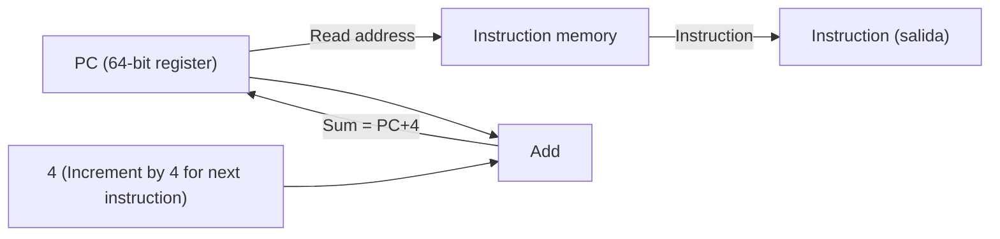
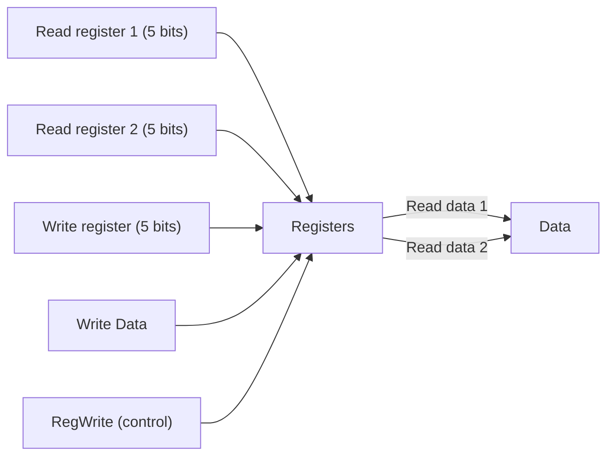
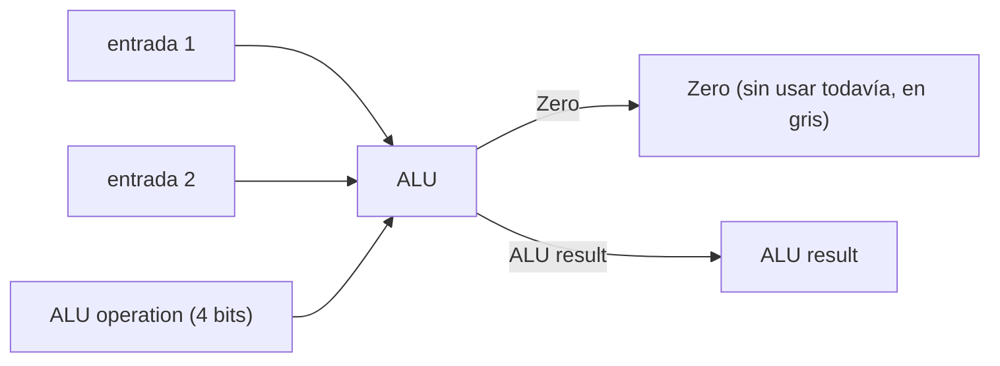
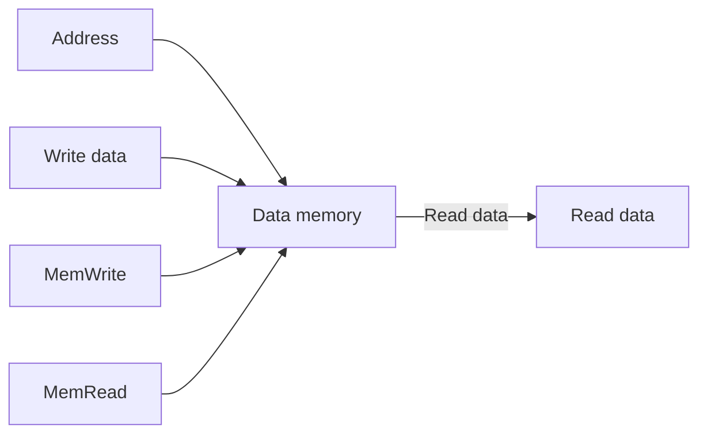
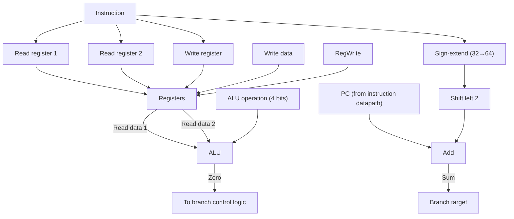
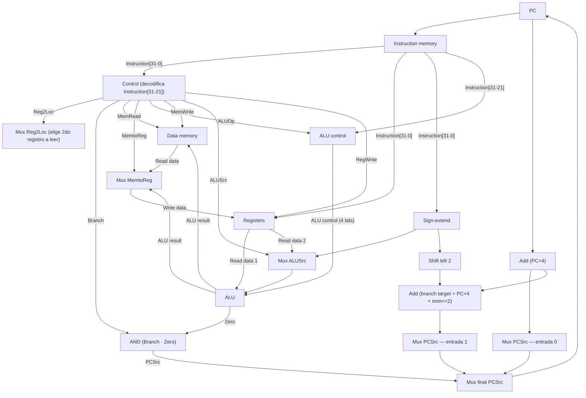
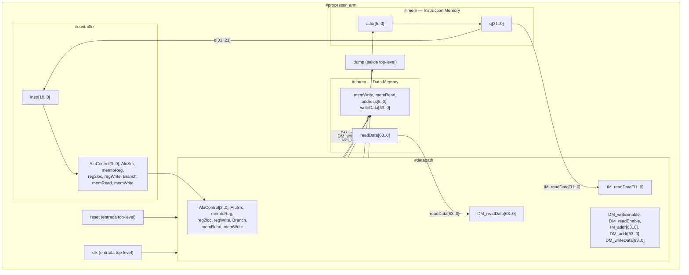
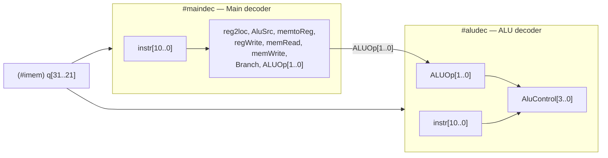
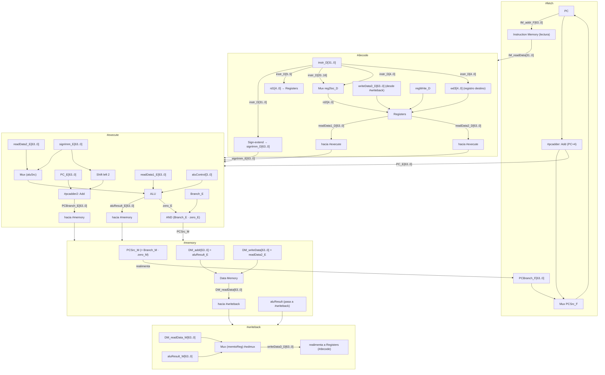

# Ensamblado y desensamblado de LEGv8 + Implementación de la ISA

Arquitectura de Computadoras 2026

---

## Arithmetic Operations

- Three operands: two sources and one destination

```asm
ADD a, b, c    // a gets b + c
```

- C code:

```c
f = (g + h) - (i + j); // f-> X19 g->X20, h->X21
                        // i->X22, j->X23
```

- Compiled LEGv8 code:

```asm
ADD X0,  X20, X21   // X0 = g + h
ADD X1,  X22, X23   // X1 = i + j
SUB X19, X0,  X1    // f = X0 - X1
```

---

## LEGv8 R-format Instructions

| opcode | Rm | shamt | Rn | Rd |
|---|---|---|---|---|
| 11 bits | 5 bits | 6 bits | 5 bits | 5 bits |

- Instruction fields
  - **opcode**: operation code
  - **Rm**: the second register source operand
  - **shamt**: shift amount (00000 for now)
  - **Rn**: the first register source operand
  - **Rd**: the register destination

---

## R-format Example

```asm
ADD X9, X20, X21
```

| opcode | Rm | shamt | Rn | Rd |
|---|---|---|---|---|
| 1112 (dec) | 21 (dec) | 0 (dec) | 20 (dec) | 9 (dec) |
| 10001011000 (bin) | 10101 (bin) | 000000 (bin) | 10100 (bin) | 01001 (bin) |

Palabra completa en binario:

```
1000 1011 0001 0101 0000 0010 1000 1001 (two)
```

= `8B150289` (hex, subíndice 16)

---

## Memory Operands

- Load values from memory into registers
- Store result from register to memory
- Memory is byte addressed

- C code: (elementos de A = DobleWord)

```c
A[12] = h + A[8]; // h->X21, base address of A->X22
```

- Compiled LEGv8 code:

```asm
LDUR X9, [X22,#64]   // Index 8 requires offset of 64
ADD  X9, X21, X9
STUR X9, [X22,#96]
```

---

## LEGv8 D-format Instructions

| opcode | address | op2 | Rn | Rt |
|---|---|---|---|---|
| 11 bits | 9 bits | 2 bits | 5 bits | 5 bits |

- Load/store instructions
  - **Rn**: base register
  - **address**: constant offset from contents of base register (-256 to 255)
  - **Rt**: destination (load) or source (store) register number
  - **op2** = "00"

---

## Branch CBZ

Branch to a labeled instruction if a **condition** is true. Otherwise, continue sequentially:

- `CBZ register, L1`
  `if (register == 0) branch to instruction labeled L1;`

| opcode | address | Rt |
|---|---|---|
| 8 bits | 19 bits | 5 bits |

"address" (n° instructions) is PC-relative:

```
New_PC = Current_PC + ("address" * 4)
```

---

## Building a Datapath

**Datapath**

- Elements that process data and addresses in the CPU
  Registers, ALUs, mux's, memories…
- We will build a LEGv8 datapath incrementally
  Refining the overview design

---

## Instruction Fetch

Diagrama del camino de fetch de instrucción:



Descripción: el PC es un registro de 64 bits que alimenta la entrada "Read address" de la memoria de instrucciones, la cual devuelve la "Instruction" leída. En paralelo, el PC entra a un sumador ("Add") junto con la constante 4, y el resultado (PC+4) vuelve a realimentar al PC (para la siguiente instrucción, asumiendo que no hay salto).

---

## R-Format Instructions

- Read two register operands
- Perform arithmetic/logical operation
- Write register result

**a. Registers**



**b. ALU**



Descripción: el banco de registros tiene 2 puertos de lectura (Read register 1, Read register 2, ambos de 5 bits que indexan entre 32 registros) y 1 puerto de escritura (Write register + Write Data), habilitado por la señal de control `RegWrite`. Devuelve "Read data 1" y "Read data 2". La ALU toma 2 datos de entrada más una señal de control de 4 bits ("ALU operation") y devuelve el resultado ("ALU result") y una bandera "Zero" (en esta diapositiva todavía no se usa, aparece atenuada).

---

## Load/Store Instructions (64 bits)

- Read register operands
- Calculate address using 9-bit offset (use ALU)
- Load: Read memory and update register
- Store: Write register value to memory

**a. Data memory unit**



**b. Sign extension unit**


Descripción: la memoria de datos tiene una entrada de dirección ("Address"), una entrada de dato a escribir ("Write data"), señales de control `MemWrite` y `MemRead`, y una salida de dato leído ("Read data"). La unidad de extensión de signo toma un valor de 32 bits y lo extiende a 64 bits replicando el bit de signo.

---

## Branch Instruction (CBZ)

- Read register operand
- Compare operand
  - Use ALU and check Zero output
- Calculate target address
  - Sign-extend displacement
  - Shift left 2 places (word displacement)
- Add to PC

### Diagrama



Notas de la diapositiva original:
- Callout "Just re-routes wires" sobre el camino PC → Add (el PC que entra a este sumador es simplemente el mismo PC del datapath de instrucción, recableado, no un valor nuevo).
- Callout "Sign-bit wire replicated" sobre la unidad Sign-extend (aclara cómo se extiende el signo).
- La salida `Zero` de la ALU va etiquetada explícitamente "To branch control logic" (todavía no se conecta al PC en esta diapositiva, se deja para más adelante).

---

## ALU Control

- ALU used for:
  - Load/Store: F = add
  - Branch: F = pass input b
  - R-type: F depends on opcode

| opcode | ALUOp | Operation | Opcode field | ALU function | ALU control |
|---|---|---|---|---|---|
| LDUR | 00 | load register | XXXXXXXXXXXXX | add | 0010 |
| STUR | 00 | store register | XXXXXXXXXXXXX | add | 0010 |
| CBZ | 01 | compare and branch on zero | XXXXXXXXXXXXX | pass input b | 0111 |
| R-type | 10 | add | 100000 | add | 0010 |
| R-type | 10 | subtract | 100010 | subtract | 0110 |
| R-type | 10 | AND | 100100 | AND | 0000 |
| R-type | 10 | ORR | 100101 | OR | 0001 |

Nota clave: para `CBZ`, la ALU no resta ni compara — directamente "pasa" (pass) el operando b (el registro a testear), y el chequeo de cero se hace sobre esa salida vía la bandera `Zero`.

---

## Datapath With Control

Datapath monociclo completo, con la unidad de control agregada. Es el datapath de las diapositivas anteriores (fetch + R-format + load/store + branch) unificado, más el bloque de "Control".



Descripción de las señales de control (en celeste en el original): `Reg2Loc`, `Branch`, `MemRead`, `MemtoReg`, `ALUOp`, `MemWrite`, `ALUSrc`, `RegWrite`. Todas salen del bloque "Control" y viajan hacia los distintos multiplexores/unidades del datapath (mismo patrón que en las diapositivas anteriores). El camino de PC final es un mux de 2 entradas: PC+4 (secuencial) o el target del branch (PC+4 + inmediato extendido y desplazado 2 bits), seleccionado por la salida del AND entre `Branch` y `Zero` (la bandera Zero de la ALU).

---

## Setting of the control lines

| Instruction | Reg2Loc | ALUSrc | MemtoReg | RegWrite | MemRead | MemWrite | Branch | ALUOp1 | ALUOp0 |
|---|---|---|---|---|---|---|---|---|---|
| R-format | 0 | 0 | 0 | 1 | 0 | 0 | 0 | 1 | 0 |
| LDUR | X | 1 | 1 | 1 | 1 | 0 | 0 | 0 | 0 |
| STUR | 1 | 1 | X | 0 | 0 | 1 | 0 | 0 | 0 |
| CBZ | 1 | 0 | X | 0 | 0 | 0 | 1 | 0 | 1 |

---

## R-Type Instruction

Mismo diagrama "Datapath With Control" de arriba, pero con el camino de la instrucción R-type resaltado en color (registro fuente 1 y 2 → ALU → resultado → escritura en el banco de registros vía Mux MemtoReg=0). El camino hacia memoria de datos y el camino de branch quedan atenuados/en gris, porque no se usan para este tipo de instrucción.

---

## Load Instruction

Mismo diagrama, con el camino de LDUR resaltado: Rn (registro base) y el inmediato con signo extendido (vía Mux ALUSrc=1) entran a la ALU para calcular la dirección; el resultado de la ALU se usa como dirección de la memoria de datos (`MemRead=1`); el dato leído de memoria (no el de la ALU) se selecciona en el Mux MemtoReg=1 y se escribe en el registro destino Rt. El camino de branch queda atenuado/en gris.

---

## CBZ Instruction

Mismo diagrama, con el camino de CBZ resaltado: se lee un único registro operando (Reg2Loc=1 para tomar el campo Rt/Rn correspondiente), pasa por la ALU (que solo "pasa" el valor, ALU control 0111) para generar la bandera `Zero`; `Zero` junto con `Branch=1` habilitan (vía el AND) el Mux final de PC para tomar el target de salto (PC+4 + inmediato extendido y desplazado 2 bits) en lugar de PC+4. El camino de memoria de datos y el de escritura en registros quedan atenuados/en gris (no se escribe registro ni se accede a memoria de datos en un CBZ).

---

## Processor_arm

Diagrama de bloques de más alto nivel del procesador implementado en SystemVerilog (`#processor_arm`), integrando 3 sub-módulos: `#controller`, `#datapath`, `#imem` (Instruction Memory) y `#dmem` (Data Memory).



Descripción: el módulo `#controller` recibe `instr[10..0]` (que viene de `q[31..21]` de la memoria de instrucciones) y produce todas las señales de control (`AluControl[3..0]`, `AluSrc`, `memtoReg`, `reg2loc`, `regWrite`, `Branch`, `memRead`, `memWrite`), que bajan al `#datapath`. El `#datapath` además recibe `IM_readData[31..0]` (instrucción completa desde `#imem`) y `DM_readData[63..0]` (dato leído desde `#dmem`), y genera `DM_writeEnable`, `DM_readEnable`, `IM_addr[63..0]`, `DM_addr[63..0]` y `DM_writeData[63..0]`. `#imem` y `#dmem` son las memorias de instrucciones y datos, con sus puertos de dirección/dato/control típicos, más `clk` y (en `#dmem`) `dump` para volcar contenido.

---

## Controller

Detalle interno de `#controller`: dos sub-decodificadores, `Main decoder` y `ALU decoder`.



Descripción: el `Main decoder` toma `instr[10..0]` (el opcode) y produce directamente las señales de control simples (`reg2loc`, `AluSrc`, `memtoReg`, `regWrite`, `memRead`, `memWrite`, `Branch`) más `ALUOp[1..0]`, que no define directamente la operación de la ALU sino que alimenta al `ALU decoder`. El `ALU decoder` combina `ALUOp[1..0]` con los bits de instrucción `instr[10..0]` (para diferenciar entre ADD/SUB/AND/ORR dentro del R-type) y produce `AluControl[3..0]`, la señal final que efectivamente controla la operación de la ALU (tabla ya vista en "ALU Control").

---

## Datapath (implementación, con nombres de señal reales)

Datapath de la implementación real en SystemVerilog, con las señales renombradas según la etapa conceptual a la que pertenecen: `#fetch`, `#decode`, `#execute`, `#memory`, `#writeback` (son etiquetas de nomenclatura para preparar el pipeline que se ve más adelante en la materia — en esta diapositiva **sigue siendo un datapath monociclo**, no hay registros de pipeline entre estas zonas).



Descripción de la lógica de nombres de señal (sufijos `_F`, `_D`, `_E`, `_M`, `_W`): indican en qué etapa conceptual "vive" la señal (Fetch, Decode, Execute, Memory, Writeback), aunque en este diagrama monociclo todas ocurren en el mismo ciclo de reloj — es la misma convención de nombres que después se va a usar para el datapath **pipelined**.

Elementos clave:
- **`#fetch`**: PC, sumador `#pcadder` (PC+4), mux `PCSrc_F` que elige entre PC+4 y `PCBranch_F` (viene de `#memory`).
- **`#decode`**: separa los campos de la instrucción (`instr_D[9..5]` = Rn, mux `reg2loc_D` entre `instr_D[20..16]` (Rm) e `instr_D[4..0]` (Rt/Rd) para el segundo registro a leer, y `instr_D[4..0]` también como registro destino `wd3`), banco de Registros (`readData1_D`, `readData2_D`), y unidad `Sign-extend` (`signImm_D`).
- **`#execute`**: mux `aluSrc` elige el 2do operando de la ALU entre `readData2_E` y `signImm_E`; ALU produce `aluResult_E` y `zero_E`; un segundo sumador `#pcadder2` calcula `PCBranch_E = PC_E + (signImm_E << 2)`; un AND entre `Branch_E` y `zero_E` decide si el salto se toma.
- **`#memory`**: acceso a memoria de datos (`DM_addr`, `DM_writeData`, `DM_readData`), y la señal `PCSrc_M` (resultado del AND de branch) se realimenta hacia el mux de `#fetch`.
- **`#writeback`**: mux `memtoReg` (`#wdmux`) elige entre el dato leído de memoria y el resultado de la ALU, y lo devuelve como `writeData3_D` al banco de registros en `#decode`.
