# Introducción a SystemVerilog

*Arquitectura de Computadoras 2026*

> Transcripción fiel del PDF `intro_systemverilog.pdf` (53 páginas / diapositivas). Cada sección corresponde a una diapositiva del deck, indicada con el número de página original.

---

## Diapositiva 1 — Introducción a SystemVerilog

**Introducción a SystemVerilog**

Arquitectura de Computadoras 2026

*(Diapositiva de portada, sin más contenido.)*

---

## Diapositiva 2 — De HDL a compuertas

### Simulación

- Se aplican entradas al circuito.
- Se verifican las salidas para comprobar su corrección.
- Se ahorran millones de dólares depurando en simulación en lugar de en hardware.

### Síntesis

- Transforma el código HDL en una *netlist* que describe el hardware (es decir, una lista de compuertas y los cables que las conectan).
- El sintetizador lógico puede realizar optimizaciones para reducir la cantidad de hardware requerido.

---

## Diapositiva 3 — Módulos en SystemVerilog

**Dos tipos de módulos:**

- Comportamental (*behavioral*): describe qué hace un módulo.
- Estructural (*structural*): describe cómo está construido a partir de módulos más simples.

Diagrama: un módulo genérico llamado "Verilog Module" con tres entradas (a, b, c) a la izquierda y una salida (y) a la derecha.

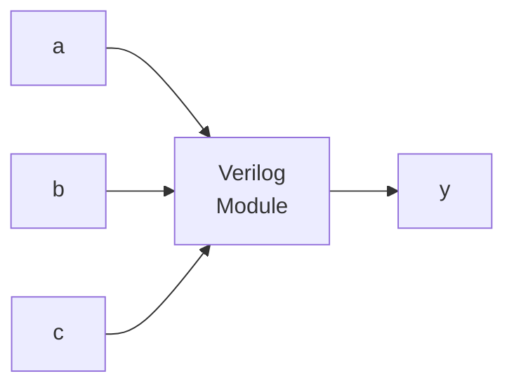

*Descripción:* caja rectangular etiquetada "Verilog Module" con tres líneas de entrada rotuladas `a`, `b`, `c` entrando por el lado izquierdo, y una línea de salida rotulada `y` saliendo por el lado derecho.

---

## Diapositiva 4 — SystemVerilog Comportamental

**Modelado comportamental:** describir un módulo en términos de las relaciones entre entradas y salidas.

- `module`/`endmodule`: requeridos para comenzar/terminar un módulo.
- El módulo comienza con el nombre (`example`) y un listado de las entradas/salidas.
- Las señales `logic`, como las entradas y salidas, son variables booleanas (0 ó 1). También pueden tener valores flotantes (z) e indefinidos (x).
- La sentencia `assign` describe lógica combinacional.

```systemverilog
// Boolean function y = a'b'c'+ ab'c'+ ab'c
module example(input  logic a, b, c,
                output logic y);
  assign y = ~a & ~b & ~c | a & ~b & ~c | a & ~b & c;
endmodule
```

---

## Diapositiva 5 — Síntesis de HDL

```systemverilog
// Boolean function y = a'b'c'+ ab'c'+ ab'c
module example(input  logic a, b, c,
                output logic y);
  assign y = ~a & ~b & ~c | a & ~b & ~c | a & ~b &  c;
endmodule
```

Diagrama: netlist a nivel de compuertas resultante de sintetizar el código anterior.

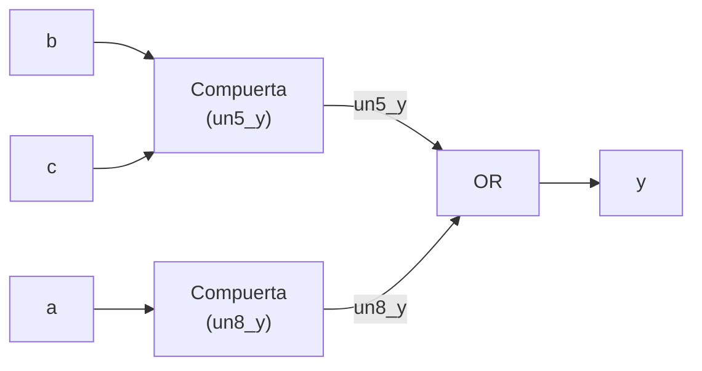

*Descripción:* el circuito tiene tres entradas primarias `a`, `b`, `c` y una salida primaria `y`. Las señales `b` y `c` entran a una primera compuerta interna cuya salida se llama `un5_y` (red interna con burbuja/inversión, dibujada como triángulo con círculo en la punta, sugiriendo una compuerta tipo NAND/inversora combinada). La señal `a` entra a una segunda compuerta interna cuya salida se llama `un8_y` (también con burbuja de inversión). Ambas señales intermedias `un5_y` y `un8_y` se conectan a una compuerta OR final, cuya salida es la señal de salida `y`. Este es el resultado de la optimización lógica del sintetizador sobre la expresión booleana `y = a'b'c' + ab'c' + ab'c`.

---

## Diapositiva 6 — Simulación de HDL

```systemverilog
// Boolean function y = a'b'c'+ ab'c'+ ab'c
module example(input  logic a, b, c,
                output logic y);
  assign y = ~a&~b&~c | a&~b&c | a&~b&c;
endmodule
```

Diagrama de forma de onda (waveform), con el tiempo actual marcado en "Now: 800 ns" y un eje temporal de 0 ns a 800 ns (marcas cada 160 ns: 0, 160, 320, 480, 640, 800):

```
Now: 800 ns
        0ns    160    320    480    640    800
a  (0)  ────────────────────────────────────────
                    ┌──────┐       ┌──────┐
b  (0)  ────────────┘      └───────┘      └──────
              ┌──────┐      ┌──────┐
c  (0)  ──────┘      └──────┘      └────────────
y  (0)  ────────────────────────────────────────
```

*Descripción del waveform:* cuatro señales digitales `a`, `b`, `c`, `y`, todas mostrando valor `0` en el instante actual (800 ns). La señal `a` se mantiene en 0 durante toda la ventana visible. Las señales `b` y `c` alternan entre 0 y 1 en distintos instantes dentro de la ventana de 0 a 800 ns (formas de onda tipo pulso). La señal `y` se mantiene en 0 en el punto observado.

Tabla de verdad asociada (a la derecha del waveform):

| a | b | c | y |
|---|---|---|---|
| 0 | 0 | 0 | 1 |
| 0 | 0 | 1 | 0 |
| 0 | 1 | 0 | 0 |
| 0 | 1 | 1 | 0 |
| 1 | 0 | 0 | 1 |
| 1 | 0 | 1 | 1 |
| 1 | 1 | 0 | 0 |
| 1 | 1 | 1 | 0 |

---

## Diapositiva 7 — Sintaxis de SystemVerilog

- **Distingue mayúsculas de minúsculas**
  Ejemplo: `reset` y `Reset` no son la misma señal.
- **Los nombres no pueden empezar con números**
  Ejemplo: `2mux` es un nombre inválido.
- **Los espacios en blanco se ignoran**
- **Comentarios:**

```systemverilog
// comentario de una linea
/* comentario
   multilinea */
```

---

## Diapositiva 8 — Operadores de SystemVerilog y precedencia

| Op | Significado |
|---|---|
| `~` | NOT |
| `*`, `/`, `%` | MUL, DIV, MOD |
| `+`, `-` | PLUS, MINUS |
| `<<`, `>>` | Desplazamiento lógico izq./der. |
| `<<<`, `>>>` | Desplazamiento aritmético izq./der. |
| `<`, `<=`, `>`, `>=` | Comparación relativa |
| `==`, `!=` | Comparación de igualdad |
| `&` | AND |
| `^` | XOR |
| `\|` | OR |
| `?:` | Condicional |

*(orden de mayor a menor precedencia)*

---

## Diapositiva 9 — Operadores bit a bit

- Los operadores bit a bit actúan sobre señales de un bit o sobre buses multi-bit.
- `a[3:0]` representa un bus de 4 bits. Los bits, del más significativo al menos significativo, son `a[3]`, `a[2]`, `a[1]` y `a[0]`. El bit menos significativo tiene el número de bit más chico.

```systemverilog
module inv  (input  logic [3:0] a,
             output logic [3:0] y);
    assign y = ~a;
endmodule
```

Diagrama: compuerta inversora (NOT) de 4 bits.

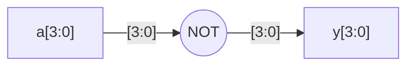

*Descripción:* una compuerta NOT (triángulo con burbuja de inversión en la punta) recibe el bus `a[3:0]` (4 bits, etiquetado `[3:0]`) en su entrada y produce el bus `y[3:0]` en su salida, también de 4 bits, rotulado `y[3:0]` debajo de la compuerta.

---

## Diapositiva 10 — Operadores bit a bit (continuación)

Diagrama: cinco compuertas de dos entradas de 4 bits cada una (una debajo de la otra), correspondientes a `y1`, `y2`, `y3`, `y4`, `y5`.

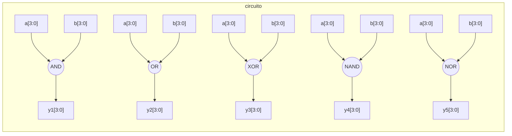

*Descripción:* cinco compuertas independientes de 4 bits de ancho, todas con las mismas entradas `a[3:0]` y `b[3:0]`, produciendo cada una una salida distinta: `y1[3:0]` (AND), `y2[3:0]` (OR), `y3[3:0]` (XOR), `y4[3:0]` (NAND, compuerta AND con burbuja de inversión en la salida) y `y5[3:0]` (NOR, compuerta OR con burbuja de inversión en la salida).

```systemverilog
module gates(input  logic [3:0] a, b,
             output logic [3:0] y1, y2,
                                 y3, y4, y5);
  /* Five different two-input logic
     gates acting on 4 bit busses */
  assign y1 = a & b;   // AND
  assign y2 = a | b;   // OR
  assign y3 = a ^ b;   // XOR
  assign y4 = ~(a & b); // NAND
  assign y5 = ~(a | b); // NOR
endmodule
```

Nota al pie de la diapositiva: *Cada vez que cambian las entradas del lado derecho del `=` en una sentencia de asignación continua, se recalcula la salida del lado izquierdo.*

---

## Diapositiva 11 — Operadores de reducción

- Los operadores de reducción implican una compuerta de múltiples entradas actuando sobre un único bus.

```systemverilog
module and8 (input  logic [7:0] a,
             output logic y);
    assign y = &a;
// &a es mucho mas facil de escribir que
// assign y = a[7]&a[6]&a[5]&a[4]&
//            a[3]&a[2]&a[1]&a[0];
endmodule
```

Diagrama: compuerta AND de reducción de 8 entradas.

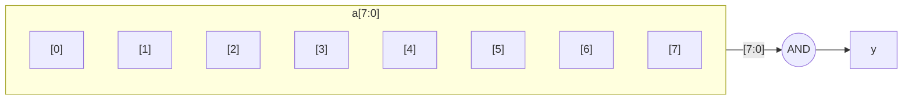

*Descripción:* el bus de entrada `a[7:0]` se dibuja como una columna vertical con los 8 bits individuales indexados de `[0]` a `[7]`, cada uno entrando como una línea separada a una única compuerta AND de 8 entradas, que produce la salida de 1 bit `y`.

---

## Diapositiva 12 — Asignación condicional

- Las asignaciones condicionales seleccionan la salida entre varias alternativas en base a una entrada llamada condición.
- El operador condicional `?:` se llama operador ternario, porque toma tres entradas.

```systemverilog
module mux2(input  logic [3:0] d0, d1,
            input  logic       s,
            output logic [3:0] y);
  assign y = s ? d1 : d0;
endmodule
```

Diagrama: multiplexor 2 a 1 de 4 bits.

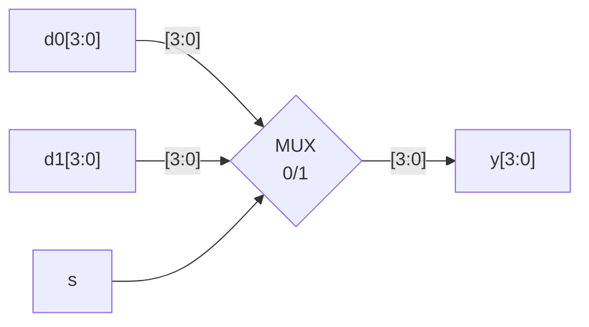

*Descripción:* un multiplexor 2:1 dibujado como un trapecio; recibe `d0[3:0]` en la entrada rotulada `0` y `d1[3:0]` en la entrada rotulada `1`, más la señal de selección `s` que entra por arriba. La salida `y[3:0]` sale por el lado derecho.

---

## Diapositiva 13 — Operadores condicionales anidados

```systemverilog
// 4:1 multiplexer
module mux4 (input  logic [3:0] d0, d1, d2, d3,
             input  logic [1:0] s,
             output logic [3:0] y);

    assign y = s[1] ? (s[0] ? d3 : d2):(s[0] ? d1 : d0);
endmodule
```

*Si `s[1]` es 1, el multiplexor elige la primera expresión, `(s[0] ? d3 : d2)`. Esta expresión a su vez elige entre `d3` o `d2` según `s[0]` (`y = d3` si `s[0]` es 1 y `d2` si `s[0]` es 0). Si `s[1]` es 0, el multiplexor elige similarmente la segunda expresión, que da `d1` o `d0` según `s[0]`.*

---

## Diapositiva 14 — Números

**Formato:** `N'Bvalue`

- `N` = cantidad de bits, `B` = base.
- SystemVerilog soporta `'b` para binario, `'o` para octal, `'d` para decimal y `'h` para hexadecimal.
- `N'B` es opcional pero recomendado (por defecto es decimal).
- `'0` y `'1`: llenan un bus con todos 0s o todos 1s, respectivamente.
- `z`: indica un valor flotante.
- `x`: indica un nivel lógico inválido.

---

## Diapositiva 15 — Números - Ejemplos

| Números | Bits | Base | Val | Almacenado |
|---|---|---|---|---|
| `3'b101` | 3 | 2 | 5 | 101 |
| `'b11` | ? | 2 | 3 | 000 … 0011 |
| `8'b11` | 8 | 2 | 3 | 00000011 |
| `8'b1010_1011` | 8 | 2 | 171 | 10101011 |
| `3'd6` | 3 | 10 | 6 | 110 |
| `6'o42` | 6 | 8 | 34 | 100010 |
| `8'hAB` | 8 | 16 | 171 | 10101011 |
| `42` | ? | 10 | 42 | 00 … 0101010 |

---

## Diapositiva 16 — Manipulación de bits - Ejemplo

```systemverilog
    assign y = {a[2:1], {3{b[0]}}, a[0], 6'b100_010};
// si y es una señal de 12 bits, la sentencia anterior produce:
    y = a[2] a[1] b[0] b[0] b[0] a[0] 1 0 0 0 1 0

// los guiones bajos (_) se usan solo para formatear y
// facilitar la lectura. SystemVerilog los ignora.
```

- El operador `{}` se usa para concatenar buses.
- `{3{b[0]}}` indica tres copias de `b[0]`.
- Si `y` fuera más ancho que 12 bits, se colocarían ceros en los bits más significativos.

---

## Diapositiva 17 — Módulos SV - tipo Comportamental vs Estructural

```systemverilog
// exampleB
module exampleB
    (input  logic a, b, sel,
     output logic f);
    logic c, d;
    assign c = a & (~sel);
    assign d = b & sel;
    assign f = c | d;
endmodule
```

```systemverilog
// exampleS
module exampleS(input  logic a, b, sel,
                 output logic f);
    logic c, d, not_sel;
    not gate0(not_sel, sel);
    and gate1(c, a, not_sel);
    and gate2(d, b, sel);
    or  gate3(f, c, d);
endmodule
```

Diagrama izquierdo (`exampleB`): circuito con entradas `a`, `b`, `sel`; una compuerta AND combina `a` con `~sel` produciendo `c`; otra compuerta AND combina `b` con `sel` produciendo `d`; una compuerta OR combina `c` y `d` produciendo `f`.

Diagrama derecho (`exampleS`): mismo circuito, pero con las compuertas explícitamente instanciadas y nombradas: `gate1` (AND, produce `c` a partir de `a` y `not_sel`), `gate2` (AND, produce `d` a partir de `b` y `sel`), `gate3` (OR, produce `f` a partir de `c` y `d`), además de una compuerta NOT (`gate0`, no rotulada explícitamente en el dibujo) que produce `not_sel` a partir de `sel`.

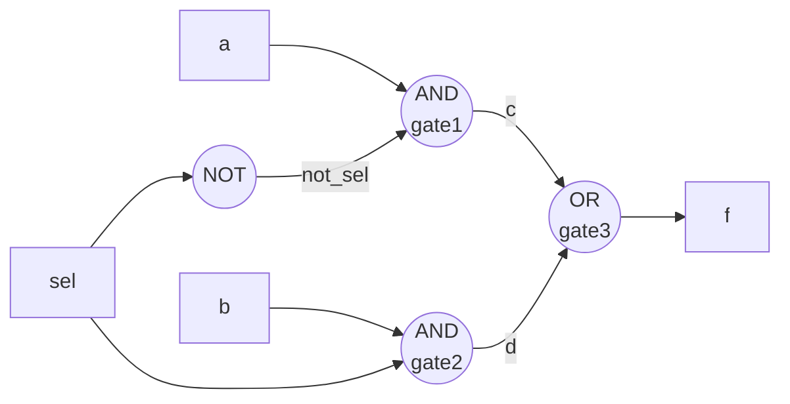

---

## Diapositiva 18 — Modelado Estructural - Jerarquía y variables internas

Describir un módulo en términos de cómo está compuesto por módulos más simples.

```systemverilog
module mux2(input  logic [3:0] d0,
    d21,
            input  logic       s2,
            output logic [3:0] y2);
  assign y2 = s2 ? d21 : d20;
endmodule
```

*(Nota: en la diapositiva el encabezado del módulo `mux2` aparece partido en dos líneas por el salto de línea de la diapositiva; el listado de puertos es `d0`, `d21` en la primera línea (correspondiendo conceptualmente a `d20`, `d21`), seguido de `s2` y `y2`.)*

```systemverilog
/* Assemble a 4:1 multiplexer from
   three 2:1 multiplexers */

module mux4(input  logic [3:0] d0, d1, d2, d3,
            input  logic [1:0] s,
            output logic [3:0] y);
  logic [3:0] low, high;  // internal variables
  mux2 lowmux(d0, d1, s[0], low);    // instance
                                      // of mux2
  mux2 highmux(d2, d3, s[0], high);  // instance
                                      // of mux2
  mux2 finalmux(low, high, s[1], y);// instance
                                      // of mux2
endmodule
```

Diagrama: jerarquía de tres instancias de `mux2` formando un `mux4`.

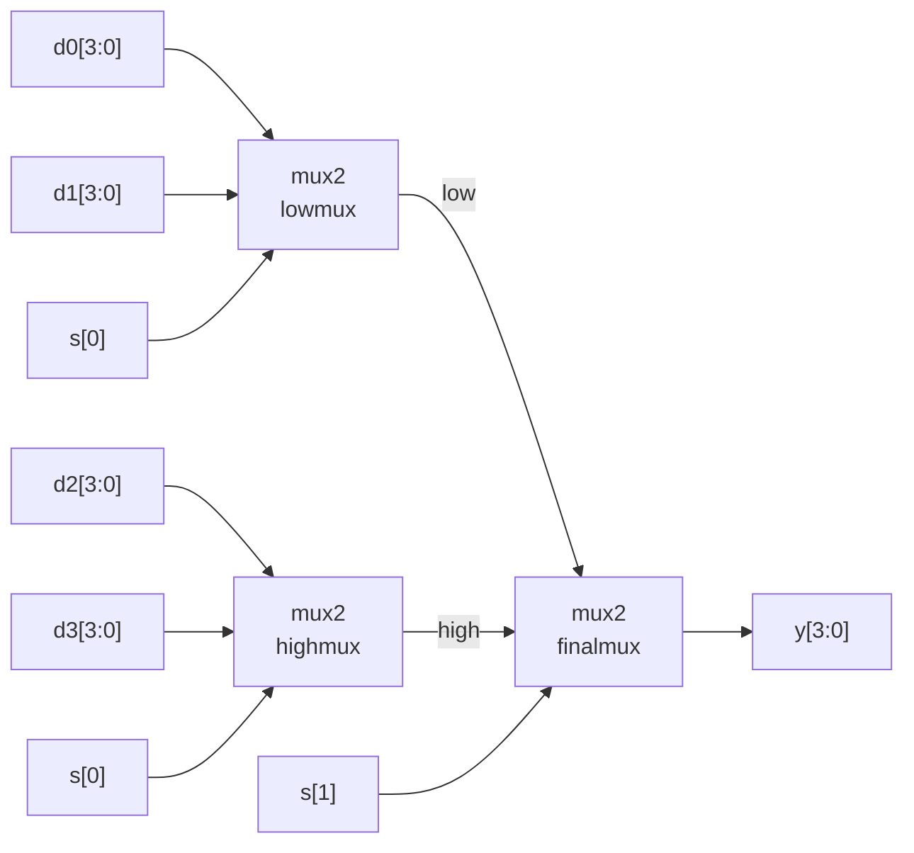

*Descripción:* dos instancias de `mux2` (`lowmux` y `highmux`) en paralelo seleccionan, respectivamente, entre `d0`/`d1` y entre `d2`/`d3`, ambas usando `s[0]` como selector, produciendo las señales internas `low` y `high`. Una tercera instancia (`finalmux`) selecciona entre `low` y `high` usando `s[1]` como selector, produciendo la salida final `y`.

---

## Diapositiva 19 — Modelado Estructural - Jerarquía y variables internas (conexión por nombre)

```systemverilog
module mux2(input  logic [3:0] d0,
    d21,
            input  logic       s2,
            output logic [3:0] y2);
  assign y2 = s2 ? d21 : d20;
endmodule
```

```systemverilog
module mux4(input  logic [3:0] d0, d1, d2, d3,
            input  logic [1:0] s,
            output logic [3:0] y);
  logic [3:0] low, high;  // internal variables
  mux2 lowmux(.d20(d0), .d21(d1), .s2(s[0]), .y2(
    low));
  mux2 highmux(.s2(s[0]), .y2(high), .d20(d2), .
    d21(d3));
  mux2 finalmux(.y2(y), .d20(low), .y2(high), .
    s2(s[1]));
endmodule
```

*Nota de transcripción:* esta diapositiva muestra la misma jerarquía que la anterior, pero usando **conexión de puertos por nombre** (`.puerto(señal)`) en lugar de por posición. El diagrama de bloques es idéntico al de la diapositiva 18 (tres instancias de `mux2`: `lowmux`, `highmux` y `finalmux`, con las mismas conexiones lógicas: `lowmux` y `highmux` en paralelo alimentando a `finalmux`).


---

## Diapositiva 20 — Accediendo a partes de buses

```systemverilog
/* Assemble an 8-bit wide 2:1 multiplexer
   using two 4-bit 2:1 multiplexers */

module mux2_8(input  logic [7:0] d0, d1,
              input  logic       s,
              output logic [7:0] y);

    mux2 lsbmux(d0[3:0], d1[3:0], s, y[3:0]);
    mux2 msbmux(d0[7:4], d1[7:4], s, y[7:4]);
endmodule
```

Diagrama: dos instancias de `mux2` (`lsbmux` y `msbmux`) accediendo a partes (nibbles) de los buses de 8 bits `d0` y `d1`.

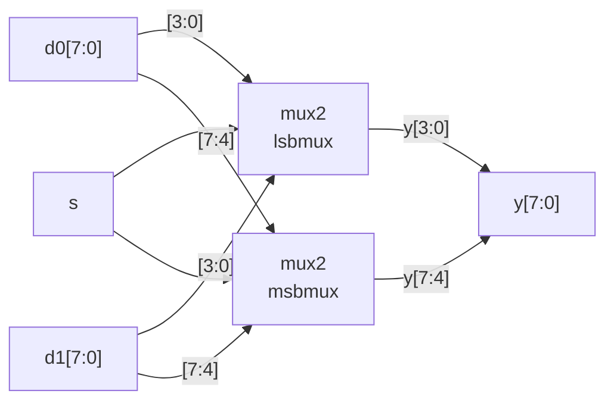

*Descripción:* `lsbmux` toma los 4 bits menos significativos de `d0` y `d1` (`d0[3:0]`, `d1[3:0]`) y la señal de selección `s`, produciendo `y[3:0]`. `msbmux` toma los 4 bits más significativos (`d0[7:4]`, `d1[7:4]`) y la misma señal `s`, produciendo `y[7:4]`. Juntas ambas instancias forman la salida completa de 8 bits `y[7:0]`.


---

## Diapositiva 21 — Bloque procedural *always*

En SystemVerilog, en las sentencias `always` las señales mantienen su valor anterior hasta que ocurre un evento en la lista de sensibilidad que causa explícitamente su cambio.

**Estructura general:**

```systemverilog
always @(sensitivity list)
    statement;
```

Cada vez que ocurre el evento en `sensitivity list`, se ejecuta `statement`.

---

## Diapositiva 22 — *always* - Lógica Combinacional

Para representar **lógica combinacional** con un bloque procedural `always` de propósito general:

- La palabra clave `always` debe ir seguida de un control de evento (el símbolo `@`).
- La lista de sensibilidad del control de evento no puede contener calificadores `posedge` o `negedge`.
- La lista de sensibilidad debe incluir todas las entradas del bloque procedural.
- El bloque procedural no puede contener otros controles de evento.
- Todas las variables escritas por el bloque procedural deben actualizarse para todas las condiciones de entrada posibles.
- Ninguna variable escrita por el bloque procedural puede ser escrita por otro bloque procedural.

---

## Diapositiva 23 — Bloque procedural *always* especializado

**`always_comb`, `always_latch` y `always_ff`** indican la intención de diseño.

- Con `always_comb` no es necesario especificar una lista de sensibilidad, porque las herramientas de software saben que la intención es representar lógica combinacional. Esta lista de sensibilidad inferida incluye toda señal leída por el bloque procedural.
- Un bloque procedural `always_comb` se dispara automáticamente una vez en el instante de simulación cero.
- Si el contenido de un bloque procedural especializado no cumple las reglas de ese tipo de lógica, las herramientas de software pueden emitir mensajes de advertencia.

---

## Diapositiva 24 — Lógica Combinacional - *always_comb*

```systemverilog
module gates(input  logic [3:0] a, b,
             output logic [3:0] y1, y2, y3, y4, y5);
   always_comb     // need begin/end because there is
      begin          // more than one statement in always
      y1 = a & b;  // AND
      y2 = a | b;  // OR
      y3 = a ^ b;  // XOR
      y4 = ~(a & b); // NAND
      y5 = ~(a | b); // NOR
      end
endmodule
```

---

## Diapositiva 25 — Problema con *always_comb*

Ejemplo en SystemVerilog:

```systemverilog
always_comb
    if (en) y = a;
```

- Las herramientas de software pueden emitir una advertencia indicando que se requeriría un *latch* para realizar la funcionalidad del bloque procedural en hardware.
- La forma correcta de modelar el ejemplo como lógica combinacional sería incluir una rama **else** para que la salida `y` se actualice para **todas las condiciones** de `en`.

---

## Diapositiva 26 — *always* - Lógica Secuencial (con Flip-Flops)

Para representar **lógica secuencial** con un bloque procedural `always` de propósito general:

- La palabra clave `always` debe ir seguida de un control de evento sensible a flanco (el símbolo `@`).
- Todas las señales en la lista de sensibilidad del control de evento deben estar calificadas con `posedge` o `negedge`.
- El bloque procedural no puede contener otros controles de evento.
- Ninguna variable escrita por el bloque procedural puede ser escrita por otro bloque procedural.

---

## Diapositiva 27 — Lógica Secuencial - *always_ff*

```systemverilog
always_ff @(posedge clock, negedge resetN)
    if (!resetN) q <= 0;
    else q <= d;
```

- El bloque procedural `always_ff` requiere que cada señal en la lista de sensibilidad esté calificada con `posedge` o `negedge`. Esto es un requisito de síntesis para la lista de sensibilidad de lógica secuencial.
- Que esta regla sea un requisito sintáctico ayuda a asegurar que los resultados de simulación coincidan con los de síntesis.

---

## Diapositiva 28 — Lógica Secuencial - Registro con reset

**Reset asíncrono:**

Diagrama (miniatura): un registro/flip-flop de n bits, con entrada de datos a la izquierda, una entrada de reset entrando por abajo, y salida a la derecha (dibujo pequeño tipo caja con etiqueta `n` en el bus).

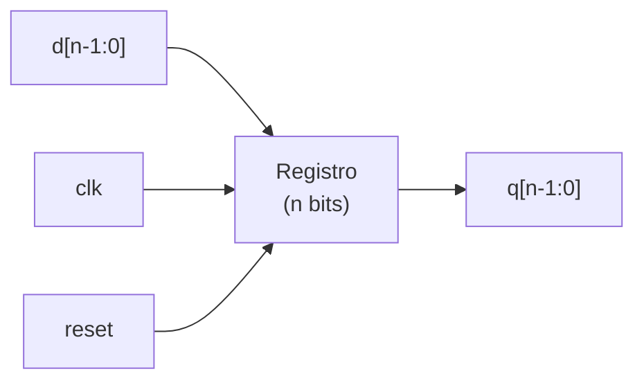

```systemverilog
module flopr(input  logic clk,
             input  logic reset,
             input  logic [3:0] d,
             output logic [3:0] q);
    always_ff @(posedge clk, posedge reset)
        if (reset) q <= 4'b0;
        else q <= d;
endmodule
```

**Reset síncrono:**

```systemverilog
module floprsync(input  logic clk,
                  input  logic reset,
                  input  logic [3:0] d,
                  output logic [3:0] q);
    always_ff @(posedge clk)
        if (reset) q <= 4'b0;
        else q <= d;
endmodule
```

---

## Diapositiva 29 — Lógica Secuencial - Registro con reset y enable

```systemverilog
module flopenr(input logic clk,
               input logic reset,
               input logic en,
               input logic [3:0] d,
               output logic [3:0] q);
    always_ff @(posedge clk, posedge reset)
        if (reset) q <= 4'b0;
        else if (en) q <= d;
endmodule
```

Diagrama: símbolo de registro con entradas `clk`, `d[3:0]`, `en` y `reset`, salida `q[3:0]`.

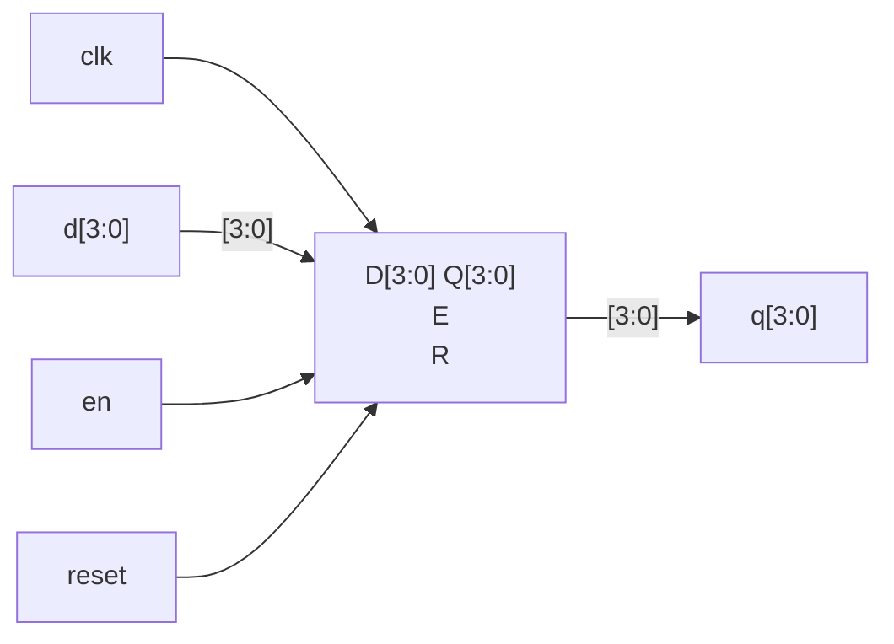

*Descripción:* símbolo de flip-flop/registro con puerto de datos `D[3:0]` (conectado a `d[3:0]`), puerto de enable `E` (conectado a `en`), puerto de reset `R` (conectado a `reset`) y reloj `clk`; la salida `Q[3:0]` se conecta a `q[3:0]`.

---

## Diapositiva 30 — Sentencia *case* - Lógica Combinacional

```systemverilog
module sevenseg(input  logic [3:0] data,
                output logic [6:0] segments);
  always_comb
    case (data)
                      // 654_3210
      0: segments =   7'b111_1110;
      1: segments =   7'b011_0000;
      2: segments =   7'b110_1101;
      3: segments =   7'b111_1001;
      4: segments =   7'b011_0011;
      5: segments =   7'b101_1011;
      6: segments =   7'b101_1111;
      7: segments =   7'b111_0000;
      8: segments =   7'b111_1111;
      9: segments =   7'b111_0011;
      default: segments = 7'b000_0000; // required
    endcase
endmodule
```

Nota lateral: *La sentencia case implica lógica combinacional solo si se describen todas las combinaciones de entrada posibles.*

Diagrama: display de siete segmentos, con la numeración de segmentos indicada sobre la figura: segmento `6` arriba (segmento superior horizontal), `1` arriba a la izquierda, `5` arriba a la derecha, `0` en el medio (segmento horizontal central), `2` abajo a la izquierda, `4` abajo a la derecha, `3` abajo (segmento inferior horizontal).

```
       _6_
      |   |
     1|   |5
      |_0_|
      |   |
     2|   |4
      |_3_|
```

*Descripción del display de 7 segmentos:* la figura es un octógono compuesto por 7 segmentos numerados del 0 al 6, dispuestos como un dígito de reloj digital clásico: segmento 6 = trazo horizontal superior; segmentos 1 y 5 = trazos verticales superiores (izquierdo y derecho); segmento 0 = trazo horizontal central; segmentos 2 y 4 = trazos verticales inferiores (izquierdo y derecho); segmento 3 = trazo horizontal inferior. Esta numeración corresponde al orden de los bits del bus `segments[6:0]` usado en el código (bit orden `654_3210`).

---

## Diapositiva 31 — Sentencia *casez* - Lógica Combinacional

```systemverilog
module priority_casez(input  logic [3:0] a,
                       output logic [3:0] y);
    always_comb
    casez(a)
      4'b1???: y = 4'b1000; // ?=don't care
      4'b01??: y = 4'b0100;
      4'b001?: y = 4'b0010;
      4'b0001: y = 4'b0001;
      default: y = 4'b0000;
    endcase
endmodule
```

Diagrama: red de compuertas que implementa el codificador de prioridad, con el bus de entrada `a[3:0]` en la parte superior izquierda y el bus de salida `y[3:0]` en la parte superior derecha; varias compuertas producen señales intermedias etiquetadas `y23[0]`, `y24[0]` e `y25` que se combinan para formar los bits de `y`.

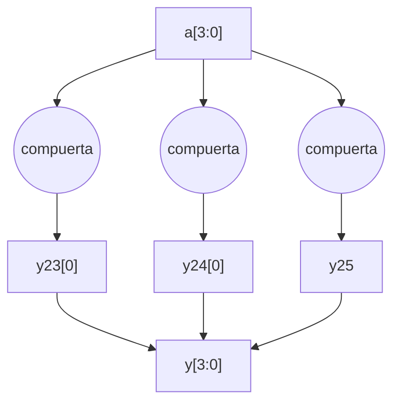

*Descripción:* el bus de 4 bits `a[3:0]` alimenta varias compuertas lógicas (dibujadas apiladas verticalmente, cada una con múltiples entradas tomadas de distintos bits de `a`, algunas con burbujas de inversión) que producen las señales intermedias `y23[0]`, `y24[0]` e `y25`, las cuales en conjunto determinan los bits del bus de salida `y[3:0]`, implementando la lógica de prioridad descrita por la sentencia `casez`.

---

## Diapositiva 32 — Asignaciones dentro de bloques procedurales *always*

`<=` es asignación **no bloqueante**: ocurre simultáneamente con las demás (para lógica secuencial).
`=` es asignación **bloqueante**: ocurre en el orden en que aparece en el archivo (para lógica combinacional).

**Ejemplo correcto (sincronizador bueno):**

```systemverilog
// Good synchronizer using
// nonblocking assignments
module syncgood(input  logic clk,
                input  logic d,
                output logic q);
  logic n1;
  always_ff @(posedge clk)
    begin
      n1 <= d;  // nonblocking
      q  <= n1; // nonblocking
    end
endmodule
```

Diagrama: dos flip-flops en cadena, `d -> [FF] -> n1 -> [FF] -> q`, disparados por `clk`.

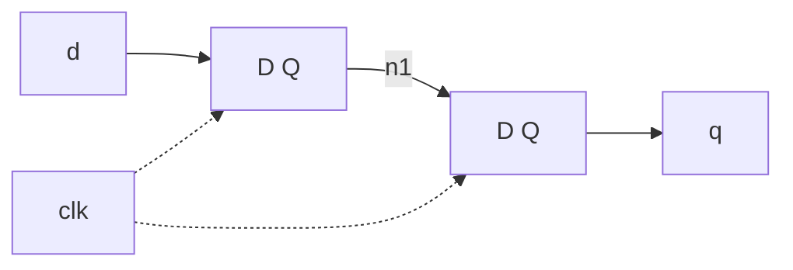

**Ejemplo incorrecto (sincronizador malo):**

```systemverilog
// Bad synchronizer using
// blocking assignments
module syncbad(input  logic clk,
              input  logic d,
              output logic q);
  logic n1;
  always_ff @(posedge clk)
    begin
      n1 = d;  // blocking
      q  = n1; // blocking
    end
endmodule
```

Diagrama: un único flip-flop, con `d` conectado directamente a la entrada `D` y la salida `Q` etiquetada `q`, dado que las asignaciones bloqueantes colapsan ambos registros en la simulación/síntesis en un único elemento (comportamiento no deseado — glitch/discrepancia respecto de la intención de dos etapas).

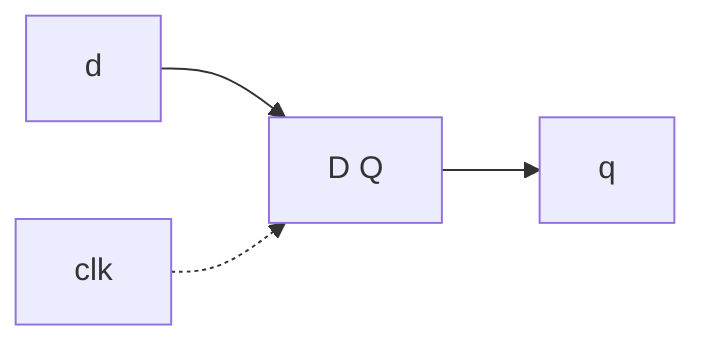

---

## Diapositiva 33 — Módulos parametrizados

**2:1 mux:**

```systemverilog
module mux2
  #(parameter width = 8)  // nombre y valor por defecto
  (input  logic [width-1:0] d0, d1,
   input  logic       s,
   output logic [width-1:0] y);
   assign y = s ? d1 : d0;
endmodule
```

**Instancia con bus de 8 bits (usa el valor por defecto):**

```systemverilog
mux2 myMux(d0, d1, s, out);
```

**Instancia con bus de 12 bits:**

```systemverilog
mux2 #(12) lowmux(d0, d1, s, out);
```

---

## Diapositiva 34 — Arrays desempaquetados

La sintaxis básica de una declaración de array desempaquetado es:

```
<data_type> <element_size> <array_name> <array_dimensions>
```

Por ejemplo:

```systemverilog
logic [7:0] table [3:0]; // array "table"
                          // tiene 4 elementos de 8 bits
```

- Con arrays desempaquetados, cada elemento del array puede almacenarse independientemente de los demás.
- Se usan arrays desempaquetados para modelar arrays donde típicamente se accede a un elemento a la vez, como en RAMs y ROMs.

---

## Diapositiva 35 — Ejemplo de array desempaquetado

```systemverilog
bit [7:0] array4[2:0];
```

Below diagram shows storing unpacked array as a **non-contiguous** set of bits.

```systemverilog
// unpacked array declaration
bit [7:0] array4[2:0];
```

Diagrama: tres filas separadas (no contiguas) de 8 bits cada una, rotuladas `array4[0]`, `array4[1]` y `array4[2]`, cada una con sus bits numerados del 7 (MSB, izquierda) al 0 (LSB, derecha).

```
array4[0]:  [7][6][5][4][3][2][1][0]
array4[1]:  [7][6][5][4][3][2][1][0]
array4[2]:  [7][6][5][4][3][2][1][0]
```

*Descripción:* cada elemento del array desempaquetado (`array4[0]`, `array4[1]`, `array4[2]`) se almacena como un grupo de 8 bits separado e independiente de los demás (no contiguo en memoria), a diferencia de un array empaquetado.

Fuente: verificationguide.com

---

## Diapositiva 36 — Ejemplo de array empaquetado

```systemverilog
bit [2:0] [7:0] array5;
```

The below diagram shows storing packed array as a **contiguous** set of bits.

```systemverilog
// packed array declaration
bit [2:0] [7:0] array5;
```

Diagrama: una única fila contigua de 24 bits, dividida en tres grupos de 8 bits consecutivos, rotulados de derecha a izquierda `array5[0]`, `array5[1]`, `array5[2]`, cada grupo con bits numerados de 7 (izquierda del grupo) a 0 (derecha del grupo).

```
[7..0]        [7..0]        [7..0]
 array5[2]     array5[1]     array5[0]
|<-------------- 24 bits contiguos -------------->|
```

*Descripción:* a diferencia del array desempaquetado, aquí los 24 bits totales forman un único vector contiguo en memoria, subdividido conceptualmente en tres campos de 8 bits (`array5[0]`, `array5[1]`, `array5[2]`).

Fuente: verificationguide.com

---

## Diapositiva 37 — Inicialización de arrays desempaquetados

- Los arrays desempaquetados pueden inicializarse en su declaración, usando una lista de valores encerrada entre llaves `'{` y `}` para cada dimensión del array.
- La asignación requiere conjuntos anidados de llaves que **coincidan exactamente con las dimensiones del array**.

```systemverilog
logic [31:0] ROM [0:5] = '{32'h8b020021,
                            32'h8b000000,
                            32'h8b000000,
                            32'hf8008001,
                            32'h91000461,
                            32'h8b000000};
```

---

## Diapositiva 38 — Ejemplos de inicialización de arrays desempaquetados

```systemverilog
logic [0:7] a1 [0:1023] = '{default:8'h55};
/* Specifying a default value to initialize all the elements,
   or a slice, of an unpacked array*/
```

```systemverilog
logic [3:0] a [0:3];
  a = '{'{0,1,0,1}, '{1,0,0,0}, '{1,1,1,1}, '{0,0,1,0}};
                      // assign a list of values to the full array
  a[3] = 4'h5;        // assign list of values to a slice of the array
  a[1][0] = 1'b1;     // assign to one element
```

```systemverilog
logic a1 [7:0][1023:0]; // unpacked array
logic a2 [8:1][1024:1]; // unpacked array
  a2 = a1;        // copy an entire array
  a2[3] = a1[0];  // copy a slice of an array
```

---

## Diapositiva 39 — Testbenches

Los módulos sintetizables describen el hardware. El testbench contiene código para aplicar entradas a un módulo, verificar si los resultados de salida son correctos, e imprimir las discrepancias entre las salidas esperadas y las reales.

- Módulo HDL que prueba otro módulo, el dispositivo bajo prueba (*dut*)
- No sintetizable
- Tipos:
  - → Simple
  - → Auto-verificable (*self-checking*)
  - → Auto-verificable con vectores de prueba

---

## Diapositiva 40 — Testbenches

- El testbench contiene sentencias para aplicar entradas al **DUT** y, idealmente, para verificar que se produzcan las salidas correctas.
- Los patrones de entrada y salida deseada se llaman **vectores de prueba**.

**Arquitectura de Testbench**

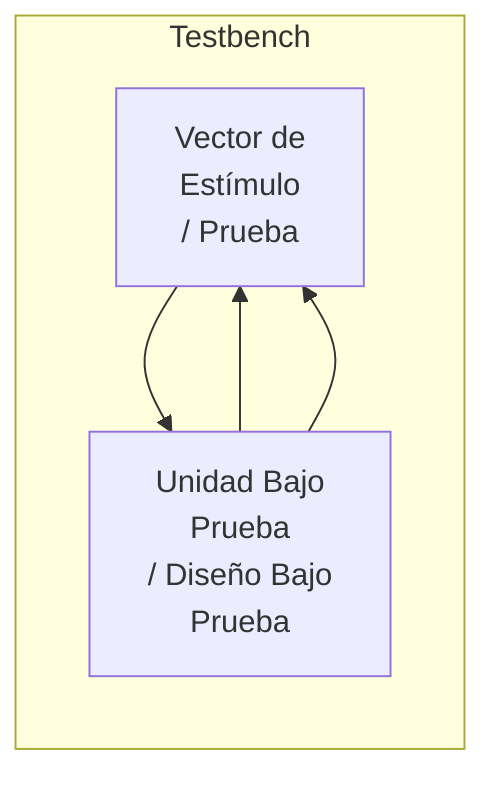

*Descripción:* dos bloques rojos dentro de un recuadro titulado "Arquitectura de Testbench". El bloque izquierdo "Vector de Estímulo / Prueba" envía señales de estímulo hacia la derecha al bloque "Unidad Bajo Prueba / Diseño Bajo Prueba" (una flecha hacia la derecha), y este último responde con señales de salida hacia la izquierda (dos flechas hacia la izquierda), que el bloque de estímulo/prueba compara para verificar corrección.

---

## Diapositiva 41 — Testbench - Ejemplo

Escribir código SystemVerilog para implementar la siguiente función en hardware:

$$y = b'c' + ab'$$

```systemverilog
module sillyfunction(input  logic a, b, c,
                      output logic y);
  assign y = ~b & ~c | a & ~b;
endmodule
```

---

## Diapositiva 42 — Testbench simple

```systemverilog
module testbench1();
  logic a, b, c; // internal variables
  logic y;
  // instantiate device under test:
  sillyfunction dut(a, b, c, y);
  // apply inputs one at a time:
  initial begin
    a = 0; b = 0; c = 0; #10;
    c = 1; #10;
    b = 1; c = 0; #10;
    c = 1; #10;
    a = 1; b = 0; c = 0; #10;
    c = 1; #10;
    b = 1; c = 0; #10;
    c = 1; #10;
  end
endmodule
```

---

## Diapositiva 43 — Testbench - Retardos

- El símbolo `#` se usa para indicar la cantidad de unidades de retardo.
- Unidad de escala de tiempo por defecto en Quartus Prime = 1ps.

```systemverilog
module sillyfunction_tb();
  logic  a, b, c;
  logic  y;
  // instantiate device under test
  sillyfunction dut(a, b, c, y);
  // apply inputs one at a time
  initial begin
    a = 0; b = 0; c = 0; #10;
    c = 1; #10;
    b = 1; c = 0; #10;
  end
endmodule
```

A la derecha se muestra una captura de pantalla de un visor de formas de onda (waveform viewer, estilo ModelSim/Quartus) con varias señales listadas en una columna izquierda (nombres de señal no completamente legibles en la imagen original) y sus trazos digitales correspondientes a lo largo del eje de tiempo, con un cursor vertical amarillo/naranja marcando el instante actual. *(Captura de simulación; el detalle exacto de los valores no es discernible en la resolución de la imagen fuente, pero corresponde a la simulación del testbench `sillyfunction_tb` de esta diapositiva.)*

---

## Diapositiva 44 — Testbench - Retardos

```systemverilog
module sillyfunction_tb();
  logic  a, b, c;
  logic  y;
  // instantiate device under test
  sillyfunction dut(a, b, c, y);
  // apply inputs one at a time
  initial begin
    a = 0; b = 0; c = 0; #10 ns;
    c = 1; #1000;
    b = 1; c = 0; #10 ns;
  end
endmodule
```

A la derecha, otra captura de pantalla del visor de formas de onda, análoga a la de la diapositiva anterior, reflejando la simulación con los nuevos retardos (`#1000` en el medio produce un tramo de señal estable mucho más largo antes del siguiente cambio).

---

## Diapositiva 45 — Testbench - Retardos

`` `timescale 1ns / 10ps``: se le indica a la herramienta de software que use unidades de tiempo de 1 nanosegundo, y una precisión de 10 picosegundos.

```systemverilog
`timescale 1ns / 10ps

module sillyfunction_tb();
  logic  a, b, c;
  logic  y;
  // instantiate device under test
  sillyfunction dut(a, b, c, y);
  // apply inputs one at a time
  initial begin
    a = 0; b = 0; c = 0; #10;
    c = 1; #10;
    b = 1; c = 0; #10;
  end
endmodule
```

A la derecha, otra captura de pantalla del visor de formas de onda mostrando la simulación resultante con la directiva `` `timescale`` aplicada (fondo negro, señales en verde, cursor de tiempo visible).

---

## Diapositiva 46 — Testbench auto-verificable

**Columna izquierda:**

```systemverilog
module testbench2();
  logic  a, b, c;
  logic  y;
  // instantiate dut
  sillyfunction dut(a, b, c, y);

  /* apply inputs and check results
     one at a time */
  initial begin
    a = 0; b = 0; c = 0; #10;
    if (y !== 1) $display("000 failed.");
    c = 1; #10;
    if (y !== 0) $display("001 failed.");
    b = 1; c = 0; #10;
    if (y !== 0) $display("010 failed.");
    c = 1; #10;
    ...
```

**Columna derecha (continuación):**

```systemverilog
    ...
    if (y !== 0) $display("011 failed.");
    a = 1; b = 0; c = 0; #10;
    if (y !== 1) $display("100 failed.");
    c = 1; #10;
    if (y !== 1) $display("101 failed.");
    b = 1; c = 0; #10;
    if (y !== 0) $display("110 failed.");
    c = 1; #10;
```

---

## Diapositiva 47 — Testbench con vectores de prueba (TwT)

**Reloj del testbench:**

- → asignar entradas (en flanco de subida)
- → comparar salidas con las salidas esperadas (en flanco de bajada)

Diagrama de forma de onda del reloj `CLK`, con flechas descendentes que indican los eventos que ocurren en cada flanco:

```
CLK:      ______        ______        ___
         |      |      |      |      |
    _____|      |______|      |______|    ...
          ↓             ↓
     Asignar        Comparar
     Entradas        Salidas con
                      lo Esperado
```

*Descripción:* la señal `CLK` es una onda cuadrada periódica. En cada flanco de **subida** (transición de 0 a 1) se ejecuta la acción "Asignar Entradas". En cada flanco de **bajada** (transición de 1 a 0) se ejecuta la acción "Comparar Salidas con lo Esperado". El patrón se repite indefinidamente (indicado con puntos suspensivos "...").

El reloj del testbench también se usa como reloj para los circuitos secuenciales síncronos.

---

## Diapositiva 48 — TwT 1. Leer vectores de prueba en un Array

```systemverilog
module testbench4();
  logic      clk, reset;
  logic      a, b, c, yexpected;
  logic      y;
  logic [31:0] vectornum, errors; // bookkeeping variables
  logic [3:0]  testvectors [7:0] = '{ 4'b000_1,// array de vectores de prueba
                                       4'b001_0,
                                       4'b010_0,
                                       4'b011_0,
                                       4'b100_1,
                                       4'b101_1,
                                       4'b110_0,
                                       4'b111_0};
...
```

---

## Diapositiva 49 — TwT 2. Generar el reloj

```systemverilog
// instantiate device under test
sillyfunction dut(a, b, c, y);

// generate clock
always      // no sensitivity list, so it always executes
  begin
      clk = 1; #5; clk = 0; #5;
  end

initial      // at start of test pulse reset
  begin
      vectornum = 0; errors = 0; reset = 1; #27;
      reset = 0;
  end
...
```

---

## Diapositiva 50 — TwT 3. Asignar entradas y salidas esperadas

```systemverilog
// apply test vectors on rising edge of clk
always @(posedge clk)
  begin
      #1; {a, b, c, yexpected} = testvectors[vectornum];
  end
...
```

---

## Diapositiva 51 — TwT 4. Comparar con las salidas esperadas

```systemverilog
// check results on falling edge of clk
always @(negedge clk)
  if (~reset) begin // skip during reset
    if (y !== yexpected)
      begin
      $display("Error: inputs = %b", {a, b, c});
      $display("outputs = %b (%b expected)",y,yexpected);
      errors = errors + 1;
      end
  end
...

// Note: to print in hexadecimal, use %h. For example,
//       $display("Error: inputs = %h", {a, b, c});
```

---

## Diapositiva 52 — TwT 4. Comparar con las salidas esperadas (continuación)

```systemverilog
    // increment array index and read next testvector
        vectornum = vectornum + 1;
        if (testvectors[vectornum] === 4'bx)
            begin
            $display("%d tests completed with %d errors",
                      vectornum, errors);
            $finish; // Usar $stop para que no se cierre ModelSim
            end
    end
endmodule

// === and !== can compare values that are 1, 0, x, or z.
```

---

## Diapositiva 53 — Bibliografía

- S. Harris and D. Harris, "Digital Design and Computer Architecture - ARM Edition". Elsevier, 2016.
- S. Sutherland, S. Davidmann, P. Flake and P. Moorby, "SystemVerilog for Design - A Guide to Using SystemVerilog for Hardware Design and Modeling", Second Edition. Springer, 2006.
