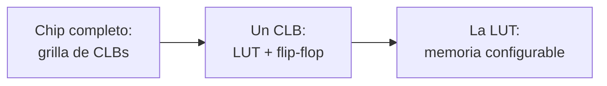
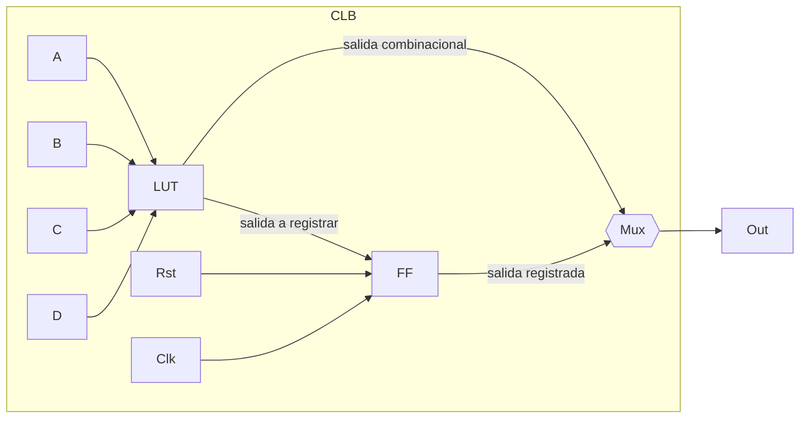
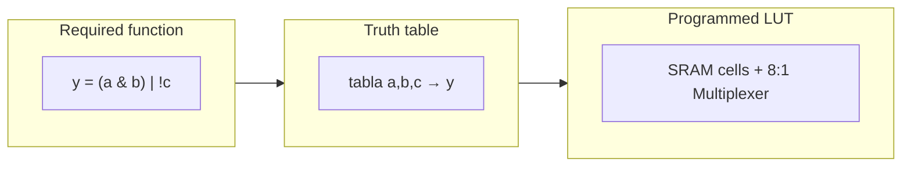
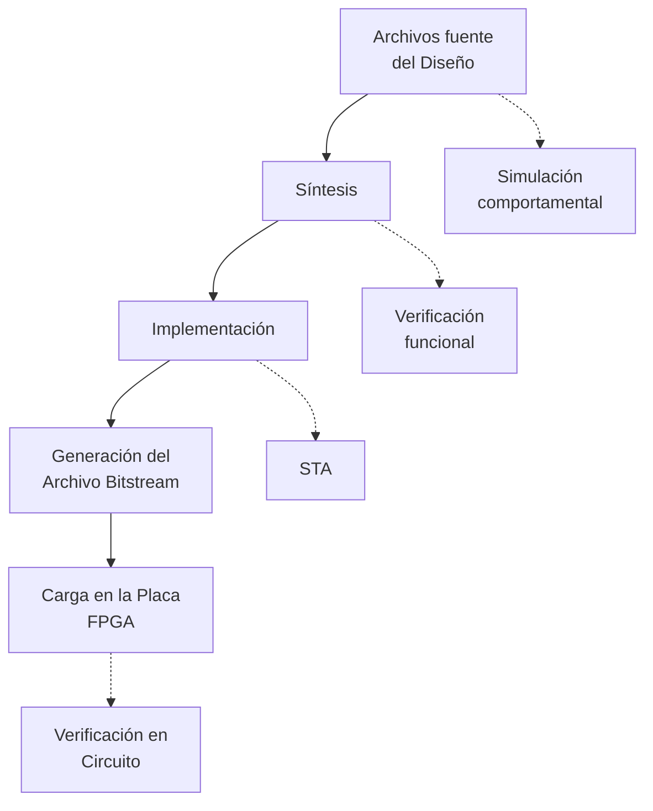

# Arquitectura de Computadoras 2026 — Iniciación a FPGAs, SystemVerilog y Vivado

> Transcripción fiel y exhaustiva del PDF `presentacion_fpga_vivado.pdf` (35 diapositivas). Cada sección corresponde a una diapositiva del original. Los diagramas técnicos se recrean con Mermaid y/o arte ASCII, seguidos siempre de una descripción textual completa de cada elemento para no perder información.

---

## Diapositiva 1 — Portada

**Arquitectura de Computadoras 2026**

Gonzalo Vodanovic

---

## Diapositiva 2 — Bibliografía

- Patterson, D. A., & Hennessy, J. L. *Computer Organization and Design ARM Edition: The Hardware Software Interface.*
- Patterson, D. A., & Hennessy, J. L. *Computer Architecture: A Quantitative Approach.*

**Consulta**

- Patterson, D. A., & Hennessy, J. L. *Computer Organization and Design RISC-V Edition: The Hardware Software Interface.*
- Harris, S., & Harris, D. *Digital Design and Computer Architecture, ARM Edition.*

---

## Diapositiva 3 — Fechas importantes y condiciones

**Fechas**

- Parcial 1: 23/09
- Parcial 2: 23/10
- Recuperatorios: 13/11

**Condiciones**

- **Regularidad**: notas ≥ 4, Lab 1 y Lab 2 aprobados para regularizar (AR)
- **Promoción**: notas ≥ 6, promedio ≥ 7, Lab 1 y Lab 2 aprobados para promocionar (AP)
- **Libre**: ambos labs aprobados en condición AP; se puede presentar durante el cursado o hasta una semana antes de la fecha del final

**Nota**

- Labs aprobados en 2024 o 2025 valen por equivalencia, en la misma condición. Para cambiar de condición hay que rehacer el lab de este año. Labs anteriores no se consideran.

---

## Diapositiva 4 — Comunicación

- Los anuncios importantes se realizarán mediante **Zulip**; además, en esa plataforma podrán hacer consultas en los canales públicos.
- Para cuestiones privadas escribir al correo `adc.famaf.unc@gmail.com` indicando nombre completo y DNI. No se responden mensajes privados en la plataforma Zulip.
- En el **aula virtual** irán encontrando el material de la materia.

---

## Diapositiva 5 — Separador de sección

**Iniciación a FPGAs, SystemVerilog y Vivado**

---

## Diapositiva 6 — CPU vs ASIC vs FPGA

| | CPU | ASIC | FPGA |
|---|---|---|---|
| Hardware | fijo, de propósito general | fijo, diseñado a medida | reconfigurable |
| Se define con | software (instrucciones) | circuito fabricado así | HDL → bitstream |
| ¿Se puede volver a cambiar? | no hace falta (mismo chip ejecuta otro programa) | no, hay que refabricar el chip | sí, las veces que haga falta |
| Uso típico | PCs, notebooks | productos masivos (celulares) | prototipado, bajo volumen, laboratorios |

---

## Diapositiva 7 — Qué es una FPGA

- Field-Programmable Gate Array
- Chip cuya lógica interna se puede reconfigurar después de fabricado
- Formado por una grilla de bloques lógicos configurables (CLBs)
- CLB = LUT (combinacional) + flip-flop D (secuencial)
- Bloques interconectados por una red de *routing* configurable
- El comportamiento completo se define con un **bitstream**

---

## Diapositiva 8 — De la FPGA a la LUT

Diagrama con tres imágenes encadenadas por flechas, que muestran el "zoom" progresivo desde el chip completo hasta la LUT:

**Descripción de cada imagen:**

1. **Chip completo: grilla de CLBs** (imagen izquierda): boceto esquemático de un chip FPGA visto "por dentro", con un anillo circular de bloques lógicos ("Logic Blocks") rodeando el núcleo del chip, y bloques de entrada/salida ("I/O Blocks") en el perímetro exterior. En el centro se ve una grilla de celdas (routing programable) que interconecta todo. Es la misma estructura que se detalla en la Diapositiva 10 ("Estructura interna de la FPGA"), mostrada aquí en miniatura.
2. **Un CLB: LUT + flip-flop** (imagen central): el diagrama de bloque de un CLB individual, idéntico al de la Diapositiva 9 — entradas A, B, C, D hacia una LUT, salida de la LUT hacia un flip-flop (FF), y un multiplexor de salida que elige entre la salida combinacional (LUT) y la registrada (FF), con señales de Reset (Rst) y Clock (Clk) adicionales.
3. **La LUT: memoria configurable** (imagen derecha): esquema que muestra cómo una función booleana requerida se traduce en una tabla de verdad y luego se "programa" en una LUT implementada como memoria SRAM seleccionada por un multiplexor — el mismo diagrama detallado en la Diapositiva 10.

Flechas "→" conectan las tres imágenes en secuencia, indicando el recorrido conceptual: del chip completo, al bloque lógico configurable, a la unidad mínima programable (la LUT).

---

## Diapositiva 9 — El CLB

**Descripción textual completa del diagrama:**

- Un recuadro punteado grande representa el **CLB** completo.
- Cuatro entradas de datos rotuladas **A**, **B**, **C**, **D** ingresan por la izquierda a un bloque rectangular etiquetado **LUT**.
- La salida de la **LUT** se bifurca en dos caminos:
  - Un camino va directo (curva por arriba, "bypass") hacia un elemento triangular a la derecha que representa un **multiplexor/buffer de salida**.
  - El otro camino entra a un bloque rectangular etiquetado **FF** (flip-flop).
- La salida del **FF** también se conecta al multiplexor triangular de salida.
- El multiplexor triangular selecciona entre la salida combinacional directa de la LUT y la salida registrada del FF, y produce la salida final **Out** (flecha hacia la derecha, fuera del recuadro del CLB).
- Dos señales adicionales, **Rst** (reset) y **Clk** (clock), entran desde la parte inferior izquierda del recuadro y se conectan al bloque **FF** (controlan su reinicio y su temporización).
- Todo el conjunto (LUT, FF, mux de salida, y el ruteo de Rst/Clk) está encerrado en el rectángulo punteado etiquetado **CLB** en la parte superior.

---

## Diapositiva 10 — La LUT

- LUT de *N* entradas = SRAM de 2^N palabras de 1 bit
- Multiplexor 2^N:1 selecciona la salida
- Ejemplo del CLB: 4 entradas → SRAM 16 palabras, mux 16:1

**Diagrama: de la función requerida a la LUT programada** (tres paneles conectados por flechas "⇒"):

**Panel 1 — "Required function" (función requerida):** un pequeño circuito lógico con dos entradas **a** y **b** hacia una compuerta **AND** (símbolo "&"), y una entrada **c** que pasa por un inversor (círculo pequeño, NOT) antes de entrar a una compuerta **OR**; la salida de la AND también entra a la OR. La salida final es **y**. Debajo se indica la ecuación booleana: **y = (a & b) | !c**.

**Panel 2 — "Truth table" (tabla de verdad):** tabla de verdad de 3 entradas (a, b, c) con 8 filas, calculada a partir de la fórmula y = (a & b) | !c:

| a | b | c | y |
|---|---|---|---|
| 0 | 0 | 0 | 1 |
| 0 | 0 | 1 | 0 |
| 0 | 1 | 0 | 1 |
| 0 | 1 | 1 | 0 |
| 1 | 0 | 0 | 1 |
| 1 | 0 | 1 | 0 |
| 1 | 1 | 0 | 1 |
| 1 | 1 | 1 | 1 |

**Panel 3 — "Programmed LUT" (LUT programada):** un bloque etiquetado **SRAM cells** con 8 celdas de memoria apiladas verticalmente, cada una rotulada con su dirección binaria de 3 bits (000 a 111) y el valor almacenado (que coincide exactamente con la columna **y** de la tabla de verdad: 1,0,1,0,1,0,1,1). Estas 8 celdas SRAM alimentan un **multiplexor 8:1** (dibujado como un trapecio rotulado "8:1 Multiplexer"), cuyas líneas de selección son las entradas **a, b, c** (que llegan desde abajo). La salida del multiplexor es **y**, hacia la derecha. Esto ilustra cómo la LUT es, en esencia, una pequeña memoria (SRAM) programada con la tabla de verdad deseada, y el multiplexor actúa como "lector" que usa las entradas como dirección de memoria.

---

## Diapositiva 11 — Estructura interna de la FPGA

**Descripción del diagrama:** el centro de la imagen muestra una grilla pequeña (cuadrícula) que representa el chip completo, compuesta por múltiples bloques cuadrados repetidos, con pines cuadrados pequeños en el borde superior. Alrededor de esta grilla central hay **tres círculos rojos punteados**, cada uno actuando como una "lupa" (zoom) sobre una zona distinta del chip, unidos a la grilla central por líneas punteadas rojas:

- **Círculo superior izquierdo — "Logic Blocks"**: muestra el detalle interno de un bloque lógico, con componentes internos dibujados esquemáticamente (líneas y compuertas en miniatura) representando la lógica configurable (LUTs, flip-flops, multiplexores) dentro de cada celda de la grilla.
- **Círculo superior derecho — "I/O Blocks"**: muestra el detalle de un bloque de entrada/salida, con componentes en miniatura (buffers, conexiones al pin externo) que conectan la lógica interna del chip con el mundo exterior (pines físicos).
- **Círculo inferior — "Programmable Routing"**: muestra el detalle de la red de ruteo programable, dibujada como una grilla de líneas horizontales y verticales con puntos de conexión en forma de rombo (switches de ruteo) en algunas intersecciones, que permiten conectar dinámicamente las señales entre los distintos bloques lógicos y de I/O.

En conjunto, el diagrama comunica que la FPGA está compuesta por una grilla repetitiva de **bloques lógicos** (Logic Blocks) en el interior, rodeada por **bloques de entrada/salida** (I/O Blocks) en el perímetro, y que todo se interconecta mediante una **red de ruteo programable** (Programmable Routing) que atraviesa el chip en ambas direcciones (filas y columnas).

---

## Diapositiva 12 — En un chip real

- Además de bloques lógicos, incluye recursos dedicados: DSP y memoria (BRAM)
- El routing configurable se arma con switches que conectan los módulos lógicos

**Descripción del diagrama:** una vista más realista/detallada del chip, con varios elementos:

- Arriba a la izquierda, un recuadro etiquetado **"DSP Block"**: muestra el diagrama interno de un bloque DSP (multiplicador, sumador y registros dibujados como sub-bloques conectados), usado para operaciones aritméticas dedicadas (multiplicación/acumulación).
- Arriba a la derecha, un recuadro etiquetado **"Memory Block"**: representa un bloque de memoria dedicada (BRAM), dibujado como una tabla con filas de direcciones y datos (puertos de memoria).
- Debajo de ambos bloques, una zona de **routing** coloreada en franjas verticales azules, verdes y amarillas (representando distintos canales/pistas de interconexión) conecta el DSP Block y el Memory Block con el resto del chip mediante líneas punteadas.
- En la parte inferior de la imagen hay una grilla de celdas cuadradas de color naranja con círculos azules en su interior (representando **switches de ruteo programable**, rotulado **"Programmable Routing Switch"** a la izquierda), y a la derecha de esa grilla, más celdas etiquetadas **"Logic Modules"** (los módulos lógicos/CLBs propiamente dichos).
- Pequeñas flechas verticales debajo de la grilla indican líneas de conexión que bajan desde los switches de ruteo hacia/desde los módulos lógicos.

En conjunto, la imagen ilustra que un chip FPGA real no solo tiene bloques lógicos genéricos (CLBs), sino también **bloques dedicados** (DSP para aritmética, BRAM para memoria) que se conectan a la misma red de routing programable mediante switches configurables.

---

## Diapositiva 13 — Bitstream

- Configuración de bloques e interconexiones
- Cargado en la memoria de configuración del dispositivo
- Generado por herramientas de síntesis y place-and-route (Vivado)
- A partir de una descripción en HDL: VHDL, Verilog, SystemVerilog

---

## Diapositiva 14 — Separador de sección

**Flujo de diseño**

---

## Diapositiva 15 — Flujo de diseño

**Descripción textual completa:** la columna izquierda (en recuadros celestes) muestra el flujo principal de diseño, de arriba hacia abajo, con flechas verticales que conectan cada etapa con la siguiente:

1. **Archivos fuente del Diseño**
2. **Síntesis**
3. **Implementación**
4. **Generación del Archivo Bitstream**
5. **Carga en la Placa FPGA**

A la derecha de cada una de estas etapas (salvo entre Implementación y Generación del Bitstream, donde no hay recuadro asociado), una flecha horizontal amarilla conecta con un recuadro naranja que indica una actividad de verificación asociada a esa etapa:

- **Archivos fuente del Diseño** → **Simulación comportamental**
- **Síntesis** → **Verificación funcional**
- **Implementación** → **STA** (análisis estático de tiempos)
- **Carga en la Placa FPGA** → **Verificación en Circuito**

Esto ilustra que, en cada etapa del flujo de diseño, existe una tarea de verificación específica en paralelo que permite validar el diseño antes de continuar (simulación del HDL, verificación de la netlist sintetizada, análisis de tiempos tras el place-and-route, y verificación física final en la placa).

---

## Diapositiva 16 — Simulación y síntesis

- Simulación comportamental → valida el HDL con un testbench
- Síntesis → HDL a *netlist* de compuertas genéricas
- Verificación funcional (opcional) → simulación post-síntesis

---

## Diapositiva 17 — Implementación y STA

- **Implementación**: mapea la netlist a recursos físicos
  - *Placement*: ubicación de cada elemento en el chip
  - *Routing*: conexión mediante pistas disponibles
- **STA** (análisis estático de tiempos): calcula retardos y verifica la frecuencia máxima

---

## Diapositiva 18 — Bitstream y verificación en circuito

- Generación del bitstream → archivo binario de configuración
- Carga en la placa FPGA
- Verificación en circuito: interruptores y LEDs de la placa

---

## Diapositiva 19 — Separador de sección

**Interfaz gráfica de Vivado**

---

## Diapositiva 20 — Abrir el proyecto

- Bajar el proyecto inicial del repositorio asignado
- Abrir Vivado → **4bits_alu.xpr**

**Descripción de la captura de pantalla:** se muestra la ventana de bienvenida de Vivado ("Vivado ML Edition", con el logo **AMD** en la esquina superior izquierda). La ventana tiene una barra de menú superior estándar (File, Edit, etc., apenas visibles). Debajo se organiza en tres secciones apiladas, cada una con un encabezado de color y contenido:

- **"Quick Start"** (encabezado verde oscuro): incluye las opciones "Create Project", "Open Project" y "Open Example Project". Una flecha verde gruesa, dibujada a mano sobre la captura, señala específicamente la opción **"Open Project"**, indicando que es el botón que hay que usar para abrir el archivo `4bits_alu.xpr`.
- **"Tasks"** (encabezado celeste): incluye opciones como "Manage IP", "Open Hardware Manager" y "Xilinx Tcl Store".
- **"Learning Center"** (encabezado celeste, parcialmente visible en el borde inferior de la imagen): incluye enlaces de documentación y tutoriales.

La instrucción visual es: desde la pantalla de bienvenida de Vivado, hacer clic en **"Open Project"** dentro del panel "Quick Start" para cargar el proyecto `4bits_alu.xpr` descargado del repositorio.

---

## Diapositiva 21 — Las 3 partes de la interfaz

**Descripción de la captura de pantalla:** ventana completa de Vivado (barra de título con la ruta del proyecto y el nombre de la versión de Vivado; barra de menú superior con File, Edit, Flow, Tools, Reports, Window, Layout, Help; barra de herramientas con iconos debajo del menú). La ventana principal está dividida en varias áreas, que corresponden a las "3 partes de la interfaz" mencionadas en el título:

1. **Flow Navigator** (panel angosto a la izquierda): árbol vertical y colapsable con las etapas del flujo de diseño — Project Manager (resaltado, activo), IP Integrator, Simulation, RTL Analysis, Synthesis, Implementation, Program and Debug — cada una con sub-opciones desplegables.
2. **Área de trabajo central**, dividida a su vez en:
   - **Sources** (arriba a la izquierda): árbol jerárquico de archivos del proyecto (Design Sources, Constraints, Simulation Sources), con una lista de módulos/archivos anidados.
   - **Project Summary** (arriba a la derecha): pestañas "Overview" y "Dashboard"; muestra un resumen del proyecto con secciones **Settings** (nombre del proyecto, ubicación, product family, product part, target language, simulator language, target simulator), **Synthesis** (estado, mensajes, estrategia) e **Implementation** (estado, mensajes, estrategia), y una sección **DRC Violations** (violaciones de reglas de diseño).
3. **Panel inferior**: barra de pestañas (Tcl Console, Messages, Log, Reports, Design Runs) con, en este caso, la tabla de **Design Runs** abierta, mostrando columnas con el nombre de cada corrida (run), sus constraints, estrategia, estado, etc.

En conjunto, la imagen enseña que la interfaz de Vivado se organiza en: navegación del flujo (izquierda), fuentes/resumen del proyecto (centro) y consola/estado de las corridas (abajo).

---

## Diapositiva 22 — Etapas de diseño en Vivado

- **RTL Analysis**: Linter, errores de sintaxis
- **Simulación**: comportamental (*Behavioral*)
- **Synthesis**: HDL → circuito
- **Implementación**: mapeo a recursos de la FPGA
- **Program and debug**: genera bitstream, configura el dispositivo

---

## Diapositiva 23 — Jerarquía: `Set as Top`

- Descripción de hardware = proceso jerárquico
- Simulación → `top = alu.sv`
- Síntesis/FPGA → `top = top.sv`

**Descripción de la captura de pantalla:** ventana "Project Manager" de Vivado. En el panel **Sources** (izquierda) se ve el árbol de archivos del proyecto con varios módulos listados, y sobre uno de ellos está desplegado un **menú contextual** (clic derecho) con las opciones: "Source Node Properties...", "Open File", "Open With", "Replace File...", "Copy File into Project", "Copy All Files into Project", "Remove File from Project...", "Enable File", "Disable File", "Move to Simulation Sources", "Hierarchy Update", "IP Hierarchy", **"Set as Top"** (resaltada, con una flecha verde superpuesta que señala esta opción), "Set Netlist Only", "Copy Global Include", "Set as Constraints for Synthesis...", "Set Library", "Set File Type...", "Set Load Unit". El panel derecho **Project Summary** muestra pestañas "Overview | Dashboard" con información del proyecto (nombre, ruta, product family, target part, target/simulator language) y las secciones de estado de Synthesis y DRC Violations, similares a la diapositiva anterior. La flecha verde indica que la acción a realizar es hacer clic derecho sobre el archivo top y elegir **"Set as Top"**, para definir cuál es el módulo raíz de la jerarquía (distinto según se esté simulando o sintetizando para la FPGA).

---

## Diapositiva 24 — Separador de sección

**Ejecución paso a paso**

---

## Diapositiva 25 — 1) RTL Analysis

**Descripción de la captura de pantalla (Flow Navigator, panel izquierdo):** árbol expandido con las secciones:
- **SIMULATION** ▾ → Run Simulation
- **RTL ANALYSIS** ▾ → **Run Linter** (ítem señalado con una flecha verde), → Open Elaborated Design
- **SYNTHESIS** ▾ → Run Synthesis, → Open Synthesized Design
- **IMPLEMENTATION** ▾ → Run Implementation

**Texto/bullets junto a la captura:**
- `Run Linter`
- Errores → pestaña Linter

---

## Diapositiva 26 — 2) Simulación

**Descripción de la captura de pantalla:** Flow Navigator con las secciones "Create Block Design", "Open Block Design", "Generate Block Design" (atenuadas/deshabilitadas), luego **SIMULATION** ▾ → Run Simulation, con un **menú desplegable contextual abierto** sobre esta opción que muestra:
- **Run Behavioral Simulation** (resaltada como opción a elegir)
- Run Post-Synthesis Functional Simulation
- Run Post-Synthesis Timing Simulation
- Run Post-Implementation Functional Simulation
- Run Post-Implementation Timing Simulation

Debajo se alcanza a ver el inicio de las secciones **RTL ANALYSIS** (Run Linter, Open Elaborated Design) y **SYNTHESIS**, parcialmente tapadas por el menú desplegable. Detrás del menú se asoma el panel de "Sources" con pestañas Hierarchy/Libraries/Compile Order.

**Texto/bullets junto a la captura:**
- `Run Simulation` → `Run Behavioral Simulation`
- Resultados en la consola inferior

---

## Diapositiva 27 — Resultado de la simulación

**Descripción de la captura de pantalla:** ventana completa de Vivado en modo simulación. A la izquierda, el Flow Navigator habitual. En el centro-izquierda, paneles adicionales típicos del simulador: jerarquía del banco de pruebas ("Untitled 1" / scope hierarchy) y un panel de "Objects" (objetos/señales). En el centro, un editor de código/log con muchas líneas resaltadas en **verde** (texto de simulación exitosa) y algunas en **amarillo** (advertencias/warnings), incluyendo el texto "Testbench Finished" hacia el final. En la parte inferior, la pestaña **Tcl Console** está activa. Una **flecha azul grande superpuesta**, en la esquina inferior izquierda, señala el panel de consola/resultado del testbench, indicando que ahí es donde se debe revisar la salida de la simulación.

---

## Diapositiva 28 — Resultado de la simulación (consola)

**Descripción de la captura de pantalla:** zoom sobre la pestaña **Tcl Console** (con pestañas hermanas "Messages" y "Log" visibles arriba). El contenido de texto muestra:

- Encabezado del testbench: `Starting ALU Testbench...`
- Una cabecera de columnas tipo tabla: `Time | A | B | Op | Result Z C` (formato aproximado, con tiempos en ns y valores de operandos A, B, código de operación Op, y resultado con flags Z/C).
- Varias filas de resultados con distintos tiempos (20000, 30000, 40000, 50000, 60000, 70000, 80000... ns aprox.) mostrando combinaciones de valores binarios/hexadecimales de A, B, la operación aplicada y el resultado, algunas filas resaltadas en colores (verde/amarillo) indicando aciertos o advertencias.
- Al final: `Testbench Finished.`
- Luego mensajes del simulador XSim, del estilo:
  - `$finish called at time : ... : File "..." Line: ...`
  - `INFO: [USF-XSim-96] XSim completed. Design snapshot 'alu_tb_behav' loaded.`
  - `INFO: [USF-XSim-97] XSim simulation ran for ... ns`
  - `launch_simulation: Time (s): cpu = 00:00:13 ; elapsed = 00:00:20 . Memory (MB): peak = 7785.542 ; gain = 109.172 ; free physical = 10344 ; free virtual = 29089.`
- Al pie, el prompt interactivo: `Type a Tcl command here`.

Esta consola es donde se ve, en texto plano, el resultado completo del testbench ejecutado sobre el diseño (ALU de 4 bits).

---

## Diapositiva 29 — Resultado de la simulación (señales)

**Descripción de la captura de pantalla:** ventana del **visor de formas de onda** (waveform viewer), titulada "Untitled 1*", con una barra de herramientas superior (iconos de zoom, guardar, agregar señales, etc.). A la izquierda, una tabla con columnas **Name** (nombre de señal) y **Value** (valor actual), listando las señales del testbench:

- `clk` = 1
- `i_rst_n` = 1
- `i_data1[2:0]`
- `i_data2[2:0]`
- `i_sel[1:0]`
- `o_data[3:0]` = 0
- `o_overflow` = 1
- `error_count[7:0]` = 00000000
- `overflow_error_count[31:0]` = 00000021 (valor aproximado)

A la derecha, el panel de formas de onda propiamente dicho, con un eje temporal horizontal marcado en pasos de 100.000 ns (0.000 ns, 100.000 ns, 200.000 ns, 300.000 ns, 400.000 ns, 500.000 ns...). Para cada señal se dibuja su traza:
- `clk`: onda cuadrada verde de alta frecuencia (pulsos de reloj regulares).
- `i_rst_n`: línea roja/naranja que permanece en un nivel constante (activo).
- `i_data1`, `i_data2`, `i_sel`: buses dibujados como "hexágonos" verdes que cambian de valor en distintos instantes, con el valor numérico escrito dentro de cada segmento (ej. 3, 5, 7, 1, 2...).
- `o_data`: bus similar, con un segmento resaltado en verde brillante en cierto tramo.
- `o_overflow`: pulso que se activa (sube) en un instante puntual.
- `error_count` y `overflow_error_count`: buses que muestran zonas con patrón rayado/cruzado (valor indeterminado/no inicializado) al comienzo, y luego se estabilizan en un valor constante.

Esta vista permite verificar visualmente, ciclo a ciclo, el comportamiento de la ALU simulada: entradas, salida, bandera de overflow y contadores de error.

---

## Diapositiva 30 — 3) Síntesis

**Descripción de la captura de pantalla:** a la izquierda, el Flow Navigator con el árbol: SIMULATION → Run Simulation; RTL ANALYSIS → Run Linter, Open Elaborated Design; **SYNTHESIS** → **Run Synthesis** (señalada con una flecha verde), Open Synthesized Design; IMPLEMENTATION → Run Implementation. En el centro, un **cuadro de diálogo "Launch Runs"** (con el ícono de Xilinx arriba a la derecha) con el texto "Launch the selected synthesis or implementation runs." Contiene:
- Campo **"Launch directory:"** con un desplegable "<Default Launch Directory>".
- Sección **"Options"** con botones de radio: **"Launch runs on local host:"** (seleccionado), con un desplegable **"Number of jobs: 12"**; "Launch runs on remote hosts" (botón "Configure Hosts", deshabilitado); "Launch runs on Cluster" (desplegable deshabilitado, muestra "lsf"); "Generate scripts only".
- Casilla de verificación **"Don't show this dialog again"** (sin marcar).
- Botones inferiores: ayuda ("?"), **"OK"**, "Cancel".

**Texto/bullets junto a la captura:**
- `Run Synthesis`
- Elegir cantidad de *jobs* → OK

---

## Diapositiva 31 — 4) Implementación

**Descripción de la captura de pantalla:** Flow Navigator con el árbol: Run Simulation; RTL ANALYSIS → Run Linter, Open Elaborated Design; SYNTHESIS → Run Synthesis, Open Synthesized Design; **IMPLEMENTATION** → **Run Implementation** (señalada con una flecha verde), → Open Implemented Design (parcialmente cortado en el borde inferior de la imagen).

**Texto/bullets junto a la captura:**
- `Run Implementation`
- Elegir cantidad de *jobs* → OK
- Puede demorar segundos o minutos

---

## Diapositiva 32 — 5) Configurar la FPGA

**Descripción de la captura de pantalla:** Flow Navigator con el árbol: SYNTHESIS → Run Synthesis, Open Synthesized Design; IMPLEMENTATION → Run Implementation, Open Implemented Design; **PROGRAM AND DEBUG** → **Generate Bitstream** (señalada con una flecha verde), → **Open Hardware Manager** (señalada con una flecha azul).

**Texto/bullets junto a la captura:**
- `Generate Bitstream`
- `Open Hardware Manager`

---

## Diapositiva 33 — Hardware Manager: Auto Connect

**Descripción de la captura de pantalla:** ventana de Vivado con el Flow Navigator a la izquierda (Project Manager, Add Sources, Language Templates, IP Catalog, IP Integrator con Create/Open/Generate Block Design, Simulation → Run Simulation, RTL Analysis → Run Linter/Open Elaborated Design, Synthesis → Run Synthesis, Implementation → Run Implementation). En la parte superior central, la pestaña **"Hardware Manager"** está activa, con una barra de herramientas verde donde el botón **"Open target"** está desplegado, mostrando un menú con las opciones:
- **"Auto Connect"** (resaltada, con una flecha verde superpuesta señalándola)
- "Open Target ▸"
- "Open New Target..."

Debajo, un panel **"Hardware"** vacío (sin ningún target de hardware abierto todavía) y un panel **"Source File Properties"**. La acción indicada es hacer clic en **Auto Connect** para que Vivado detecte automáticamente la placa FPGA conectada por USB/JTAG.

---

## Diapositiva 34 — Placa conectada: Program Device

**Descripción de la captura de pantalla:** ventana completa de Vivado en el **Hardware Manager**, ahora con un dispositivo detectado: en el panel de jerarquía de hardware se ve un árbol tipo `localhost (1)` → servidor de hardware (`xilinx_tcf/Digilent/...`) → el dispositivo FPGA conectado (por ejemplo `xc7a35t_0 (1)`). En la barra de herramientas superior de ese panel aparecen resaltados en verde los botones **"Program device"** y **"Refresh device"**, con el puntero del mouse señalando el botón **"Program Device"**. En la parte inferior, la consola Tcl muestra mensajes de conexión (líneas `INFO:` sobre la conexión al `hw_server`, apertura del target, lectura del IDCODE del dispositivo, etc.).

---

## Diapositiva 35 — Configurar el dispositivo

**Descripción de la captura de pantalla:** cuadro de diálogo **"Program Device"** (con botones de minimizar/maximizar/cerrar en la esquina superior derecha e ícono de Xilinx). Texto explicativo: *"Select a bitstream programming file and download it to your hardware device. You can optionally select a debug probes file that corresponds to the debug cores contained in the bitstream programming file."*

Campos del formulario:
- **"Bitstream file:"** campo de texto con una ruta de ejemplo del tipo `.../20250412_gv/OdC2025-Lab1/4bits_alu/4bits_alu.runs/impl_1/top.bit`, con un botón "..." para explorar archivos.
- **"Debug probes file:"** campo de texto vacío, con su botón "..." de exploración.
- Casilla **"Enable end of startup check"** (marcada/activada).

Botones inferiores: **"Program"** (resaltado, rodeado por un círculo verde superpuesto que indica que es el botón a presionar) y **"Cancel"**. Ícono de ayuda ("?") en la esquina inferior izquierda.

Esta es la última pantalla del flujo: al presionar **Program**, Vivado descarga el bitstream generado (`top.bit`) a la placa FPGA conectada, completando la configuración del dispositivo.
